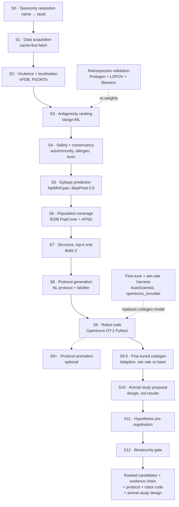

# VaxForge

**From a pathogen name to a ranked set of candidate vaccine antigens, a falsifiable wet-lab protocol, and executable robot code — with a retrospective validation harness that tells you how much to trust any of it.**

> Rename the project before pushing. `VaxForge` is a placeholder.

---

## 0. What this is, and what it is not

Most in-silico vaccine design projects produce a ranked list and stop. The list looks authoritative, nothing in the repo tells you whether the ranking is better than chance, and the published literature in this area has a measurable credibility problem: multi-epitope in-silico vaccine papers grew from ~5% to ~43% of reverse-vaccinology output by 2024 while the field's mean impact factor fell from 6.4 to 4.2, and none of the 39 FDA-monitored trials for WHO priority pathogens originated from reverse-vaccinology antigen selection.

VaxForge is built around the opposite commitment.

**This project DOES:**
- Resolve a plain-language pathogen name to a reference proteome and run a transparent, versioned screening cascade over it
- Rank candidate antigens and expose the full evidence chain behind every rank
- Report **held-out** performance against experimentally verified protective antigens, including a leave-one-pathogen-out protocol
- Emit a complete wet-lab protocol with controls, cost, timeline, and an explicit falsification condition per candidate
- Compile the liquid-handling subset of that protocol to executable Opentrons OT-2 Python, validated by simulation
- Emit an animal immunogenicity study proposal, ready for ethics review, in which **every in-silico prediction is mapped to the assay that would refute it**

**This project DOES NOT:**
- Simulate wet-lab results. No predicted ELISA readings, no synthetic flow cytometry, no fabricated cytokine values. A prediction is a hypothesis; a measurement is an observation. Presenting the former as the latter is not exaggeration, it is a category error.
- Simulate Phase 1/2/3 clinical trials. As of late 2026 there is no scientific or regulatory basis for this in vaccines. ICH M15 (CHMP-adopted 2026-01-23, effective 2026-07-23) does not mention vaccines or immunology anywhere in its text. The FDA MIDD Paired Meeting Program explicitly excludes using simulation to determine the operating characteristics of confirmatory trials. The two real cases where in-silico work substituted for trials — the UVA/Padova T1D simulator (FDA Master File #1521, accepted 2008, as a substitute for *animal* trials) and VICTRE — are both outside vaccines and both outside efficacy endpoints.
- Design, enhance, or characterise anything that increases pathogen virulence, transmissibility, or immune escape. Scope is restricted to protective antigens and therapeutic binders. See §8.

---

## 1. Architecture



Every stage is a pure function over the previous stage's artifact. Artifacts are content-addressed JSON written to `runs/<run_id>/`, so any stage can be re-run without recomputing upstream work, and any claim in the final report can be traced to the exact tool version and parameters that produced it.

---

## 2. Stage reference

| Stage | Input | Output | Primary tooling | Typical runtime |
|---|---|---|---|---|
| S0 | Pathogen name (free text) | `taxid`, resolved lineage | NCBI Taxonomy via E-utilities | <2 s |
| S1 | `taxid` | Reference proteome + reference DBs | UniProt, VFDB, Protegen, IEDB | 5–120 s cold, <1 s cached |
| S2 | Proteome FASTA | Annotation table | BLAST+ vs VFDB, PSORTb 3.0 | 1–5 min |
| S3 | Annotation table | Ranked candidates | Vaxign-ML (Docker) | 1–3 min |
| S4 | Ranked candidates | Filtered candidates | BLASTp vs human proteome, AlgPred 2.0, ToxinPred2 | 2–5 min |
| S5 | Filtered candidates | T-cell + B-cell epitopes | NetMHCpan, NetMHCIIpan, BepiPred-3.0, DiscoTope-3.0 | 2–10 min |
| S6 | Epitope set | Per-population coverage, PC90 | IEDB Population Coverage + AFND | <1 min |
| S7 | top-k candidates | Structures + coarse ranking | Boltz-2 | 2–30 min GPU |
| S8 | Final candidates | Structured NL protocol | LLM + protocol templates | <1 min |
| S9 | NL protocol | OT-2 Python + validation report | LLM codegen + `opentrons_simulate` | 1–3 min |
| S9.5 | NL protocol (S8) + S9 output | Fine-tuned OT-2 Python + win/loss/tie vs S9 + refusal rates | AutoScientist (SFT), `opentrons_simulate` v7.5.0 | Training "hours" per Adaption's docs; not measured here |
| S10 | Final candidates | Animal study design + ethics pack | Power analysis + ARRIVE 2.0 template | <1 min |
| S11 | Final ranking | Timestamped prediction manifest | git tag + JSON manifest | <1 s |
| S12 | Any sequence output | Screening-cleared sequences | Synthesis-provider screening | manual |

### S0 — Taxonomy resolution

The user types `Neisseria meningitidis` or `SARS-CoV-2`, not a taxid. Two failure modes must be handled explicitly rather than silently:

- **Synonymy.** Many bacterial species have been renamed. NCBI Taxonomy carries synonyms; resolve through them and surface which name was matched.
- **Ambiguity.** `Neisseria` matches a genus, not a species: return the candidate list for user confirmation; never silently take the first hit. A name that resolves to exactly one species is accepted, loudly: `E. coli` becomes *Escherichia coli* (taxid 562) with a note that thousands of strains sit below it, S1 then takes the species' UniProt reference proteome, and `--taxid` pins one strain.

On failure, return the nearest matches rather than an error. Implementation uses `esearch` against `db=taxonomy`. Register your `tool` and `email` parameters with NCBI; with an API key the default limit is 10 requests/second.

### S1 — Data acquisition (cache-first)

```
resolve(taxid) → check local cache → miss? → fetch → persist → return
```

| Source | What | Access |
|---|---|---|
| UniProt | Reference proteome FASTA | REST, by taxid |
| VFDB | Virulence factors, Set A (~4,496 curated) | Bulk download |
| Protegen (VIOLIN) | Experimentally verified protective antigens | Bulk FASTA |
| IEDB | Experimentally verified epitopes | Database export |
| AFND | HLA allele frequencies by population | Via IEDB PopCover |

**Two operational warnings.**

First, **do not use the NCBI BLAST URL API at demo time.** It requires ≥10 s between requests, asks that >50 searches run off-peak, and may throttle or block above ~100 requests/24 h. Run `BLAST+` locally or in Docker instead.

Second, **pre-warm the cache before the demo.** Cache-first satisfies "fetch automatically from the internet" while making the live demo independent of conference wifi. Ship `make warm-cache PATHOGENS=...` and run it the night before.

**Licensing caution:** Protegen's publication does not state a redistribution licence, and reported entry counts differ across sources (590 at publication; 854 across 200 pathogens in one later source; >1,600 as of 2024-12 in another). The database's own update log appears to stall around 2011. Contact the corresponding author before redistributing it inside your repo, and cite the count with its source rather than picking the largest number.

### S2 — Virulence and localisation annotation

Two labels per protein:

1. **Virulence association.** `blastp` against VFDB. Record identity, coverage, and E-value — all three, not just a boolean.
2. **Subcellular localisation.** PSORTb 3.0. Surface-exposed and secreted proteins are reachable by antibody; cytoplasmic ones generally are not.

PSORTb returns `unknown` for a non-trivial fraction of proteins. **Keep `unknown` as an explicit value.** Collapsing it into "not surface" silently discards candidates and inflates your apparent precision.

### S3 — Antigenicity ranking

**Do not use VaxiJen as your ranker.** On an independent evaluation it scored AUC 0.56 / MCC 0.08. VaxiJen v2.0 labels roughly 63.8% of a proteome as candidate with a fold-enrichment of about 1.2 — that is not a filter. On a benchmark of 45 known bacterial protective antigens against 52,752 proteins, fold enrichment was: NERVE 2.0 **16.57**, Vaxign2 filter 9.06, VaxiJen **3.41**, Vaxign-ML 1.58.

Use **Vaxign-ML** (open-source Docker build) as the baseline ranker. Report **two** protegenicity thresholds (e.g. 0.90 and 0.85), not just the one that flatters your numbers.

> We were unable to verify Vaxign-ML's exact published AUROC/AUPRC from primary sources. **Do not put a Vaxign-ML AUC number on a slide** — cite fold enrichment, which we did verify.

### S4 — Safety and conservancy filters

Four gates, all absent from naive pipelines:

| Gate | Why | Tool |
|---|---|---|
| Human-proteome homology | Antigens resembling self-proteins risk autoimmunity | `blastp` vs human proteome → shared peptides re-checked against IEDB human MHC ligands (NERVE 2.0 approach) |
| Allergenicity | Allergenic candidates are non-starters | AlgPred 2.0 (@0.45) |
| Toxicity | Toxic candidates are non-starters | ToxinPred2 (@0.8) |
| Conservancy | Strain-variable antigens fail on strain switch | `blastp` vs a second strain proteome |

**Counter-caution:** over-aggressive subtractive filtering can discard subdominant but protective epitopes. Log every rejection with its reason so a rejected candidate can be recovered and inspected.

### S5 — Epitope prediction

An epitope is the short stretch of an antigen the immune system actually recognises.

- **T-cell epitopes** must first be presented by MHC. Use NetMHCpan (class I) and NetMHCIIpan (class II). **Down-weight class II** — its accuracy lags class I substantially.
- **B-cell epitopes** are antibody binding sites. **Use BepiPred-3.0, not 2.0.** BepiPred-2.0 scores **AUC 0.574** on linear IEDB data, which is close to random. BepiPred-3.0 reaches 0.65–0.771 depending on encoding. The realistic ceiling for linear B-cell epitope prediction is roughly AUC 0.70–0.84; a 2026 review describes a reproducibility crisis in this subfield.
- **Conformational epitopes** benefit from structure, but you do not need an experimental one: DiscoTope-3.0 scores AUC 0.783 on AlphaFold models vs 0.795 on experimental structures.

**Implementation gotcha:** BepiPred truncates sequences above 1,023 aa. Bacterial surface proteins frequently exceed this. Chunk with overlap and merge, or you will silently lose the C-terminus of your best candidates.

> **Verify access terms yourself.** We could not confirm current API or licence terms for the DTU Health Tech services (NetMHCpan-4.1, BepiPred-3.0) — the pages carry no announcement either way. Prefer local installs or IEDB NG standalone tools, and contact DTU if you intend to call their servers programmatically.

### S6 — Population coverage and fairness

HLA genotypes differ between populations, and a T-cell epitope is useless to someone whose HLA cannot present it. IEDB's Population Coverage tool draws on AFND, spanning 115 countries, 21 ethnicities, 16 geographic regions and 3,245 alleles.

Report: projected coverage, average epitope hits, **PC90**, per-population sample sizes, and — the interesting number — **how much coverage you lose in non-European populations if you optimise only on European frequencies**.

**This is the only defensible remnant of "population-scale simulation", and its limits must be stated out loud:** presentable ≠ recognised ≠ sufficient response ≠ clinical protection. The tool says nothing about dose, adjuvant, durability, or safety. Note also that IEDB's documentation does not state whether it assumes locus independence; **do not assert that it does** — HLA loci are in strong linkage disequilibrium.

### S7 — Structure and affinity (top-k only)

Run on the top-k candidates only; this is the expensive stage.

**Use Boltz-2 (MIT licence), not AlphaFold 3.** AlphaFold 3's weights are CC-BY-NC-SA 4.0, must be obtained directly from Google by application at their sole discretion (~2–3 business days), and are not licensed for commercial or clinical use. Boltz-2 is MIT, adds an affinity module (FEP+ benchmark mean Pearson **0.62**, >1000× faster), and you can `git clone` it today.

**Delete or explicitly demote the ClusPro–TLR docking step.** Blind docking top-1 success for free servers is 5–16%; ClusPro specifically scored **13.7% top-1 / 45.1% top-10** across 51 targets, and medium-quality hit rates drop by roughly two thirds when docking model structures rather than experimental ones. A ClusPro score is not an affinity estimate and not an immunogenicity estimate.

> **Phrase this carefully.** We found *no* study measuring correlation between docking score and immunostimulatory activity, in either direction. The honest statement is "there is no evidence supporting its predictive validity here", **not** "it has been shown not to work."

**Validator sensitivity matters.** On MotifBench, the same design set scores 28.05 with ESMFold as the refolder and 22.5 with AF2-no-MSA. Always report which validator you used, and ideally report two.

### S8 — Protocol generation

Output a structured natural-language protocol per candidate: assays, ordering, reagents and volumes, **controls**, estimated cost and timeline, and one mandatory line — **what result would falsify this prediction**.

Ordering constraint that is easy to get wrong: **endotoxin removal and an LPS control must precede the THP-1 assay.** Residual endotoxin is the dominant false-positive source in this cascade; without the control the entire cytokine readout is uninterpretable.

What the THP-1 → FACS/ELISA/RT-qPCR cascade actually measures: **innate immune activation**. The monocyte activation test has real regulatory standing (Ph. Eur. 2.6.30) for pyrogen detection. What it does **not** measure: adaptive immunity, antibody titre, neutralisation, T-cell memory, or protection. THP-1 is a single-genotype cell line and does not represent population HLA diversity.

### S9 — Robot code generation and validation

**This is where Text2WetLab belongs.** The repository benchmarks exactly this task: *"Benchmarking LLM agents on turning lab protocols and papers into robot code."* Its data flow is `instruction.md` + `paper.txt` → agent → `protocol.py` (Opentrons OT-2 Python) → `reward.json`.

Two things to be clear about:

1. **It is a grader, not a generator.** Your LLM writes the protocol code; Text2WetLab's methodology is what you borrow to check it — `opentrons_simulate` (v7.5.0), ground-truth comparison, physical-rule checks, and an LLM judge. Its 11 "tasks" are liquid-handling benchmarks (plate distribution, AMPure beads, colony PCR, heat-shock transformation, Golden Gate, RNA extraction), **not** an 11-step immunogenicity workflow.
2. **Simulation passing is not correctness.** The repo says so itself: a protocol that runs can still ruin an experiment, and nothing in the robot API flags that. Hence the layered validators above it.

#### Automatability matrix

This is the table that makes your demo honest. Classify every protocol step before emitting code:

| Wet-lab step | OT-2 automatable | Notes |
|---|---|---|
| Gene synthesis | ❌ | Outsourced to vendor |
| Golden Gate / plasmid assembly | ✅ | Core liquid handling + temperature module |
| Heat-shock transformation | ⚠️ Partial | Temperature module; plating is manual |
| Colony PCR setup | ✅ | Reaction assembly only |
| Expression culture + IPTG induction | ⚠️ Partial | Inducer addition yes; shaking incubation no |
| Cell lysis | ⚠️ Partial | Reagent addition yes; sonication/centrifugation no |
| Ni-NTA purification | ⚠️ Partial | Magnetic-bead His-tag format yes (magnetic module); gravity column / FPLC no |
| Endotoxin removal + LAL assay | ⚠️ Partial | Plate setup yes; reading needs a plate reader |
| THP-1 culture + PMA differentiation | ❌ | CO₂ incubator, sterile handling |
| Antigen stimulation | ✅ | Addition to seeded plate |
| FACS | ⚠️ Partial | Staining prep yes; acquisition no |
| ELISA | ⚠️ Partial | Plate setup and washes yes; reading no |
| RT-qPCR | ⚠️ Partial | Reaction setup yes; thermocycling and reading no |

> ✅ fully automatable · ⚠️ liquid-handling portion only · ❌ requires a human or other instrument
> This classification is our engineering judgment about OT-2 capability, not a literature claim. Validate against your actual deck configuration and modules.

Emit per-step annotations in the generated code so a human reading `protocol.py` can see immediately which steps the robot owns and which it does not.

#### Expect safety refusals

Text2WetLab §5.2 records 5 trials where an LLM refused before writing code (Golden Gate assembly and *E. coli* transformation prompts). The benchmark authors explicitly decline to call these false positives, since those procedures do produce genetically modified organisms. **Design for this**: detect refusals, surface them to the user as a distinct outcome rather than a crash, and do not attempt to engineer around them. A refusal handled gracefully is a better demo than a jailbreak.

### S9+ — Protocol animation (optional)

Parse the `opentrons_simulate` command list into a JSON timeline, then render it frame by frame in HTML canvas or SVG: deck layout, labware positions, tip pickup, aspirate/dispense source and destination wells, volumes, and elapsed time.

```
protocol.py → opentrons_simulate → command list → timeline.json → canvas player
```

Why it is worth doing if time allows: it converts "the generated code actually runs" from a number into something a judge can watch. It is strictly additive — cut it without touching the main line if you are short on time.

### S9.5 — Fine-tuned protocol-code generation (Adaption)

**Status: specified, not run on Adaption.** At the time of writing no fine-tune has been trained and no win rate has been measured. The training set reaches the platform's minimum only with rows from our own generator, which are most of it (see Size). This section fixes the data rules, the metric and the refusal constraint before any run, and they are written to the S11 manifest before training starts, so none of them can be chosen after seeing a result. S9.5 is strictly additive: if it cannot be run to this specification, S9 keeps its base model and nothing downstream changes.

#### Why S9, and only S9

S9 is the only generative-LLM stage with an objective grader attached: `opentrons_simulate`, the physical-rule checks and the ground-truth comparison each return a result without a person or a second model deciding what it means. S8 also generates text, and nothing grades it. S9 is therefore the one place where a fine-tune can be **measured rather than asserted**.

**S3, S5 and S7 are not candidates.** Vaxign-ML, NetMHCpan and Boltz-2 are used as published and are not fine-tuned here. §3 validates the pipeline with those predictors at their published versions. Swapping in a fine-tuned or different model changes what was validated, and every §3 number would stop describing what ships. Fine-tuning on antigen data would also bring back the circularity §3 removes, because the Bexsero antigens are in any protective-antigen training set.

What is fine-tuned is the S9 code generator, the model that turns the S8 protocol into OT-2 Python. What judges it is unchanged: simulation, the physical-rule checks, the automatability matrix and refusal detection. Offline, `validation/winrate.py` runs the base model and the fine-tune on held-out tasks and reports the pairwise result below. In a pipeline run, S9.5 emits the fine-tune's code beside S9's for the same S8 input, with both validation reports. Whether the fine-tune replaces the base model in S9 is a decision for a person reading that evidence; the pipeline never promotes it on its own.

Training uses Adaption's AutoScientist, which its [documentation](https://docs.adaptionlabs.ai/autoscientist/overview/) describes this way: "You choose the outcome; AutoScientist optimizes the data and training recipe, trains a model, evaluates it, and repeats until the run reaches its goal or exhausts its iterations." We use it as a training service only. Nothing it reports counts as evidence here (see the last limit under the evaluation protocol).

#### Training data provenance

| Source | Role | Licence | Status |
|---|---|---|---|
| Opentrons protocol library (`Opentrons/Protocols`) | Training | None stated; Opentrons states its copyright | Used on the project owner's decision for non-commercial personal research (a decision, not a licence; Opentrons not asked); 21 rows in the final training set |
| Permissively licensed public repositories (including `Opentrons/opentrons`) | Training | Apache-2.0, MIT, BSD-3-Clause, CC0-1.0 | Cleared on licence; 408 rows from 135 pinned repositories in the final training set (77 from 37 in the first pass); the family labels are an agent's reading and no person has checked them (the run guard accepts them; the leakage check is the safeguard) |
| Synthetic protocols from our generator (`src/vaxforge/s9_5_synth.py`) | Training | Ours | 1,150 rows labelled by the generator's rule, all passing `opentrons_simulate`; none can contain a held-out procedure; 571 used in the final set (see Size) |
| Text2WetLab task set | Held-out evaluation | MIT | Evaluation only |
| protocols.io extractions | — | CC BY; training prohibited by site policy | Excluded |

**The real supply was small at first, 98 clean pairs; the final training set holds 429 real rows (see Size).** What we read in the first pass:

- **Opentrons library.** 833 protocol directories at commit `2f447c9` of `develop`, all OT-2, each with a Python file and a README. There is no `LICENSE`, `NOTICE` or `COPYING` file, GitHub's licence field is null, and no protocol's metadata has a licence key. The repository README says the protocols "are stored for everyone to use", which is not a licence. Opentrons' EULA (2024-07-10) defines its products to include the Protocol Library and says all copyrights in them "are the exclusive property of Opentrons". Its documentation says the library hosts protocols written "either by Opentrons itself or by members of the Opentrons community", and 46 of the 833 list a non-Opentrons author. We found no clause on reuse, automated downloading or model training in the EULA, the Terms of Sale or the privacy policy. We have not asked Opentrons. The project owner decided to use the library for non-commercial personal research, which is a decision and not a licence. Training uploads the corpus to Adaption, whose privacy policy says input and output are shared with third-party AI service providers, and whose Terms of Service list "Uploading or inputting data you do not have the legal right to use" among the prohibited activities. The owner reports that Adaption's representatives treat hackathon submissions differently, that the Adaption account was registered with the hackathon's registration email, and that the collected data may be published; we have not seen any of that in writing. Library protocols call `get_values`, so `scripts/s9_5_stage_library.py` replaces each call with the form's defaults: 663 of the 833 stage, and the 170 that need an input file or do not parse are skipped. After the corpus filters 282 candidates remain, 132 of them simulate, and 21 are clean once the doubted ones were read (87 of the 96 simulating doubted ones turned out to perform a held-out procedure).
- **Permissively licensed public repositories.** We read the LICENSE text of 331 GitHub repositories that contain OT-2 protocols: 85 Apache-2.0, 235 MIT, 8 BSD-3-Clause, 1 CC0-1.0 and 2 we could not classify. After excluding repositories that are sources of the held-out tasks (Slowpoke, DNA-BOT and others) or AI-generated, they hold 1,944 protocol-shaped Python files. Of those, 760 are OT-2, parse and are unique; 229 pass `opentrons_simulate` v7.5.0; 204 are not in a held-out family on our keyword and shape rules; and 16 are not in doubt on family. The 16 come from 8 repositories and are 13 distinct skeletons. The other 188 were in doubt on family, so two model passes read them, each half, as text and running nothing: 111 were kept (51 and 60), 65 excluded, and 12 left unsure, which count as excluded. That leaves 127 pairs, from 31 repositories and 84 distinct skeletons, that clear every rule except the refusal filter, which has not been run. They are weakly independent: 49 of the 127 come from three repositories, 21 are the days of one assay that differ only in a data dictionary, several are single-transfer test scripts, and three do almost no liquid handling when simulated. A model's reading is not the by-hand assignment this section requires, so a person has to confirm the 111, and the run guard refuses any label that a person has not assigned. `Opentrons/opentrons` is Apache-2.0 (its `LICENSE` and `NOTICE`) and contributes none of the 16: most of its protocols are for the Flex, and none of its OT-2 protocols that simulate is clear of doubt by rule. After the review it contributes 7 test and calibration scripts. Apache-2.0 and MIT require the licence and copyright notices to travel with the code, so every pair keeps its `repo@commit`, and uploading to Adaption is redistribution. Prompts are built from the code with no model in the loop (an AST-derived spec of labware, pipettes, steps, volumes and wells, plus the author's description), one prompt per file. The family labels are keyword and shape heuristics, not the by-hand assignment this section requires, so a person has to confirm them. On 2026-11-14 the corpus was rebuilt from 37 of these repositories pinned to the commits in `validation/s9_5_corpus_sources.json` (`scripts/s9_5_build_corpus.py`) with the conservative labeller: 508 candidates, of which 77 are clean once the 160 doubted candidates that simulate were read and each resolved with a recorded reason (61 to none, 99 to a held-out family; `validation/s9_5_labels.json`, `assigned_by: agent-review`). That rebuild is the set we use: it is one command from the pinned sources and every label carries a reason. The 127 above were a first pass and are superseded. A person must still confirm these labels. This is a licence reading, not legal advice.
- **Text2WetLab.** MIT (`LICENSE`). The dataset card's prose says Apache 2.0, so the repository contradicts itself between two permissive licences. Reference scripts it copied from upstream author repos keep their own licences, and 22 of the 45 in its `PROVENANCE.csv` come from repos that state none. We use its tasks and verifier for evaluation only.
- **protocols.io.** User content is "licensed under the Creative Commons Attribution License (CC-BY)" (Terms of Service §1.B, effective 2026-01-27). The site's machine-readable policy ([`/llms.txt`](https://www.protocols.io/llms.txt)) says public content "MUST NOT be used for model training or fine-tuning" and that its Creative Commons licences "DO NOT grant permission for machine learning training unless explicitly stated". Terms §4.A(xi) prohibits "systematic or automated downloading". Excluded unless protocols.io grants written permission.

**Size.** Adaption documents a minimum of 1,000 effective rows for an SFT run and defines that as "base rows plus augmentation". The first pass over public repositories gave 98 clean real pairs, far below it: most OT-2 protocols perform one of the held-out procedures, which we must exclude, and most candidates fail simulation. So the supply was widened (a larger search of public repositories and the Opentrons library, a second model pass over the family labels, rows that need custom labware tagged `custom_labware`, one recovered input file tagged `recovered_by`) and topped up from our own generator, `src/vaxforge/s9_5_synth.py`. **The final training set is exactly 1,000 rows: 429 real (42.9%: 21 from the Opentrons library and 408 from 135 pinned repositories; 92 tagged `custom_labware`, 1 `recovered_by`) and 571 synthetic (57.1%).** Family labels on the real rows: 239 by an agent's review, 190 by the keyword and shape rules, none checked by a person; the leakage check is the safeguard. Real rows longer than 32,000 characters (29) were excluded as a run-time control (`--max-row-chars`, recorded in the manifest). The platform counted `row_count` 1000 and accepted the run, so a set of that size is accepted; we did not try a smaller one, and the docs' "effective dataset size" is still not defined beyond that. The public leaderboard lists a run on a 1,099-row dataset with no augmentation (observed 2026-11-14). It writes a seeded operation list (volumes, wells, labware, pipettes, optional mixing, delays and temperature steps) and renders it to both a task prompt and OT-2 code, in ten kinds of protocol: serial dilution, column gradient, plate copy, cherry-pick, normalisation, pooling, incubation, tube aliquots, a labware matrix and a column loop. It never emits PCR, primer, magnet, thermocycler or heat-shock vocabulary, a row is accepted only if the labeller finds no held-out family in it (`validation/tests/test_s9_5_synth.py`), and all 1,150 rows we generated pass `opentrons_simulate` v7.5.0. They are narrow, ten templates with varied parameters, so a model can learn the generator's style, and a win rate measured after training on them says as much about that as about writing protocols in general. Every result is reported with the 42.9% / 57.1% split, and the manifest records each row's `origin` and `assigned_by`. The platform can add rows in two ways. The run's own parameters (`augmentation_domain_rows`, `augmentation_general_rows`) apply them at training time, "instead of writing a new dataset", so those rows cannot be inspected, checked against the family split or the refusal rule, or simulated. A separate call, `datasets.augment`, "returns them as a new dataset" that can be downloaded, and it does not mark which rows were added, so each added row could be checked like any other candidate before anything is trained on. Both run parameters are omitted, which the docs say skips that addition, and Adaptive Data's improve and invent steps are not run. We were unable to verify what the "curated pool" is, which model writes the `similar_rows` that `datasets.augment` generates from a dataset's own rows, or who owns the added rows and on what terms. If the pool holds public OT-2 protocols, which the docs neither say nor rule out, we could not say what they are. Not done: a run on the real rows alone with the platform's augmentation (we were unable to verify that a run that small is accepted, and it spends credits), and platform-generated rows downloaded and put through the same checks.

**Training targets must pass the grader that judges them.** A pair is kept only if its code passes `opentrons_simulate` v7.5.0. On the first pass over the permissive repositories 229 of 760 OT-2 files did; on the rebuild 318 of the 790 candidates (repositories and library) do. Many failures are protocols that open a file that is not there, such as custom labware or a CSV. They stay out, because the grader's tasks have no such file and a model trained on them would learn to write code that crashes (our inference, not tested). Library protocols call `get_values`, which the library site injects when a protocol is downloaded, so they do not run as stored; they are staged with the form's defaults first (see the library bullet).

**The split is by task family, not by example.** A family is a procedure, defined by what the robot does, not by its source or its wording. Text2WetLab's 11 tasks are 7 families: seven protocols each have an easy task, and four of them (colony PCR, heat-shock transformation, Golden Gate assembly, RNA extraction) also have a paper-only task over the same procedure. Split by example, one of each pair lands in training and the other in test, and the "held-out" task is a rewording of a training example. All 7 families are held out. Any protocol from any source that performs one of those procedures is removed from the training set. Assignment is by hand, recorded per protocol in the training manifest together with who assigned it, and the run guard refuses any label on a real protocol that a person has not assigned (so far an agent has read each doubted one and recorded a reason, and a person has to confirm those), and a synthetic row must carry the generator's own rule label; a protocol that is in doubt is removed; the library's own categories (203 category and subcategory pairs) are a starting point, not the key. Text2WetLab's reference solutions and tests are never training data.

This is the §3 failure mode in a different place. There, the Bexsero antigens were in Protegen, so "rediscovering" them with a Protegen-trained predictor was circular. Here, a near-duplicate of a held-out protocol in the training set makes the win rate circular, and the remedy is the same: remove it, then say so. `validation/leakage_check.py` asserts that no entry in the training manifest belongs to a held-out family.

#### Evaluation protocol

**Pairwise win rate against the base model on the held-out tasks.** Each held-out task is run once through each model (pass@1, as in Text2WetLab) and the pair is decided by the first rule below that separates the two outputs:

1. **Simulation.** The fine-tune passes `opentrons_simulate` v7.5.0 and the base model does not: **win**. The reverse: **loss**.
2. **Physical rules.** Both pass: the one with fewer physical-rule violations wins. The violations are Text2WetLab's five safety rules in `spec_check.py`: a tip before every aspiration, no overdispense, no aspiration from an empty well, no tip left on, no cross-contamination.
3. **Ground truth.** Equal violations: the one with the smaller diff against the task's reference solution on volumes, wells, labware and step order wins.

If neither passes, or the two are equal at every step, the pair is a **tie**. The LLM judge in Text2WetLab's methodology is not used: a win has to be decidable without a second model.

Report **n** (tasks scored, after the refusal rule below), the **win rate**, **loss rate** and **tie rate** (they sum to 1), and a 95% percentile bootstrap interval on each rate, from 10,000 resamples of the **task families**, not the tasks, because tasks in one family are not independent. Ties are reported in two parts, "neither passes" and "equal at every step", since the first says nothing about either model. `validation/winrate.py` computes all of it.

**Running the models.** We found no documented way to call a trained model on Adaption, so we run the downloaded checkpoint ourselves. The base model and the fine-tune are served from one OpenAI-compatible server (the base model, and the base model with the adapter), so the two arms differ only by the adapter. `s9_5_generate.py` sends each task once per arm: a recorded pair is never run again, a reply cut off by `max_tokens` is recorded as a failed attempt and not as a refusal, and the decoding settings go into the generation manifest before the first request and into the S11 manifest before the run. Each generated protocol is graded by Text2WetLab's own lint, reward-hacking traps, simulation and checks (`validation/t2wl_adapter.py`, which needs a Text2WetLab checkout at `a50139a` and an `opentrons` 7.5.0 interpreter). The protocols are model output and the lint is a filter, not a sandbox, so on a shared machine run the grading in a container. The adapter classifies refusals with stream C's detector (`vaxforge.refusal.detect_refusal`, copied unchanged into `validation/refusal_detector.py`; a test fails if the copies differ). Its wording rules are a heuristic: a refusal phrased in a way they do not list is scored as a failed attempt, which favours the arm that did not refuse, so quote the refusal rates next to any win rate.

**What this metric does not tell you:**

- **Simulation passing is not correctness.** §S9 already says so, and the win rate inherits it. A win under rule 1 means the fine-tune's code ran and the base model's did not. It does not mean the protocol is right for the experiment.
- **n is small.** At most 11 tasks in 7 families. Text2WetLab's own repeat of one model moved single-task scores by up to 0.70, so one attempt per task is a screening result, not a ranking. An interval that includes equal win and loss rates is reported as no measurable difference, whatever the point estimate.
- **A protocol that moves no liquid can win.** Code that simulates but pipettes nothing has no physical-rule violations, so under rule 2 it beats a working protocol that breaks one rule, and rule 3 is never reached. The harness does not yet count such outputs per arm.
- **Rule 3 is the weakest.** On Text2WetLab's paper-only tasks the paper does not always fix the reference's exact quantities, and three of the four reuse their easy task's ground truth (a limitation its authors state). A smaller diff there is not always a more correct protocol.
- **The base model may already have seen these tasks.** Text2WetLab's four paper-based protocols come from papers whose authors published robot code, which its authors say "may be in the models' training data". The same applies to ours.
- **This is not Adaption's win rate.** AutoScientist reports its own `best_win_rate`: the base model against the adapted model "on evaluations derived from your dataset". The docs do not name the judge or say that data is held out, and the run repeats until that rate reaches `target_win_rate` or the iterations run out, so it is an optimisation target. Adaption's public [leaderboard](https://adaptionlabs.ai/auto-scientist-leaderboard) shows two other win rates, each judged by Gemini 3.1 pro except for Gemma: a task win rate "on a held-out split of this experiment's training data" and a domain win rate "on a shared held-out test set for this domain". The hackathon's "Best Use of Adaption" track ranks on Adaption's leaderboard by win rate against the base model, so we report Adaption's numbers for that track, labelled as Adaption's and next to ours, never in place of them. None of them is a held-out OT-2 evaluation, so none is evidence that the protocols are better. AutoScientist returns the checkpoint from its best iteration, "not necessarily the final iteration"; we evaluate that one checkpoint, once.

#### Scope limit on the training objective

**The training set contains no examples that teach compliance with a prompt the base model refused.** §S9 commits to surfacing refusals rather than engineering around them, and fine-tuning is the most direct way to break that commitment: a model trained on compliant answers to refused prompts stops refusing them. Refusal behaviour is excluded from the objective.

- **Filter before training.** Every candidate training prompt is run through the base model and S9's refusal detector. A prompt it refuses is dropped together with its paired code, and listed in the training manifest.
- **SFT only.** Runs use AutoScientist's `instruction` method. Its `alignment` method (SFT, then DPO) is not used, because preference pairs are the usual way refusal behaviour is changed.
- **Score only what the base model attempts.** The fine-tune is evaluated only on held-out tasks the base model also attempts. A task the base model refuses is not scored. Text2WetLab makes the same choice for the same reason: "A refusal is the provider's safety policy, not a protocol."
- **Record both refusal rates side by side**, for the base model and the fine-tune: over all held-out tasks before the attempted-only filter, and over the prompts dropped from training. A refusal by the fine-tune on a task the base model attempted counts as a failed simulation, a loss under rule 1.
- **A drop in refusal rate is a red flag to investigate, not a result to report.** The run's win rate is not reported until the cause is found.

If the base model refuses nothing here, both rates are 0% and the comparison is empty. It shows that the base model did not refuse these prompts, not that fine-tuning preserved refusal behaviour, and it is reported as "not tested". In Text2WetLab's run its two open-weight models refused none of the 11 tasks, while its Anthropic models refused 5 trials.

> We were unable to verify the following about Adaption. **Do not state any of it on a slide without reading the primary pages.**
> - **Base models.** The docs page and the live model list (`GET /api/v1/autoscientist/models`, 16 entries on 2026-11-14) differ, and the page says "The runtime model list is authoritative". Neither names a licence for any base model. Three candidates carry Apache-2.0 on their own Hugging Face cards, Qwen/Qwen3.5-9B, openai/gpt-oss-20b and Qwen/Qwen3.5-4B; the runs used Qwen/Qwen3.5-4B and Qwen/Qwen3.5-2B (see "What ran"), and each manifest check pins the model id given at run time.
> - **Weights.** The docs describe downloading a checkpoint archive and uploading it to Hugging Face by hand, and a 2026-07-28 post says the weights are "yours to download and deploy anywhere". We found no licence or ownership term for them, and the Terms of Service (last updated 2026-02-24) predate AutoScientist's launch on 2026-05-13. The docs say a LoRA checkpoint "typically" holds adapter files; an observed download is a Zstandard tar of a PEFT LoRA adapter (adapter files, not merged weights).
> - **Reproducibility.** The create request has no seed field, so the fine-tune is not reproducible from `finetune.seed`. We record the run id and the SHA-256 of the downloaded checkpoint instead. Run ids are UUIDs (a read-only call with a non-UUID returns HTTP 400), not the `autoscientist_run_abc123` shape in the docs' examples. The platform names the trained model `adaption_<base>_<dataset name>_<first 8 characters of the run id>` (observed on the run page).
> - **Win-rate internals.** For `best_win_rate`, the judge, the scoring and the size of the evaluation set are not stated. The leaderboard names a judge for its two win rates (see the last limit under the evaluation protocol).
> - **Pricing, credits and leaderboard entry.** `adaptionlabs.ai/pricing` and `/hackathon` return 404, and no page we read gives credit amounts or what a run costs. A post dated 2026-05-13 offered AutoScientist free for 30 days. The leaderboard page says it ranks "the best AutoScientist runs the community has submitted so far" and shows an adjusted z-score ("Normalised Score"). We found no documentation of how a run is submitted, how its domain is assigned, or how `best_win_rate` relates to the two win rates it shows. Augmentation is billed "on the rows retrieved", at a rate the docs do not state for `datasets.augment`; the unit in which a training run is billed is not stated, and the MCP page says `create_autoscientist_run` "has no estimate mode". The API's own estimates for the 20-row test dataset, which start and charge nothing: 1 credit for 20 `similar_rows`; 200 credits for the recommended fill of a 20-row dataset (9,990 domain and 9,990 general rows, about 20,000 rows in all); 20 credits to invent 200 rows.
> - **Leaderboard listing (observed 2026-11-15).** The run page and the Share tab of the Adaption app have no leaderboard submission control, and the public page did not list our runs when we looked. Whether a run is listed automatically, on request or by Adaption staff is unknown; so is the domain it would be assigned to (the run page's Domain Win Rates chart is behind a paid tier).
> - **Data handling.** The privacy policy says input and output are shared with AI service providers, and does not say whether uploaded datasets are used to train anyone's models.
> - **Platform-supplied rows.** The docs do not say what the "curated pool" is, which model generates `similar_rows`, who owns the rows `datasets.augment` adds, or on what terms, and we found no clause on generated rows in the Terms of Service. The only terms we found are for a different feature, Invent, in a blog post: "The terms of Invent a Dataset permit commercial use of the datasets it generates for downstream model training." The same post notes that some frontier model providers do not allow training on data generated with their models.

#### What ran (2026-11-15)

Three runs on the same 1,000-row set, SFT (`instruction`) with LoRA, created with `scripts/s9_5_adaption_run.py` (guard, leakage check and cleared sources first; `max_iterations`, `target_win_rate` and a wall-clock cap set; Adaption allows one run per dataset, so each run has its own upload). Adaption's `best_win_rate` is the platform's number on evaluations it derives from our data, not our held-out win rate.

| Base model | Run id | Iterations | Target | `best_win_rate` | Wall clock |
|---|---|---|---|---|---|
| Qwen/Qwen3.5-4B | `82c660bc-2c35-4917-b4d1-e7c58039b904` | 1 of 2 | 0.6 | **0.7832** (run page: adapted 78, base 22) | 41 minutes |
| Qwen/Qwen3.5-2B | `d84a8798-c9ef-441d-872c-0a6c409dcbd3` | 1 of 2 | 0.6 | 0.6037 | about 20 minutes |

Both stopped at the first iteration because they passed the target. The 4B checkpoint (a PEFT LoRA adapter, sha256 `c7b45c546dfb9732c6074c03bbffeba94f629e311c171ef6571db2fe8999ec3d`) was downloaded; our own held-out win rate for it is measured separately and is reported where it exists.

#### Evidence for the Adaption track

The hackathon's "Best Use of Adaption" track asks for a fine-tune made with Adaption, ranked on Adaption's leaderboard by win rate against the base model, and for evidence of how Adaption was used. The runs are listed under "What ran". The evidence is:

- `adaption_evidence.json`, written by `s9_5_adaption.record_evidence`: run id, base model id, trained-model name, training method, iterations, Adaption's `best_win_rate` and `target_win_rate`, and the SHA-256 of the downloaded checkpoint. The leaderboard numbers (task and domain win rate, normalised score, percentile) are in no API, so a person types them in from the page with `add_leaderboard_row`, and the file says so.
- The training manifest, the leakage-check report and the no-augmentation setting, which show what went into the run.
- Our held-out win, loss and tie rates with their intervals, and both refusal rates (`validation/winrate.py`), labelled separately from Adaption's numbers.
- Adaption's results page for the run (Training Winrates chart, trained model ID, weights export, AutoScientist config) and, if the run is ranked, its leaderboard row.

Whether a run must be submitted to the leaderboard, and how an entry is identified for the prize, is not in anything we read. It depends on the hackathon's rules.

### S10 — Animal study proposal

A ranked list is a set of hypotheses. An animal immunogenicity study is the first experiment that can actually refute them. This stage emits a **study design ready for ethics review** — arms, group sizes, schedule, endpoints, statistics, and ethics documentation. As everywhere else in this pipeline, the output is a design, never results.

#### Falsification mapping — the core of this stage

Each upstream prediction is paired with the readout that can kill it. This table is what turns the project from "we ranked some proteins" into "we made testable claims and stated in advance how we would be wrong."

| Upstream prediction | Animal readout | Falsified if |
|---|---|---|
| S3 antigenicity rank | Antigen-specific IgG ELISA titre | No titre rise over the adjuvant-only arm |
| S5 T-cell epitopes | IFN-γ ELISpot against predicted peptide pools | Response to whole antigen but **not** to the predicted pools — antigen right, epitope prediction wrong |
| S5 B-cell epitopes | Competition ELISA or peptide-array mapping | Sera bind the antigen but not the predicted epitopes |
| S6 population coverage | Panel of HLA-transgenic lines | Response absent in backgrounds predicted to be covered |
| S7 structure / conformation | Binding to folded vs denatured antigen | Sera recognise only the denatured form — the conformational epitope was an artifact |
| Functional protection | Species-appropriate functional assay | Titres rise but functional activity is absent |

On that last row: for meningococcal B the serum bactericidal assay (hSBA) is an accepted correlate of protection, which is why immunobridging was possible there. **This is unusual.** Most vaccines have no agreed correlate. Do not assume one exists for your pathogen — check, and if there is none, say so in the proposal.

#### Species selection

| Goal | Species | Note |
|---|---|---|
| Basic immunogenicity | BALB/c or C57BL/6 mice | Cheap and fast; strain drives Th bias, so state which and why |
| **Validating S5/S6 human epitope predictions** | **HLA-transgenic mice** | The only design in which your human MHC predictions are actually under test. Wild-type mouse MHC does not present the epitopes NetMHCpan predicted for humans |
| Large-volume polyclonal sera | Rabbit | More serum per animal |
| Challenge model | A species genuinely susceptible to the pathogen | Many human pathogens have no good small-animal model. If none exists, **write that in the proposal** rather than inventing one |
| Non-human primates | Last resort | Ethically and financially constrained; out of scope for a hackathon proposal |

The HLA-transgenic row is what makes this stage coherent with the rest of the pipeline. Without it, S5 and S6 remain unfalsifiable.

#### Minimum study arms

1. Candidate antigen + adjuvant
2. Adjuvant only
3. Naive / PBS
4. Licensed vaccine positive control, where one exists

#### Parameters the generator must fill in

- **Dose levels:** ≥3 for dose-ranging
- **Route:** IM / SC / IN, justified against the target immune compartment
- **Schedule:** prime-boost with bleed points, e.g. immunise d0/21/42, bleed d0/20/41/56
- **Adjuvant:** named, with rationale (alum biases Th2; TLR-agonist systems bias Th1)
- **Group size:** from a **power analysis**, stating effect size, α and power. n=5–10/group is conventional in mouse immunogenicity work, but convention is not a justification — compute it
- **Randomisation and blinding:** specify both, including who is blinded to what
- **Primary endpoint:** pre-specified, single, fixed before any data is collected
- **Humane endpoints:** explicit, with monitoring frequency
- **Statistical analysis plan:** pre-specified, including the multiplicity correction for comparing several candidates at once

#### Ethics and regulatory layer

The proposal is not a proposal without these:

- **ARRIVE 2.0** — report against the Essential 10 at minimum
- **3Rs** — Replacement, Reduction, Refinement, each addressed explicitly. Reduction is where the power analysis earns its place
- **UK:** Animals (Scientific Procedures) Act 1986 — project licence (PPL) and personal licence (PIL), plus AWERB review
- **US:** IACUC approval

Generate these as a populated checklist, not as prose a reviewer has to mine.

#### Scope limit on challenge studies

This stage produces study **design**: arms, endpoints, group sizes, statistics, and ethics documentation. It does **not** produce pathogen handling, culture, or challenge-inoculum preparation procedures. Those belong with the containment facility and its biosafety committee, and are deliberately out of scope for this tool.

#### Honest limits — state these inside the proposal itself

- **Mouse immunogenicity does not predict human protection.** It shows an antigen is immunogenic in a mouse. Necessary, not sufficient.
- Industry base rate for vaccines: **Phase 1 → approval 39.6%** (6.8% for non-industry sponsors). The narrowest transition is **Phase 2 → 3 at 65.4%** — precisely the step where immunogenicity data exists and efficacy data does not. No amount of preclinical work closes that gap.
- A positive animal result moves a candidate from "predicted" to "immunogenic in one species." It does not move it to "works."

> We were unable to retrieve Plotkin's *Correlates of Protection Induced by Vaccination* (Clin Vaccine Immunol, 2010) in full, so this README carries no authoritative definition of correlate vs surrogate vs mechanistic correlate, and no list of vaccines lacking an agreed correlate. **Read it before making correlate claims in your pitch.**

### S11 — Hypothesis pre-registration

Before running any validation: fix random seeds, pin tool versions and thresholds, write the prediction list to a manifest, and timestamp it (git tag, or a hash posted publicly).

This prevents post-hoc selection. A metric chosen after seeing the answer is not a result. It costs almost nothing and reads as a clear rigour signal to scientific judges.

### S12 — Biosecurity gate

Any sequence leaving the pipeline passes synthesis-provider screening before order. Draw this as a node in the architecture diagram, not as a disclaimer on the last slide — judges are assessing whether it is part of the system.

In this build a candidate that S2 marks virulence-associated is **flagged for human review, not blocked**: virulence-associated proteins include real vaccine antigens (FHBP, NadA), so the flag is recorded in the artifact (`review`, `review_required`), repeated as a warning and printed by `vaxforge biosafety check`, and the run goes on. This is the project owner's decision for an exploratory demo build. The toxin check, sequence sanity, the selected-candidate check and provider screening still block, and a virulence flag that was never computed still blocks. Inside `vaxforge run` the gate screens the order list S8 wrote (`data/s8/order.fasta`) unless `biosafety.order` names another file, and records which one it used.

---

## 3. Retrospective validation — the part that makes the demo credible

A pipeline that runs is not a pipeline that works. This harness is the difference.

### Three-tier protocol

**Tier 1 — Antigen-level retrieval.**
- Positives: experimentally verified protective antigens from Protegen.
- Negatives: UniProt proteins at <30% sequence identity, with homologues excluded at `blastp` E ≤ 1e-3.
- Protocol: nested 5-fold cross-validation **plus leave-one-pathogen-out (LOPOV)**, following Vaxign-ML's published precedent.
- Metrics: fold enrichment, precision@k, PR-AUC, rank-of-truth.
- **Status (checked by an independent audit, 2026-11-15): only the metrics half exists.** `validation/lopov.py` computes precision@k, recall, fold enrichment, PR-AUC and rank-of-truth from per-fold scores the caller supplies (hand-checked on a toy input). It does not build the <30%-identity negatives, run the nested cross-validation or train a model with the holdout, and `training_set_assertion` reads "not checked" unless a reference set is supplied. The protocol above is the plan, not something this repository runs.

**Tier 2 — Case retrieval: Bexsero.**
Bexsero/4CMenB contains three recombinant antigens — **fHbp, NadA, NHBA** (50 µg each, plus 25 µg OMV supplying PorA 1.4). Run the pipeline on *N. meningitidis* serogroup B and report **recall@3** and **rank-of-truth**. A retrieval question with exactly three correct answers is far more legible to a judge than an AUC.

**Tier 3 — Honest base rate.**
Pizza et al., *Science* 287:1816 (2000) is the canonical reverse-vaccinology funnel:

```
570 candidate ORFs
  → 350 successfully expressed (61%)
    → 85 strongly positive in ≥1 assay
      → 7 positive in all three assays across 31 strains
        → 3 in the licensed vaccine
```

**Experimental hit rate: 1.2%. Timeline from genome paper to approval: roughly 13–15 years.** Put this on a slide. It is more persuasive than any precision figure you can report, because it shows you know what your numbers mean.

### Data leakage — say it before a judge finds it

**Vaxign-ML is trained on Protegen. The Bexsero antigens are necessarily in that training set. "Rediscovering" them with a Protegen-trained predictor is circular.**

Mitigation: remove *N. meningitidis* entirely from the training/reference set before the Tier 2 run — that is the point of LOPOV — and state this explicitly in the demo.

This failure mode is endemic, not hypothetical: DeepSol and SKADE were found to have 75.1% overlap between training and test sets. A 2025 paper in this exact subfield reports no held-out test set, no AUC, and no cross-validation at all. **Getting this one thing right puts you ahead of most published work in the area**, which is precisely why you should say it out loud rather than bury it.

---

## 4. Known limitations

Report these; do not let a judge discover them.

| Claim | Honest ceiling |
|---|---|
| B-cell epitope prediction | BepiPred-2.0 AUC 0.574; field ceiling ~0.70–0.84 |
| Antigenicity (VaxiJen) | AUC 0.56, MCC 0.08; flags ~64% of proteome |
| Blind docking (ClusPro) | 13.7% top-1, 45.1% top-10 |
| Affinity prediction (Boltz-2) | Pearson 0.62 vs FEP+ |
| Solubility prediction | Best of 12 predictors: 58.4% accuracy (AUC 0.60, MCC 0.17). Value is enrichment — top 10% of SoluProt rankings yielded 199 true positives vs 145 expected by chance, a 37.2% relative lift — **not** replacing the experiment |
| De novo binder design | BindCraft reports 46.3% mean success (10–100% by target). An independent reproduction of RFdiffusion found near-total failure on several targets, with no measurable affinity. Design success is target-dependent and often much worse than headline numbers |
| Mouse immunogenicity → human protection | No reliable predictive relationship. Most vaccines lack an agreed correlate of protection; meningococcal hSBA is an exception, not the rule |
| Expression itself | ProteinGenerator designs *intended* to be soluble monomers passed 32/42; 8/19 when tryptophan-enriched. "It expresses" is itself a high-failure experimental outcome |
| Trial outcome prediction | HINT reports PR-AUC 0.772/0.607/0.623 (Ph 1/2/3) on its own benchmark; on an independent evaluation of 2,163 trials its balanced accuracy was 0.470–0.594 with overall MCC 0.050. In the same evaluation GPT-4o-mini degenerated to predicting "success" for everything (balanced accuracy 0.500, recall 1.000, specificity 0.000) |
| Vaccine industry base rate | Phase 1 → approval 39.6% (industry-sponsored), 6.8% (non-industry). The narrowest transition is Phase 2 → 3 at 65.4% — exactly the point where immunogenicity data exists but efficacy data does not, which is the furthest any in-silico immune model can reach |
| Fine-tuning for protocol code (S9.5) | Improves syntactic and procedural conformance to the Opentrons API and to protocol conventions. Does **not** improve biological validity: a protocol that compiles and passes simulation can still ruin an experiment, and the win rate inherits that limit |

---

## 5. Install and quickstart

```bash
git clone https://github.com/<you>/vaxforge.git
cd vaxforge
make setup              # python deps + pulls Docker images
make warm-cache PATHOGENS="Neisseria meningitidis,SARS-CoV-2"
```

```bash
# Full pipeline
vaxforge run --pathogen "Neisseria meningitidis" --top-k 20 --out runs/nmb

# Offline demo, no network and no container: copies the committed fixture (S0-S2) and runs S3-S12 on the copy
make demo-offline                                      # = vaxforge demo-offline --out runs/demo --force; S3 uses the real Vaxign-ML scores in docs/examples (stock model: not a validation)
make demo-offline DEMO_FLAGS=--rule-based              # S3 with the rule-based fallback instead (or DEMO_FLAGS="--scores-file FILE" for your own scores)
vaxforge run --out runs/demo --stages s7,s8 --offline  # later stages on an existing run folder need no --pathogen
vaxforge run ... --set s3.backend=scores_file          # --set KEY=VALUE overrides one config value for this run

# Look at, check and report on a run
vaxforge show runs/nmb                                 # summary of the stages in a run folder
vaxforge verify runs/nmb                               # digests, upstream chain, file hashes
vaxforge report runs/nmb --out report.html             # one self-contained HTML page for the run
vaxforge prereg verify runs/nmb                        # S11: recompute the pre-registration digest
vaxforge biosafety check ORDER.fasta --run runs/nmb    # S12: check an order list before it goes to a synthesis provider
vaxforge finetune manifest                             # S9.5 tools (manifest, check, tasks, generate, grade, winrate): see --help
vaxforge doctor --online                               # tools, cache, network; S3-S12 tools are listed as found / not found only

# Retrospective validation (do this before the demo)
vaxforge validate lopov INPUT.json --k 3 5 10          # leave-one-pathogen-out metrics (input format: validation/lopov.py)
vaxforge validate bexsero runs/nmb/s3_rank.json --k 3  # recall@3 of the Bexsero antigens in the S3 ranking

# Robot code only, from an existing protocol artifact
vaxforge compile-protocol runs/nmb/protocol.json --target opentrons-ot2

# Animal study proposal for the top candidates
vaxforge animal-study runs/nmb --species hla-transgenic --arms 4 --power 0.8
# After this, `vaxforge verify runs/nmb` reports s11 as STALE: a stage upstream of S11 was re-written after S11 recorded
# its digests, so S11's chain no longer matches. That is expected, not corruption; it is flagged on purpose.
```

Docker is required for BLAST+ and Vaxign-ML. A GPU with ≥16 GB VRAM is recommended for S7; the pipeline degrades gracefully to sequence-only ranking without one.

### Configuration

```yaml
# config.yaml
thresholds:
  protegenicity: [0.90, 0.85]   # always report both
  allergenicity: 0.45           # AlgPred 2.0
  toxicity: 0.80                # ToxinPred2
  conservancy_identity: 0.80
epitopes:
  bcell_tool: bepipred-3.0      # never 2.0
  mhc_class_ii_weight: 0.3      # down-weighted deliberately
structure:
  engine: boltz-2               # MIT; do not switch to AF3 weights
  refolder: [esmfold, af2-no-msa]
finetune:
  base_model_id: null           # unpinned: set from the live AutoScientist model list before training
  model_id: null                # unpinned: exists only after a run; record run id + checkpoint SHA-256
  eval_tasks: 11                # Text2WetLab: 11 tasks, 7 families, before the refusal filter
  seed: 20261114                # bootstrap + any subsampling; Adaption's create request has no seed
reproducibility:
  seed: 20261114
  pin_versions: true
```

---

## 6. Repository layout

```
vaxforge/
├── src/vaxforge/
│   ├── s0_taxonomy.py        # name → taxid, synonymy + ambiguity handling
│   ├── s1_acquire.py         # cache-first fetch
│   ├── s2_annotate.py        # VFDB + PSORTb
│   ├── s3_rank.py            # Vaxign-ML wrapper
│   ├── s4_filter.py          # autoimmunity / allergen / toxin / conservancy
│   ├── s5_epitopes.py        # NetMHCpan, BepiPred-3.0, DiscoTope-3.0
│   ├── s6_coverage.py        # IEDB PopCover + AFND, fairness report
│   ├── s7_structure.py       # Boltz-2, dual refolder
│   ├── s8_protocol.py        # NL protocol + falsification condition
│   ├── s9_robot.py           # OT-2 codegen + simulate + rule checks
│   ├── s9plus_animate.py     # optional: command list → timeline → canvas
│   ├── s9_5_finetune.py      # training manifest + run guard (family split, refusal filter)
│   ├── s9_5_corpus.py        # candidate pairs from protocol files: AST prompt, family flags, simulate gate
│   ├── s9_5_adaption.py      # AutoScientist client: dry run unless confirmed and guarded
│   ├── s9_5_generate.py      # pass@1 generation against any OpenAI-compatible endpoint
│   ├── s10_animal.py         # study design, power analysis, ARRIVE pack
│   ├── s11_prereg.py         # manifest + timestamp
│   └── s12_biosafety.py      # screening gate
├── validation/
│   ├── lopov.py              # leave-one-pathogen-out
│   ├── bexsero_case.py       # recall@3 retrieval test
│   ├── leakage_check.py      # asserts holdout actually held out
│   ├── winrate.py            # S9.5 pairwise win rate vs base, bootstrap CI
│   ├── t2wl_adapter.py       # S9.5 grading: Text2WetLab's own lint, traps, simulation and checks
│   └── heldout_families.json # the 7 Text2WetLab families held out of S9.5 training
├── cache/                    # gitignored
├── runs/                     # gitignored
└── config.yaml
```

---

## 7. What is deliberately absent

| Not implemented | Why |
|---|---|
| Phase 1/2/3 trial simulation | No scientific or regulatory basis for vaccines (§0) |
| C-ImmSim immune simulation | Model described only partially in the literature, no complete manual, derivative IMMSIM++ shipped as binary only so third parties cannot test it. Widely used in this genre; treated here as decorative |
| MD + MM-PBSA "validation" | Flagged in the literature as computational validation that does not demonstrate immunological efficacy |
| ClusPro–TLR docking | See §S7 |
| Predicted assay readouts | See §0 |

Listing what you refused to build is itself a result. Judges at science-track hackathons have consistently rewarded systems that disclose the limits of their own evidence.

---

## 8. Scope and responsible use

VaxForge is restricted to **protective antigen identification and therapeutic binder design**. It does not support, and will not be extended to support, work that increases pathogen virulence, transmissibility, or immune escape.

Sequence screening before synthesis is implemented as a pipeline node (S12), not an afterthought. The Responsible AI × Biodesign commitments (published 2024-03-08, 206 signatories as of the 2024-10-26 list update) include an explicit undertaking to *"obtain DNA synthesis services only from providers that demonstrate adherence"* to screening practice, alongside red-teaming commitments.

> The US OSTP *Framework for Nucleic Acid Synthesis Screening*, Executive Order 14292 (May 2025), and the International Gene Synthesis Consortium's Harmonized Screening Protocol all exist and are relevant. We verified only their titles, publishers and dates — **do not cite specific provisions or compliance deadlines on a slide without reading the primary documents yourself.**

---

## 9. Licensing notes for dependencies

| Component | Licence | Constraint |
|---|---|---|
| Boltz-2 | MIT | Academic and commercial use |
| AlphaFold 3 | Code Apache 2.0; **weights CC-BY-NC-SA 4.0** | Weights only from Google, by application, at their sole discretion; non-commercial; not for clinical use |
| Text2WetLab | MIT | Benchmark + grading harness |
| BindCraft | MIT | **But it pulls in PyRosetta** |
| PyRosetta | Requires a Rosetta licence | Paper signature; international applications can take months. **Avoid entirely at a hackathon** |
| Vaxign-ML | Open-source Docker build | — |
| Protegen / VIOLIN | Not stated | Contact corresponding author before redistributing |
| Fine-tuned S9.5 model, and its base model | Not determined | Bound by the base model's licence, unknown until the base model is pinned (the three candidates are Apache-2.0 on their own cards); Adaption names no licence for any base model or for the trained weights. The checkpoint is typically a LoRA adapter, which needs the base weights. The training-data licences in §S9.5 also bind. **Read all of them before publishing the weights** |

---

## 10. Citations

Numbers quoted in this README trace to the primary sources below. Where we could not verify a claim, the text says so explicitly rather than filling the gap.

- Pizza et al., *Science* 287:1816 (2000) — reverse vaccinology funnel, 570 → 3
- NERVE 2.0, *BMC Bioinformatics* 25:378 (2024) — fold-enrichment benchmark
- Vaxign-ML, *Bioinformatics* 36(10):3185–3191 (2020) — nested CV + LOPOV protocol
- Text2WetLab — https://github.com/PhysicalAIBenchmarks/Text2WetLab (MIT; self-hosted preprint, not peer-reviewed, no third-party citations found)
- Boltz-2 (2025-06-06) — MIT, affinity module
- ICH M15, EMA/CHMP/ICH/496426/2024 — MIDD general principles
- Lo, Siah & Wong, NBER WP 27176 — vaccine clinical success rates
- Zumárraga et al., *Front. Immunol.* 17:1730217 (2026-02-05) — reverse-vaccinology output quality analysis
- Responsible AI × Biodesign community commitments (2024-03-08)
- Adaption AutoScientist documentation — https://docs.adaptionlabs.ai (read 2026-11-14): model list, create request, win-rate and download pages; leaderboard — https://adaptionlabs.ai/auto-scientist-leaderboard
- protocols.io Terms of Service (effective 2026-01-27) and https://www.protocols.io/llms.txt (read 2026-11-14)
- Opentrons/Protocols — https://github.com/Opentrons/Protocols (`develop` at `2f447c9`; no licence file); Opentrons EULA (2024-07-10)

---

## 11. Roadmap

- [ ] Replace the Vaxign-ML baseline with a model trained on a leakage-audited split and report both
- [ ] Add a second validator for S7 beyond ESMFold and report the spread
- [ ] Extend the automatability matrix to PyLabRobot so the codegen is not OT-2-specific
- [ ] Add mRNA construct design (LinearDesign is CPU-fast — ~11 min for spike — and reported 57–128× higher IgG titre in mouse)
- [ ] Auto-populate the ARRIVE 2.0 Essential 10 checklist directly from the study design artifact
- [ ] Per-candidate uncertainty display: show the evidence chain and the predictor's known accuracy next to every score
