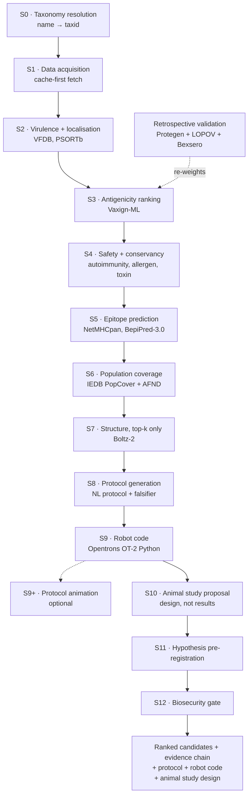

# VaxForge

**From a pathogen name to a ranked set of candidate vaccine antigens, a falsifiable wet-lab protocol, and executable robot code — with a retrospective validation harness that tells you how much to trust any of it.**

> Rename the project before pushing. `VaxForge` is a placeholder.

---

## 0. What this is, and what it is not

Most in-silico vaccine design projects produce a ranked list and stop. The list looks authoritative, nothing in the repo tells you whether the ranking is better than chance, and the published literature in this area has a measurable credibility problem: multi-epitope in-silico vaccine papers grew from ~5% to ~43% of reverse-vaccinology output by 2024 while the field's mean impact factor fell from 6.4 to 4.2, and none of the 39 FDA-monitored trials for WHO priority pathogens originated from reverse-vaccinology antigen selection.

VaxForge is built around the opposite commitment.

**This project DOES:**
- Resolve a plain-language pathogen name to a reference proteome and run a transparent, versioned screening cascade over it
- Rank candidate antigens and expose the full evidence chain behind every rank
- Report **held-out** performance against experimentally verified protective antigens, including a leave-one-pathogen-out protocol
- Emit a complete wet-lab protocol with controls, cost, timeline, and an explicit falsification condition per candidate
- Compile the liquid-handling subset of that protocol to executable Opentrons OT-2 Python, validated by simulation
- Emit an animal immunogenicity study proposal, ready for ethics review, in which **every in-silico prediction is mapped to the assay that would refute it**

**This project DOES NOT:**
- Simulate wet-lab results. No predicted ELISA readings, no synthetic flow cytometry, no fabricated cytokine values. A prediction is a hypothesis; a measurement is an observation. Presenting the former as the latter is not exaggeration, it is a category error.
- Simulate Phase 1/2/3 clinical trials. As of late 2026 there is no scientific or regulatory basis for this in vaccines. ICH M15 (CHMP-adopted 2026-01-23, effective 2026-07-23) does not mention vaccines or immunology anywhere in its text. The FDA MIDD Paired Meeting Program explicitly excludes using simulation to determine the operating characteristics of confirmatory trials. The two real cases where in-silico work substituted for trials — the UVA/Padova T1D simulator (FDA Master File #1521, accepted 2008, as a substitute for *animal* trials) and VICTRE — are both outside vaccines and both outside efficacy endpoints.
- Design, enhance, or characterise anything that increases pathogen virulence, transmissibility, or immune escape. Scope is restricted to protective antigens and therapeutic binders. See §8.

---

## 1. Architecture



Every stage is a pure function over the previous stage's artifact. Artifacts are content-addressed JSON written to `runs/<run_id>/`, so any stage can be re-run without recomputing upstream work, and any claim in the final report can be traced to the exact tool version and parameters that produced it.

---

## 2. Stage reference

| Stage | Input | Output | Primary tooling | Typical runtime |
|---|---|---|---|---|
| S0 | Pathogen name (free text) | `taxid`, resolved lineage | NCBI Taxonomy via E-utilities | <2 s |
| S1 | `taxid` | Reference proteome + reference DBs | UniProt, VFDB, Protegen, IEDB | 5–120 s cold, <1 s cached |
| S2 | Proteome FASTA | Annotation table | BLAST+ vs VFDB, PSORTb 3.0 | 1–5 min |
| S3 | Annotation table | Ranked candidates | Vaxign-ML (Docker) | 1–3 min |
| S4 | Ranked candidates | Filtered candidates | BLASTp vs human proteome, AlgPred 2.0, ToxinPred2 | 2–5 min |
| S5 | Filtered candidates | T-cell + B-cell epitopes | NetMHCpan, NetMHCIIpan, BepiPred-3.0, DiscoTope-3.0 | 2–10 min |
| S6 | Epitope set | Per-population coverage, PC90 | IEDB Population Coverage + AFND | <1 min |
| S7 | top-k candidates | Structures + coarse ranking | Boltz-2 | 2–30 min GPU |
| S8 | Final candidates | Structured NL protocol | LLM + protocol templates | <1 min |
| S9 | NL protocol | OT-2 Python + validation report | LLM codegen + `opentrons_simulate` | 1–3 min |
| S10 | Final candidates | Animal study design + ethics pack | Power analysis + ARRIVE 2.0 template | <1 min |
| S11 | Final ranking | Timestamped prediction manifest | git tag + JSON manifest | <1 s |
| S12 | Any sequence output | Screening-cleared sequences | Synthesis-provider screening | manual |

### S0 — Taxonomy resolution

The user types `Neisseria meningitidis` or `SARS-CoV-2`, not a taxid. Two failure modes must be handled explicitly rather than silently:

- **Synonymy.** Many bacterial species have been renamed. NCBI Taxonomy carries synonyms; resolve through them and surface which name was matched.
- **Ambiguity.** `Neisseria` matches a genus, not a species. `E. coli` matches thousands of strains. Return the candidate list for user confirmation; never silently take the first hit.

On failure, return the nearest matches rather than an error. Implementation uses `esearch` against `db=taxonomy`. Register your `tool` and `email` parameters with NCBI; with an API key the default limit is 10 requests/second.

### S1 — Data acquisition (cache-first)

```
resolve(taxid) → check local cache → miss? → fetch → persist → return
```

| Source | What | Access |
|---|---|---|
| UniProt | Reference proteome FASTA | REST, by taxid |
| VFDB | Virulence factors, Set A (~4,496 curated) | Bulk download |
| Protegen (VIOLIN) | Experimentally verified protective antigens | Bulk FASTA |
| IEDB | Experimentally verified epitopes | Database export |
| AFND | HLA allele frequencies by population | Via IEDB PopCover |

**Two operational warnings.**

First, **do not use the NCBI BLAST URL API at demo time.** It requires ≥10 s between requests, asks that >50 searches run off-peak, and may throttle or block above ~100 requests/24 h. Run `BLAST+` locally or in Docker instead.

Second, **pre-warm the cache before the demo.** Cache-first satisfies "fetch automatically from the internet" while making the live demo independent of conference wifi. Ship `make warm-cache PATHOGENS=...` and run it the night before.

**Licensing caution:** Protegen's publication does not state a redistribution licence, and reported entry counts differ across sources (590 at publication; 854 across 200 pathogens in one later source; >1,600 as of 2024-12 in another). The database's own update log appears to stall around 2011. Contact the corresponding author before redistributing it inside your repo, and cite the count with its source rather than picking the largest number.

### S2 — Virulence and localisation annotation

Two labels per protein:

1. **Virulence association.** `blastp` against VFDB. Record identity, coverage, and E-value — all three, not just a boolean.
2. **Subcellular localisation.** PSORTb 3.0. Surface-exposed and secreted proteins are reachable by antibody; cytoplasmic ones generally are not.

PSORTb returns `unknown` for a non-trivial fraction of proteins. **Keep `unknown` as an explicit value.** Collapsing it into "not surface" silently discards candidates and inflates your apparent precision.

### S3 — Antigenicity ranking

**Do not use VaxiJen as your ranker.** On an independent evaluation it scored AUC 0.56 / MCC 0.08. VaxiJen v2.0 labels roughly 63.8% of a proteome as candidate with a fold-enrichment of about 1.2 — that is not a filter. On a benchmark of 45 known bacterial protective antigens against 52,752 proteins, fold enrichment was: NERVE 2.0 **16.57**, Vaxign2 filter 9.06, VaxiJen **3.41**, Vaxign-ML 1.58.

Use **Vaxign-ML** (open-source Docker build) as the baseline ranker. Report **two** protegenicity thresholds (e.g. 0.90 and 0.85), not just the one that flatters your numbers.

> We were unable to verify Vaxign-ML's exact published AUROC/AUPRC from primary sources. **Do not put a Vaxign-ML AUC number on a slide** — cite fold enrichment, which we did verify.

### S4 — Safety and conservancy filters

Four gates, all absent from naive pipelines:

| Gate | Why | Tool |
|---|---|---|
| Human-proteome homology | Antigens resembling self-proteins risk autoimmunity | `blastp` vs human proteome → shared peptides re-checked against IEDB human MHC ligands (NERVE 2.0 approach) |
| Allergenicity | Allergenic candidates are non-starters | AlgPred 2.0 (@0.45) |
| Toxicity | Toxic candidates are non-starters | ToxinPred2 (@0.8) |
| Conservancy | Strain-variable antigens fail on strain switch | `blastp` vs a second strain proteome |

**Counter-caution:** over-aggressive subtractive filtering can discard subdominant but protective epitopes. Log every rejection with its reason so a rejected candidate can be recovered and inspected.

### S5 — Epitope prediction

An epitope is the short stretch of an antigen the immune system actually recognises.

- **T-cell epitopes** must first be presented by MHC. Use NetMHCpan (class I) and NetMHCIIpan (class II). **Down-weight class II** — its accuracy lags class I substantially.
- **B-cell epitopes** are antibody binding sites. **Use BepiPred-3.0, not 2.0.** BepiPred-2.0 scores **AUC 0.574** on linear IEDB data, which is close to random. BepiPred-3.0 reaches 0.65–0.771 depending on encoding. The realistic ceiling for linear B-cell epitope prediction is roughly AUC 0.70–0.84; a 2026 review describes a reproducibility crisis in this subfield.
- **Conformational epitopes** benefit from structure, but you do not need an experimental one: DiscoTope-3.0 scores AUC 0.783 on AlphaFold models vs 0.795 on experimental structures.

**Implementation gotcha:** BepiPred truncates sequences above 1,023 aa. Bacterial surface proteins frequently exceed this. Chunk with overlap and merge, or you will silently lose the C-terminus of your best candidates.

> **Verify access terms yourself.** We could not confirm current API or licence terms for the DTU Health Tech services (NetMHCpan-4.1, BepiPred-3.0) — the pages carry no announcement either way. Prefer local installs or IEDB NG standalone tools, and contact DTU if you intend to call their servers programmatically.

### S6 — Population coverage and fairness

HLA genotypes differ between populations, and a T-cell epitope is useless to someone whose HLA cannot present it. IEDB's Population Coverage tool draws on AFND, spanning 115 countries, 21 ethnicities, 16 geographic regions and 3,245 alleles.

Report: projected coverage, average epitope hits, **PC90**, per-population sample sizes, and — the interesting number — **how much coverage you lose in non-European populations if you optimise only on European frequencies**.

**This is the only defensible remnant of "population-scale simulation", and its limits must be stated out loud:** presentable ≠ recognised ≠ sufficient response ≠ clinical protection. The tool says nothing about dose, adjuvant, durability, or safety. Note also that IEDB's documentation does not state whether it assumes locus independence; **do not assert that it does** — HLA loci are in strong linkage disequilibrium.

### S7 — Structure and affinity (top-k only)

Run on the top-k candidates only; this is the expensive stage.

**Use Boltz-2 (MIT licence), not AlphaFold 3.** AlphaFold 3's weights are CC-BY-NC-SA 4.0, must be obtained directly from Google by application at their sole discretion (~2–3 business days), and are not licensed for commercial or clinical use. Boltz-2 is MIT, adds an affinity module (FEP+ benchmark mean Pearson **0.62**, >1000× faster), and you can `git clone` it today.

**Delete or explicitly demote the ClusPro–TLR docking step.** Blind docking top-1 success for free servers is 5–16%; ClusPro specifically scored **13.7% top-1 / 45.1% top-10** across 51 targets, and medium-quality hit rates drop by roughly two thirds when docking model structures rather than experimental ones. A ClusPro score is not an affinity estimate and not an immunogenicity estimate.

> **Phrase this carefully.** We found *no* study measuring correlation between docking score and immunostimulatory activity, in either direction. The honest statement is "there is no evidence supporting its predictive validity here", **not** "it has been shown not to work."

**Validator sensitivity matters.** On MotifBench, the same design set scores 28.05 with ESMFold as the refolder and 22.5 with AF2-no-MSA. Always report which validator you used, and ideally report two.

### S8 — Protocol generation

Output a structured natural-language protocol per candidate: assays, ordering, reagents and volumes, **controls**, estimated cost and timeline, and one mandatory line — **what result would falsify this prediction**.

Ordering constraint that is easy to get wrong: **endotoxin removal and an LPS control must precede the THP-1 assay.** Residual endotoxin is the dominant false-positive source in this cascade; without the control the entire cytokine readout is uninterpretable.

What the THP-1 → FACS/ELISA/RT-qPCR cascade actually measures: **innate immune activation**. The monocyte activation test has real regulatory standing (Ph. Eur. 2.6.30) for pyrogen detection. What it does **not** measure: adaptive immunity, antibody titre, neutralisation, T-cell memory, or protection. THP-1 is a single-genotype cell line and does not represent population HLA diversity.

### S9 — Robot code generation and validation

**This is where Text2WetLab belongs.** The repository benchmarks exactly this task: *"Benchmarking LLM agents on turning lab protocols and papers into robot code."* Its data flow is `instruction.md` + `paper.txt` → agent → `protocol.py` (Opentrons OT-2 Python) → `reward.json`.

Two things to be clear about:

1. **It is a grader, not a generator.** Your LLM writes the protocol code; Text2WetLab's methodology is what you borrow to check it — `opentrons_simulate` (v7.5.0), ground-truth comparison, physical-rule checks, and an LLM judge. Its 11 "tasks" are liquid-handling benchmarks (plate distribution, AMPure beads, colony PCR, heat-shock transformation, Golden Gate, RNA extraction), **not** an 11-step immunogenicity workflow.
2. **Simulation passing is not correctness.** The repo says so itself: a protocol that runs can still ruin an experiment, and nothing in the robot API flags that. Hence the layered validators above it.

#### Automatability matrix

This is the table that makes your demo honest. Classify every protocol step before emitting code:

| Wet-lab step | OT-2 automatable | Notes |
|---|---|---|
| Gene synthesis | ❌ | Outsourced to vendor |
| Golden Gate / plasmid assembly | ✅ | Core liquid handling + temperature module |
| Heat-shock transformation | ⚠️ Partial | Temperature module; plating is manual |
| Colony PCR setup | ✅ | Reaction assembly only |
| Expression culture + IPTG induction | ⚠️ Partial | Inducer addition yes; shaking incubation no |
| Cell lysis | ⚠️ Partial | Reagent addition yes; sonication/centrifugation no |
| Ni-NTA purification | ⚠️ Partial | Magnetic-bead His-tag format yes (magnetic module); gravity column / FPLC no |
| Endotoxin removal + LAL assay | ⚠️ Partial | Plate setup yes; reading needs a plate reader |
| THP-1 culture + PMA differentiation | ❌ | CO₂ incubator, sterile handling |
| Antigen stimulation | ✅ | Addition to seeded plate |
| FACS | ⚠️ Partial | Staining prep yes; acquisition no |
| ELISA | ⚠️ Partial | Plate setup and washes yes; reading no |
| RT-qPCR | ⚠️ Partial | Reaction setup yes; thermocycling and reading no |

> ✅ fully automatable · ⚠️ liquid-handling portion only · ❌ requires a human or other instrument
> This classification is our engineering judgment about OT-2 capability, not a literature claim. Validate against your actual deck configuration and modules.

Emit per-step annotations in the generated code so a human reading `protocol.py` can see immediately which steps the robot owns and which it does not.

#### Expect safety refusals

Text2WetLab §5.2 records 5 trials where an LLM refused before writing code (Golden Gate assembly and *E. coli* transformation prompts). The benchmark authors explicitly decline to call these false positives, since those procedures do produce genetically modified organisms. **Design for this**: detect refusals, surface them to the user as a distinct outcome rather than a crash, and do not attempt to engineer around them. A refusal handled gracefully is a better demo than a jailbreak.

### S9+ — Protocol animation (optional)

Parse the `opentrons_simulate` command list into a JSON timeline, then render it frame by frame in HTML canvas or SVG: deck layout, labware positions, tip pickup, aspirate/dispense source and destination wells, volumes, and elapsed time.

```
protocol.py → opentrons_simulate → command list → timeline.json → canvas player
```

Why it is worth doing if time allows: it converts "the generated code actually runs" from a number into something a judge can watch. It is strictly additive — cut it without touching the main line if you are short on time.

### S10 — Animal study proposal

A ranked list is a set of hypotheses. An animal immunogenicity study is the first experiment that can actually refute them. This stage emits a **study design ready for ethics review** — arms, group sizes, schedule, endpoints, statistics, and ethics documentation. As everywhere else in this pipeline, the output is a design, never results.

#### Falsification mapping — the core of this stage

Each upstream prediction is paired with the readout that can kill it. This table is what turns the project from "we ranked some proteins" into "we made testable claims and stated in advance how we would be wrong."

| Upstream prediction | Animal readout | Falsified if |
|---|---|---|
| S3 antigenicity rank | Antigen-specific IgG ELISA titre | No titre rise over the adjuvant-only arm |
| S5 T-cell epitopes | IFN-γ ELISpot against predicted peptide pools | Response to whole antigen but **not** to the predicted pools — antigen right, epitope prediction wrong |
| S5 B-cell epitopes | Competition ELISA or peptide-array mapping | Sera bind the antigen but not the predicted epitopes |
| S6 population coverage | Panel of HLA-transgenic lines | Response absent in backgrounds predicted to be covered |
| S7 structure / conformation | Binding to folded vs denatured antigen | Sera recognise only the denatured form — the conformational epitope was an artifact |
| Functional protection | Species-appropriate functional assay | Titres rise but functional activity is absent |

On that last row: for meningococcal B the serum bactericidal assay (hSBA) is an accepted correlate of protection, which is why immunobridging was possible there. **This is unusual.** Most vaccines have no agreed correlate. Do not assume one exists for your pathogen — check, and if there is none, say so in the proposal.

#### Species selection

| Goal | Species | Note |
|---|---|---|
| Basic immunogenicity | BALB/c or C57BL/6 mice | Cheap and fast; strain drives Th bias, so state which and why |
| **Validating S5/S6 human epitope predictions** | **HLA-transgenic mice** | The only design in which your human MHC predictions are actually under test. Wild-type mouse MHC does not present the epitopes NetMHCpan predicted for humans |
| Large-volume polyclonal sera | Rabbit | More serum per animal |
| Challenge model | A species genuinely susceptible to the pathogen | Many human pathogens have no good small-animal model. If none exists, **write that in the proposal** rather than inventing one |
| Non-human primates | Last resort | Ethically and financially constrained; out of scope for a hackathon proposal |

The HLA-transgenic row is what makes this stage coherent with the rest of the pipeline. Without it, S5 and S6 remain unfalsifiable.

#### Minimum study arms

1. Candidate antigen + adjuvant
2. Adjuvant only
3. Naive / PBS
4. Licensed vaccine positive control, where one exists

#### Parameters the generator must fill in

- **Dose levels:** ≥3 for dose-ranging
- **Route:** IM / SC / IN, justified against the target immune compartment
- **Schedule:** prime-boost with bleed points, e.g. immunise d0/21/42, bleed d0/20/41/56
- **Adjuvant:** named, with rationale (alum biases Th2; TLR-agonist systems bias Th1)
- **Group size:** from a **power analysis**, stating effect size, α and power. n=5–10/group is conventional in mouse immunogenicity work, but convention is not a justification — compute it
- **Randomisation and blinding:** specify both, including who is blinded to what
- **Primary endpoint:** pre-specified, single, fixed before any data is collected
- **Humane endpoints:** explicit, with monitoring frequency
- **Statistical analysis plan:** pre-specified, including the multiplicity correction for comparing several candidates at once

#### Ethics and regulatory layer

The proposal is not a proposal without these:

- **ARRIVE 2.0** — report against the Essential 10 at minimum
- **3Rs** — Replacement, Reduction, Refinement, each addressed explicitly. Reduction is where the power analysis earns its place
- **UK:** Animals (Scientific Procedures) Act 1986 — project licence (PPL) and personal licence (PIL), plus AWERB review
- **US:** IACUC approval

Generate these as a populated checklist, not as prose a reviewer has to mine.

#### Scope limit on challenge studies

This stage produces study **design**: arms, endpoints, group sizes, statistics, and ethics documentation. It does **not** produce pathogen handling, culture, or challenge-inoculum preparation procedures. Those belong with the containment facility and its biosafety committee, and are deliberately out of scope for this tool.

#### Honest limits — state these inside the proposal itself

- **Mouse immunogenicity does not predict human protection.** It shows an antigen is immunogenic in a mouse. Necessary, not sufficient.
- Industry base rate for vaccines: **Phase 1 → approval 39.6%** (6.8% for non-industry sponsors). The narrowest transition is **Phase 2 → 3 at 65.4%** — precisely the step where immunogenicity data exists and efficacy data does not. No amount of preclinical work closes that gap.
- A positive animal result moves a candidate from "predicted" to "immunogenic in one species." It does not move it to "works."

> We were unable to retrieve Plotkin's *Correlates of Protection Induced by Vaccination* (Clin Vaccine Immunol, 2010) in full, so this README carries no authoritative definition of correlate vs surrogate vs mechanistic correlate, and no list of vaccines lacking an agreed correlate. **Read it before making correlate claims in your pitch.**

### S11 — Hypothesis pre-registration

Before running any validation: fix random seeds, pin tool versions and thresholds, write the prediction list to a manifest, and timestamp it (git tag, or a hash posted publicly).

This prevents post-hoc selection. A metric chosen after seeing the answer is not a result. It costs almost nothing and reads as a clear rigour signal to scientific judges.

### S12 — Biosecurity gate

Any sequence leaving the pipeline passes synthesis-provider screening before order. Draw this as a node in the architecture diagram, not as a disclaimer on the last slide — judges are assessing whether it is part of the system.

---

## 3. Retrospective validation — the part that makes the demo credible

A pipeline that runs is not a pipeline that works. This harness is the difference.

### Three-tier protocol

**Tier 1 — Antigen-level retrieval.**
- Positives: experimentally verified protective antigens from Protegen.
- Negatives: UniProt proteins at <30% sequence identity, with homologues excluded at `blastp` E ≤ 1e-3.
- Protocol: nested 5-fold cross-validation **plus leave-one-pathogen-out (LOPOV)**, following Vaxign-ML's published precedent.
- Metrics: fold enrichment, precision@k, PR-AUC, rank-of-truth.

**Tier 2 — Case retrieval: Bexsero.**
Bexsero/4CMenB contains three recombinant antigens — **fHbp, NadA, NHBA** (50 µg each, plus 25 µg OMV supplying PorA 1.4). Run the pipeline on *N. meningitidis* serogroup B and report **recall@3** and **rank-of-truth**. A retrieval question with exactly three correct answers is far more legible to a judge than an AUC.

**Tier 3 — Honest base rate.**
Pizza et al., *Science* 287:1816 (2000) is the canonical reverse-vaccinology funnel:

```
570 candidate ORFs
  → 350 successfully expressed (61%)
    → 85 strongly positive in ≥1 assay
      → 7 positive in all three assays across 31 strains
        → 3 in the licensed vaccine
```

**Experimental hit rate: 1.2%. Timeline from genome paper to approval: roughly 13–15 years.** Put this on a slide. It is more persuasive than any precision figure you can report, because it shows you know what your numbers mean.

### Data leakage — say it before a judge finds it

**Vaxign-ML is trained on Protegen. The Bexsero antigens are necessarily in that training set. "Rediscovering" them with a Protegen-trained predictor is circular.**

Mitigation: remove *N. meningitidis* entirely from the training/reference set before the Tier 2 run — that is the point of LOPOV — and state this explicitly in the demo.

This failure mode is endemic, not hypothetical: DeepSol and SKADE were found to have 75.1% overlap between training and test sets. A 2025 paper in this exact subfield reports no held-out test set, no AUC, and no cross-validation at all. **Getting this one thing right puts you ahead of most published work in the area**, which is precisely why you should say it out loud rather than bury it.

---

## 4. Known limitations

Report these; do not let a judge discover them.

| Claim | Honest ceiling |
|---|---|
| B-cell epitope prediction | BepiPred-2.0 AUC 0.574; field ceiling ~0.70–0.84 |
| Antigenicity (VaxiJen) | AUC 0.56, MCC 0.08; flags ~64% of proteome |
| Blind docking (ClusPro) | 13.7% top-1, 45.1% top-10 |
| Affinity prediction (Boltz-2) | Pearson 0.62 vs FEP+ |
| Solubility prediction | Best of 12 predictors: 58.4% accuracy (AUC 0.60, MCC 0.17). Value is enrichment — top 10% of SoluProt rankings yielded 199 true positives vs 145 expected by chance, a 37.2% relative lift — **not** replacing the experiment |
| De novo binder design | BindCraft reports 46.3% mean success (10–100% by target). An independent reproduction of RFdiffusion found near-total failure on several targets, with no measurable affinity. Design success is target-dependent and often much worse than headline numbers |
| Mouse immunogenicity → human protection | No reliable predictive relationship. Most vaccines lack an agreed correlate of protection; meningococcal hSBA is an exception, not the rule |
| Expression itself | ProteinGenerator designs *intended* to be soluble monomers passed 32/42; 8/19 when tryptophan-enriched. "It expresses" is itself a high-failure experimental outcome |
| Trial outcome prediction | HINT reports PR-AUC 0.772/0.607/0.623 (Ph 1/2/3) on its own benchmark; on an independent evaluation of 2,163 trials its balanced accuracy was 0.470–0.594 with overall MCC 0.050. In the same evaluation GPT-4o-mini degenerated to predicting "success" for everything (balanced accuracy 0.500, recall 1.000, specificity 0.000) |
| Vaccine industry base rate | Phase 1 → approval 39.6% (industry-sponsored), 6.8% (non-industry). The narrowest transition is Phase 2 → 3 at 65.4% — exactly the point where immunogenicity data exists but efficacy data does not, which is the furthest any in-silico immune model can reach |

---

## 5. Install and quickstart

```bash
git clone https://github.com/<you>/vaxforge.git
cd vaxforge
make setup              # python deps + pulls Docker images
make warm-cache PATHOGENS="Neisseria meningitidis,SARS-CoV-2"
```

```bash
# Full pipeline
vaxforge run --pathogen "Neisseria meningitidis" --top-k 20 --out runs/nmb

# Retrospective validation (do this before the demo)
vaxforge validate --protocol lopov --holdout "Neisseria meningitidis"
vaxforge validate --case bexsero --report recall@3

# Robot code only, from an existing protocol artifact
vaxforge compile-protocol runs/nmb/protocol.json --target opentrons-ot2

# Animal study proposal for the top candidates
vaxforge animal-study runs/nmb --species hla-transgenic --arms 4 --power 0.8
```

Docker is required for BLAST+ and Vaxign-ML. A GPU with ≥16 GB VRAM is recommended for S7; the pipeline degrades gracefully to sequence-only ranking without one.

### Configuration

```yaml
# config.yaml
thresholds:
  protegenicity: [0.90, 0.85]   # always report both
  allergenicity: 0.45           # AlgPred 2.0
  toxicity: 0.80                # ToxinPred2
  conservancy_identity: 0.80
epitopes:
  bcell_tool: bepipred-3.0      # never 2.0
  mhc_class_ii_weight: 0.3      # down-weighted deliberately
structure:
  engine: boltz-2               # MIT; do not switch to AF3 weights
  refolder: [esmfold, af2-no-msa]
reproducibility:
  seed: 20261114
  pin_versions: true
```

---

## 6. Repository layout

```
vaxforge/
├── src/vaxforge/
│   ├── s0_taxonomy.py        # name → taxid, synonymy + ambiguity handling
│   ├── s1_acquire.py         # cache-first fetch
│   ├── s2_annotate.py        # VFDB + PSORTb
│   ├── s3_rank.py            # Vaxign-ML wrapper
│   ├── s4_filter.py          # autoimmunity / allergen / toxin / conservancy
│   ├── s5_epitopes.py        # NetMHCpan, BepiPred-3.0, DiscoTope-3.0
│   ├── s6_coverage.py        # IEDB PopCover + AFND, fairness report
│   ├── s7_structure.py       # Boltz-2, dual refolder
│   ├── s8_protocol.py        # NL protocol + falsification condition
│   ├── s9_robot.py           # OT-2 codegen + simulate + rule checks
│   ├── s9plus_animate.py     # optional: command list → timeline → canvas
│   ├── s10_animal.py         # study design, power analysis, ARRIVE pack
│   ├── s11_prereg.py         # manifest + timestamp
│   └── s12_biosafety.py      # screening gate
├── validation/
│   ├── lopov.py              # leave-one-pathogen-out
│   ├── bexsero_case.py       # recall@3 retrieval test
│   └── leakage_check.py      # asserts holdout actually held out
├── cache/                    # gitignored
├── runs/                     # gitignored
└── config.yaml
```

---

## 7. What is deliberately absent

| Not implemented | Why |
|---|---|
| Phase 1/2/3 trial simulation | No scientific or regulatory basis for vaccines (§0) |
| C-ImmSim immune simulation | Model described only partially in the literature, no complete manual, derivative IMMSIM++ shipped as binary only so third parties cannot test it. Widely used in this genre; treated here as decorative |
| MD + MM-PBSA "validation" | Flagged in the literature as computational validation that does not demonstrate immunological efficacy |
| ClusPro–TLR docking | See §S7 |
| Predicted assay readouts | See §0 |

Listing what you refused to build is itself a result. Judges at science-track hackathons have consistently rewarded systems that disclose the limits of their own evidence.

---

## 8. Scope and responsible use

VaxForge is restricted to **protective antigen identification and therapeutic binder design**. It does not support, and will not be extended to support, work that increases pathogen virulence, transmissibility, or immune escape.

Sequence screening before synthesis is implemented as a pipeline node (S12), not an afterthought. The Responsible AI × Biodesign commitments (published 2024-03-08, 206 signatories as of the 2024-10-26 list update) include an explicit undertaking to *"obtain DNA synthesis services only from providers that demonstrate adherence"* to screening practice, alongside red-teaming commitments.

> The US OSTP *Framework for Nucleic Acid Synthesis Screening*, Executive Order 14292 (May 2025), and the International Gene Synthesis Consortium's Harmonized Screening Protocol all exist and are relevant. We verified only their titles, publishers and dates — **do not cite specific provisions or compliance deadlines on a slide without reading the primary documents yourself.**

---

## 9. Licensing notes for dependencies

| Component | Licence | Constraint |
|---|---|---|
| Boltz-2 | MIT | Academic and commercial use |
| AlphaFold 3 | Code Apache 2.0; **weights CC-BY-NC-SA 4.0** | Weights only from Google, by application, at their sole discretion; non-commercial; not for clinical use |
| Text2WetLab | MIT | Benchmark + grading harness |
| BindCraft | MIT | **But it pulls in PyRosetta** |
| PyRosetta | Requires a Rosetta licence | Paper signature; international applications can take months. **Avoid entirely at a hackathon** |
| Vaxign-ML | Open-source Docker build | — |
| Protegen / VIOLIN | Not stated | Contact corresponding author before redistributing |

---

## 10. Citations

Numbers quoted in this README trace to the primary sources below. Where we could not verify a claim, the text says so explicitly rather than filling the gap.

- Pizza et al., *Science* 287:1816 (2000) — reverse vaccinology funnel, 570 → 3
- NERVE 2.0, *BMC Bioinformatics* 25:378 (2024) — fold-enrichment benchmark
- Vaxign-ML, *Bioinformatics* 36(10):3185–3191 (2020) — nested CV + LOPOV protocol
- Text2WetLab — https://github.com/PhysicalAIBenchmarks/Text2WetLab (MIT; self-hosted preprint, not peer-reviewed, no third-party citations found)
- Boltz-2 (2025-06-06) — MIT, affinity module
- ICH M15, EMA/CHMP/ICH/496426/2024 — MIDD general principles
- Lo, Siah & Wong, NBER WP 27176 — vaccine clinical success rates
- Zumárraga et al., *Front. Immunol.* 17:1730217 (2026-02-05) — reverse-vaccinology output quality analysis
- Responsible AI × Biodesign community commitments (2024-03-08)

---

## 11. Roadmap

- [ ] Replace the Vaxign-ML baseline with a model trained on a leakage-audited split and report both
- [ ] Add a second validator for S7 beyond ESMFold and report the spread
- [ ] Extend the automatability matrix to PyLabRobot so the codegen is not OT-2-specific
- [ ] Add mRNA construct design (LinearDesign is CPU-fast — ~11 min for spike — and reported 57–128× higher IgG titre in mouse)
- [ ] Auto-populate the ARRIVE 2.0 Essential 10 checklist directly from the study design artifact
- [ ] Per-candidate uncertainty display: show the evidence chain and the predictor's known accuracy next to every score
