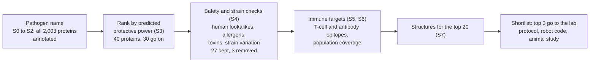
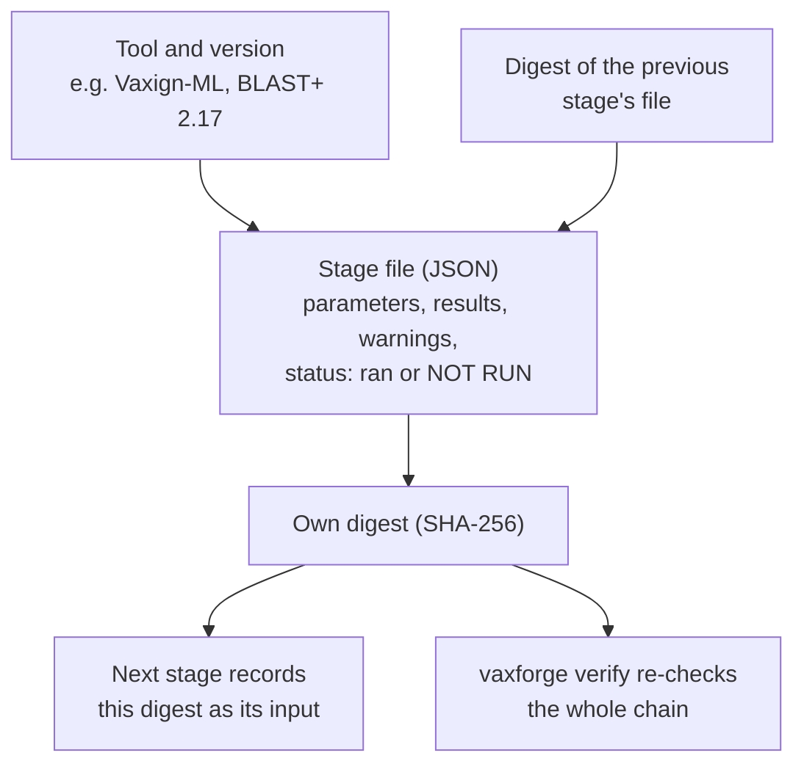
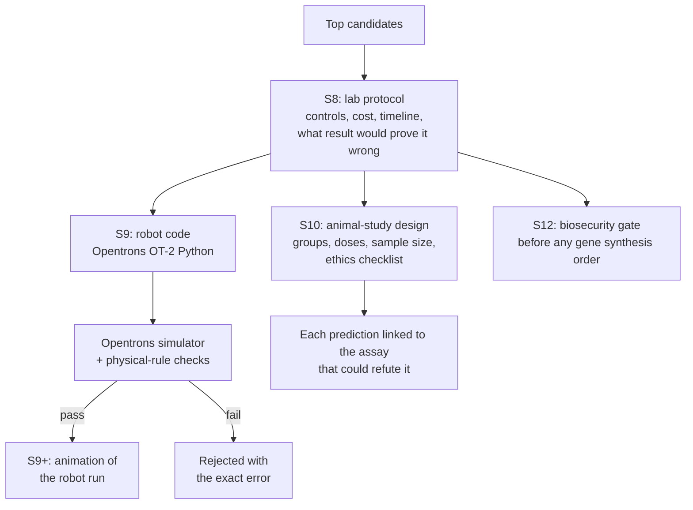
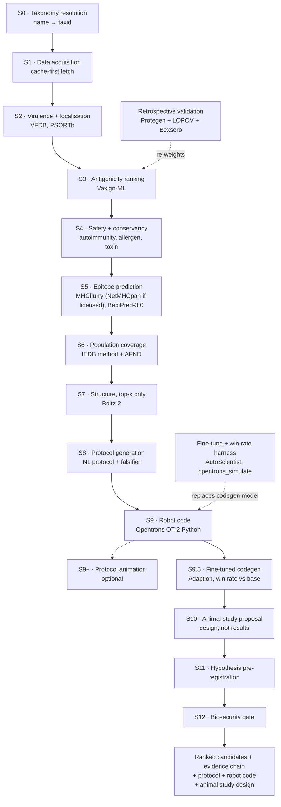

# VaxForge

**Type a pathogen name. VaxForge returns a short, explained list of vaccine antigen candidates, a lab protocol that states what result would prove each one wrong, robot code that has passed the simulator, and an animal-study design ready for ethics review.**

**The problem.** Finding a vaccine target means sifting thousands of bacterial proteins by hand across a dozen separate tools. It takes years, and most candidates fail in the lab. Published computational vaccine studies often give a ranked list with no way to check how it was made. VaxForge automates that first, slow step and shows its working: every number is stored with the tool and version that produced it, linked in a hashed chain that `vaxforge verify` re-checks, so anyone can trace a result from the pathogen name to the lab bench.

**How we keep it accurate.** We use published, peer-reviewed predictors and name them in every output. Each prediction is a hypothesis, paired with the experiment that would refute it. The ranking method is checked against vaccine antigens whose answers are known (section 3).

**How we keep fake data out.** The pipeline never invents a measurement. A tool that could not run is reported as "not run", never replaced by a made-up value. Lab and animal results are never simulated, so the outputs are designs and predictions, not data.

## At a glance

```
name  ->  proteome  ->  rank antigens  ->  safety + conservancy  ->  epitopes  ->  population coverage  ->  structure (top-k)
 S0         S1-S2           S3                    S4                   S5               S6                     S7
                                                                                                   |
   biosecurity <- animal study design <- robot code (simulator-checked) <- lab protocol <-----------+
       S12              S10                       S9                         S8            (+ pre-registration S11)
```

| | |
|---|---|
| **One input** | A plain pathogen name, for example *Neisseria meningitidis* |
| **Real tools** | Vaxign-ML, BLAST+, AlgPred2, ToxinPred2, MHCflurry, BepiPred-3.0, Boltz-2, the IEDB population-coverage method |
| **Outputs** | Ranked shortlist with the evidence behind each rank; wet-lab protocol with a falsification condition per candidate; Opentrons OT-2 code; animal-study design for ethics review |
| **Traceable** | Every stage writes a hashed artifact; `vaxforge verify` re-checks the whole chain; a stage that did not run is shown as "not run" |
| **Tested** | More than 2,200 automated tests |

## Pre-demo run: *Neisseria meningitidis*

A full run takes a long time (the annotation stage alone took 48 minutes on the whole 2,003-protein proteome), so the demo shows runs we made beforehand and saved in the repo. Both are real runs of this code, and `vaxforge verify` passes on each.

| Saved run | What it shows |
|---|---|
| [`results/nmb_real_run/`](results/nmb_real_run/) | S3 to S12 with the real prediction tools installed, plus a self-contained `report.html` and a one-page `SUMMARY.md` |
| [`demo_data/run_nmb_fixture/`](demo_data/run_nmb_fixture/) | S3 to S12 end to end, including all 36 robot sessions passing the Opentrons 7.5.0 simulator and the protocol animations |

**What the real-tool run found** (40 *N. meningitidis* proteins, including the three Bexsero vaccine antigens):

| Step | Result |
|---|---|
| S3 ranking | Vaxign-ML scores all proteins; 30 go forward |
| S4 safety and conservancy | BLAST+, AlgPred2, ToxinPred2 and a second-strain check: **27 of 30 kept**; 3 removed (frpA and frpC for toxicity, lldD for similarity to a human protein) |
| S5 epitopes | T-cell epitopes for 27 HLA alleles (MHCflurry) and antibody epitopes (BepiPred-3.0) |
| S6 population coverage | 98.5% of the world population covered by the class I epitopes |
| S7 final shortlist | porA, hmbR, iga, NMB1829, hap, mtrD, **NHBA (7th)**, lbpA, potD-1, **NadA (10th)** ... **fHbp (15th)** |
| S8 to S12 | Protocol, robot code, animal-study design, pre-registration and a biosecurity gate that holds synthesis orders for human review |

**The Bexsero antigens.** The licensed Bexsero vaccine uses three *N. meningitidis* antigens (fHbp, NadA, NHBA). They differ between strains, so S4 **flags** a strain-variability or allergen-score failure and keeps the protein, instead of discarding it; toxicity and human similarity still remove proteins. All three stay in the shortlist with their flags recorded. We chose that rule after a first strict run removed all three, so this is a demonstration of how the pipeline treats variable antigens, not held-out validation (see below).

## Robot code: from protocol to a liquid-handling robot (S9)

**What it does.** The lab protocol (S8) is a plan written in words. S9 turns its liquid-handling steps (pipetting, dilution series, Golden Gate gene assembly, transformation, colony PCR set-up) into Python for the **Opentrons OT-2**, a benchtop pipetting robot. A protocol step that the robot cannot do, such as cell culture or reading an instrument, is marked as a human step in an automation table, so nobody assumes the robot covers it.

**How we check it before anyone runs it.**
- **Simulator:** every program is run in the official Opentrons simulator (7.5.0). A program that fails, for example by asking a pipette for more liquid than it holds, is rejected with the exact error.
- **Physical-rule checks:** volumes, tip use and labware are compared with what the plan says.
- **Safety filter:** the code is scanned for anything it should not do before it runs. This is a filter, not a sandbox, so we say that the code "passes the simulator", never that it is "safe".

**What the saved demo run shows.** For the three top candidates it writes 36 robot sessions, and all 36 pass the simulator (`demo_data/run_nmb_fixture/`). Each session also gets a short animation of the deck and the pipetting, so a reviewer can watch what the robot would do (S9+).

**Learning from past protocols (S9.5).** We also fine-tuned the code-writing model with Adaption's AutoScientist (details in the stage table above). The fine-tune is judged by the same simulator, not by opinion.

**Before real use.** Volumes and times in the generated programs are defaults and must be set from your kit's instructions. Gene synthesis must not be ordered until the S12 biosecurity gate clears the sequence.

## How it works in more detail

**From a whole proteome to a short list.** Each step removes proteins for a stated reason. The numbers are from the saved *N. meningitidis* run (a 40-protein projection of the 2,003-protein proteome).



**How every number can be traced.** Each stage writes one file that records where its numbers came from. A change anywhere upstream is detected.



**From candidate to lab bench.** Everything on this side is a design or a program, never a measurement.



## How much to trust it

- **It narrows; it does not prove.** Nothing here shows that any candidate protects anyone. That needs lab and animal work, which is exactly what the protocol and the animal-study design are for.
- **Scale.** S0 to S2 ran on all 2,003 proteins of the *N. meningitidis* reference proteome (about 48 minutes with the real tools). The saved S3 to S12 runs use a 40-protein projection of it that includes the three Bexsero antigens, so the demo takes seconds instead of the better part of an hour. Localisation in that projection comes from UniProt text, not PSORTb.
- **Pre-registration, in plain words.** Step S11 locks the ranking, tool versions and thresholds into a timestamped file before any validation is run, so results cannot be quietly adjusted afterwards. In the saved runs that file was written after we chose the S4 rule above (keep strain-variable antigens, with a flag). It therefore records the exact settings used for the demo; it is not a blind forecast made before seeing any results.

The sections below give the full scope, the stage reference, the validation protocol and the known limits.

---

## 0. What this is, and what it is not

Most in-silico vaccine design projects produce a ranked list and stop. The list looks authoritative, nothing in the repo tells you whether the ranking is better than chance, and the published literature in this area has a measurable credibility problem: multi-epitope in-silico vaccine papers grew from ~5% to ~43% of reverse-vaccinology output by 2024 while the field's mean impact factor fell from 6.4 to 4.2, and none of the 39 FDA-monitored trials for WHO priority pathogens originated from reverse-vaccinology antigen selection.

VaxForge is built around the opposite commitment.

**What VaxForge does**
- **Reads a plain pathogen name** and builds the full protein list for it, then screens that list in a fixed, versioned order, so any run can be repeated.
- **Ranks candidate antigens** and keeps the evidence behind every rank: which tool scored it, with which settings.
- **Checks itself against known answers.** It measures whether the ranking finds antigens already proven to protect, including a test that hides one whole pathogen from the model (the scoring code is built; the full hidden-pathogen run is the next step).
- **Writes a complete lab protocol** with controls, cost, timeline and, for each candidate, the result that would prove the prediction wrong.
- **Turns the liquid-handling steps into robot code** for the Opentrons OT-2 and checks it in the Opentrons simulator before anyone uses it.
- **Designs the animal study** (groups, doses, sample sizes, ethics checklist) and links every prediction to the assay that could refute it.

**What VaxForge deliberately does not do, and why**
- **It does not simulate lab results** (no predicted ELISA readings or flow-cytometry data). A prediction is a hypothesis and a measurement is an observation; mixing them up produces convincing but meaningless data. VaxForge stops at the design of the experiment.
- **It does not simulate clinical trials.** For vaccines there is currently no scientific or regulatory basis for it. The international guideline on model-informed drug development (ICH M15, 2026) does not cover vaccines, and the FDA's programme excludes using simulation to decide confirmatory trials. The two cases where simulation did replace testing (a diabetes simulator in place of animal studies, and the VICTRE imaging trial) are outside vaccines and outside efficacy endpoints.
- **It does not design anything that makes a pathogen more dangerous** (more virulent, more transmissible or better at escaping immunity). Scope is protective antigens and therapeutic binders only (section 8).

---

## 1. Architecture



Every stage is a pure function over the previous stage's artifact. Artifacts are content-addressed JSON written to `runs/<run_id>/`, so any stage can be re-run without recomputing upstream work, and any claim in the final report can be traced to the exact tool version and parameters that produced it.

---

## 2. Stage reference

| Stage | Input | Output | Primary tooling | Typical runtime |
|---|---|---|---|---|
| S0 | Pathogen name (free text) | `taxid`, resolved lineage | NCBI Taxonomy via E-utilities | <2 s |
| S1 | `taxid` | Reference proteome + reference DBs | UniProt, VFDB, Protegen, IEDB | 5–120 s cold, <1 s cached |
| S2 | Proteome FASTA | Annotation table | BLAST+ vs VFDB, PSORTb 3.0 | about 48 min for all 2,003 proteins of the *N. meningitidis* reference proteome (measured by the lead's agent with Docker BLAST+ and PSORTb on a Mac; PSORTb is the slow part), 37 s for the 40-protein fixture (measured on Windows) |
| S3 | Annotation table | Ranked candidates | Vaxign-ML (Docker) | 1–3 min |
| S4 | Ranked candidates | Filtered candidates | BLASTp vs human proteome, AlgPred 2.0, ToxinPred2 | 2–5 min |
| S5 | Filtered candidates | T-cell + B-cell epitopes | MHCflurry (NetMHCpan if licensed), NetMHCIIpan, BepiPred-3.0, DiscoTope-3.0 | 2–10 min |
| S6 | Epitope set | Per-population coverage, PC90 | IEDB Population Coverage + AFND | <1 min |
| S7 | top-k candidates | Structures + coarse ranking | Boltz-2 | 2–30 min GPU |
| S8 | Final candidates | Structured NL protocol | LLM + protocol templates | <1 min |
| S9 | NL protocol | OT-2 Python + validation report | LLM codegen + `opentrons_simulate` | 1–3 min |
| S9.5 | NL protocol (S8) + S9 output | Fine-tuned OT-2 Python + win/loss/tie vs S9 + refusal rates | AutoScientist (SFT), `opentrons_simulate` v7.5.0 | Training "hours" per Adaption's docs; not measured here |
| S10 | Final candidates | Animal study design + ethics pack | Power analysis + ARRIVE 2.0 template | <1 min |
| S11 | Final ranking | Timestamped prediction manifest | git tag + JSON manifest | <1 s |
| S12 | Any sequence output | Screening-cleared sequences | Synthesis-provider screening | manual |

Per-stage notes (data sources, tool choices, caveats): [docs/STAGE_REFERENCE.md](docs/STAGE_REFERENCE.md).

**S9.5 results.** Three Adaption fine-tunes of the protocol-code model finished. Adaption's own `best_win_rate`, measured on evaluations it derives from our data, was 0.9439 (Qwen3.5-9B), 0.7832 (4B) and 0.6037 (2B). Our own held-out test of the 4B adapter showed no measurable difference from the base model (0 wins, 0 losses, 10 ties), so we do not claim better protocol quality. Details in the stage reference.

**S11** freezes the ranking, tool versions and thresholds in a timestamped manifest before validation. **S12** is a biosecurity gate: any sequence that could be sent for synthesis is screened first, and the demo run holds the order for human review.

### S10 — Animal study proposal

A ranked list is a set of hypotheses. An animal immunogenicity study is the first experiment that can actually refute them. This stage emits a **study design ready for ethics review** — arms, group sizes, schedule, endpoints, statistics, and ethics documentation. As everywhere else in this pipeline, the output is a design, never results.

#### Falsification mapping — the core of this stage

Each upstream prediction is paired with the readout that can kill it. This table is what turns the project from "we ranked some proteins" into "we made testable claims and stated in advance how we would be wrong."

| Upstream prediction | Animal readout | Falsified if |
|---|---|---|
| S3 antigenicity rank | Antigen-specific IgG ELISA titre | No titre rise over the adjuvant-only arm |
| S5 T-cell epitopes | IFN-γ ELISpot against predicted peptide pools | Response to whole antigen but **not** to the predicted pools — antigen right, epitope prediction wrong |
| S5 B-cell epitopes | Competition ELISA or peptide-array mapping | Sera bind the antigen but not the predicted epitopes |
| S6 population coverage | Panel of HLA-transgenic lines | Response absent in backgrounds predicted to be covered |
| S7 structure / conformation | Binding to folded vs denatured antigen | Sera recognise only the denatured form — the conformational epitope was an artifact |
| Functional protection | Species-appropriate functional assay | Titres rise but functional activity is absent |

On that last row: for meningococcal B the serum bactericidal assay (hSBA) is an accepted correlate of protection, which is why immunobridging was possible there. **This is unusual.** Most vaccines have no agreed correlate. Do not assume one exists for your pathogen — check, and if there is none, say so in the proposal.

#### Species selection

| Goal | Species | Note |
|---|---|---|
| Basic immunogenicity | BALB/c or C57BL/6 mice | Cheap and fast; strain drives Th bias, so state which and why |
| **Validating S5/S6 human epitope predictions** | **HLA-transgenic mice** | The only design in which your human MHC predictions are actually under test. Wild-type mouse MHC does not present the epitopes NetMHCpan predicted for humans |
| Large-volume polyclonal sera | Rabbit | More serum per animal |
| Challenge model | A species genuinely susceptible to the pathogen | Many human pathogens have no good small-animal model. If none exists, **write that in the proposal** rather than inventing one |
| Non-human primates | Last resort | Ethically and financially constrained; out of scope for a hackathon proposal |

The HLA-transgenic row is what makes this stage coherent with the rest of the pipeline. Without it, S5 and S6 remain unfalsifiable.

#### Minimum study arms

1. Candidate antigen + adjuvant
2. Adjuvant only
3. Naive / PBS
4. Licensed vaccine positive control, where one exists

#### What the generator fills in for each study

Each item is a design decision a reviewer will ask about; the point of each is in the last words.

- **Dose levels (at least 3):** testing several doses shows whether more antigen gives a stronger response.
- **Route (IM / SC / IN):** where the vaccine is given, chosen to reach the immune tissue we care about.
- **Schedule:** a first dose and boosters with blood samples between them (for example immunise on days 0, 21 and 42, bleed on days 0, 20, 41 and 56), so we see the response build up.
- **Adjuvant:** the helper ingredient, named and justified (alum favours antibody-type responses, TLR agonists favour cell-type responses).
- **Group size:** calculated by a power analysis from the expected effect, the false-positive rate (α) and the desired power. 5 to 10 mice per group is common, but a number is only justified when it is computed.
- **Randomisation and blinding:** animals are assigned to groups by chance, and the people measuring do not know which group is which, so bias cannot creep in.
- **Primary endpoint:** one main measurement, fixed before any data exist, so the result cannot be chosen afterwards.
- **Humane endpoints:** the signs that end an animal's participation, and how often animals are checked.
- **Statistical analysis plan:** written in advance, including a correction for comparing several candidates at once so a lucky result is not mistaken for a real one.

#### Ethics and regulatory layer

An animal-study proposal is only usable if it meets the reporting and licensing standards below, so the generator produces each of them:

- **ARRIVE 2.0** — report against the Essential 10 at minimum
- **3Rs** — Replacement, Reduction, Refinement, each addressed explicitly. Reduction is where the power analysis earns its place
- **UK:** Animals (Scientific Procedures) Act 1986 — project licence (PPL) and personal licence (PIL), plus AWERB review
- **US:** IACUC approval

Generate these as a populated checklist, not as prose a reviewer has to mine.

#### Scope limit on challenge studies

This stage produces study **design**: arms, endpoints, group sizes, statistics, and ethics documentation. It does **not** produce pathogen handling, culture, or challenge-inoculum preparation procedures. Those belong with the containment facility and its biosafety committee, and are deliberately out of scope for this tool.

#### Honest limits — state these inside the proposal itself

- Industry base rate for vaccines: **Phase 1 → approval 39.6%** (6.8% for non-industry sponsors). The narrowest transition is **Phase 2 → 3 at 65.4%** — precisely the step where immunogenicity data exists and efficacy data does not. No amount of preclinical work closes that gap.
- A positive animal result moves a candidate from "predicted" to "immunogenic in one species." It does not move it to "works."


## 3. How VaxForge tests itself (retrospective validation)

A pipeline that runs is not necessarily a pipeline that works. This section describes how VaxForge tests its own ranking, in three steps of increasing realism.

**Two terms used below.** *Recall@3* asks: of the antigens we know are right, how many appear in the top 3 of the ranked list? For the three Bexsero antigens, 3 of 3 would be perfect and 0 of 3 would mean none made the top 3. *Rank-of-truth* is simply the position a known-correct antigen takes in the list (1 is best), so it shows how close we came even when it is not in the top 3.

### Three-step testing

**Tier 1 — Can the ranking tell known protective antigens from ordinary proteins?**
In plain terms: we mix proteins that are proven to protect with ordinary ones and see whether the ranking puts the proven ones first. Technically:
- Positives: experimentally verified protective antigens from Protegen.
- Negatives: UniProt proteins at <30% sequence identity, with homologues excluded at `blastp` E ≤ 1e-3.
- Protocol: nested 5-fold cross-validation **plus leave-one-pathogen-out (LOPOV)**, following Vaxign-ML's published precedent.
- Metrics: fold enrichment, precision@k, PR-AUC, rank-of-truth.
- **Status:** the scoring code (precision@k, recall, fold enrichment, PR-AUC, rank-of-truth) is built and unit-tested. The full hidden-pathogen run, which retrains the model with one pathogen removed, is the next step.

**Tier 2 — Can it find the antigens of a real licensed vaccine?**
In plain terms: the meningitis vaccine Bexsero is built from three known antigens, so we check where the ranking puts them. Technically:
Bexsero/4CMenB contains three recombinant antigens — **fHbp, NadA, NHBA** (50 µg each, plus 25 µg OMV supplying PorA 1.4). Run the pipeline on *N. meningitidis* serogroup B and report **recall@3** and **rank-of-truth**. A question with exactly three correct answers is easier to read than an AUC score.

**Tier 3 — How hard is this problem in the real world?**
In plain terms: even good predictions rarely become vaccines, and we state that rate so the numbers above are read in context. Technically:
Pizza et al., *Science* 287:1816 (2000) is the canonical reverse-vaccinology funnel:

```
570 candidate ORFs
  → 350 successfully expressed (61%)
    → 85 strongly positive in ≥1 assay
      → 7 positive in all three assays across 31 strains
        → 3 in the licensed vaccine
```

**Experimental hit rate: 1.2%. Timeline from genome paper to approval: roughly 13–15 years.** This is the context for every number above: a realistic hit rate, stated openly.

---

## 4. Known limitations

These are the known limits of the methods VaxForge relies on, with the best published figures.

| Claim | Honest ceiling |
|---|---|
| B-cell epitope prediction | BepiPred-2.0 AUC 0.574; field ceiling ~0.70–0.84 |
| Antigenicity (VaxiJen) | AUC 0.56, MCC 0.08; flags ~64% of proteome |
| Blind docking (ClusPro) | 13.7% top-1, 45.1% top-10 |
| Affinity prediction (Boltz-2) | Pearson 0.62 vs FEP+ |
| Solubility prediction | Best of 12 predictors: 58.4% accuracy (AUC 0.60, MCC 0.17). Value is enrichment — top 10% of SoluProt rankings yielded 199 true positives vs 145 expected by chance, a 37.2% relative lift — **not** replacing the experiment |
| De novo binder design | BindCraft reports 46.3% mean success (10–100% by target). An independent reproduction of RFdiffusion found near-total failure on several targets, with no measurable affinity. Design success is target-dependent and often much worse than headline numbers |
| Mouse immunogenicity → human protection | No reliable predictive relationship. Most vaccines lack an agreed correlate of protection; meningococcal hSBA is an exception, not the rule |
| Expression itself | ProteinGenerator designs *intended* to be soluble monomers passed 32/42; 8/19 when tryptophan-enriched. "It expresses" is itself a high-failure experimental outcome |
| Trial outcome prediction | HINT reports PR-AUC 0.772/0.607/0.623 (Ph 1/2/3) on its own benchmark; on an independent evaluation of 2,163 trials its balanced accuracy was 0.470–0.594 with overall MCC 0.050. In the same evaluation GPT-4o-mini degenerated to predicting "success" for everything (balanced accuracy 0.500, recall 1.000, specificity 0.000) |
| Vaccine industry base rate | Phase 1 → approval 39.6% (industry-sponsored), 6.8% (non-industry). The narrowest transition is Phase 2 → 3 at 65.4% — exactly the point where immunogenicity data exists but efficacy data does not, which is the furthest any in-silico immune model can reach |
| Fine-tuning for protocol code (S9.5) | Improves syntactic and procedural conformance to the Opentrons API and to protocol conventions. Does **not** improve biological validity: a protocol that compiles and passes simulation can still ruin an experiment, and the win rate inherits that limit |

**S4 gate settings.** The allergenicity and conservancy defaults (flag, not reject) were chosen after seeing that strict settings removed fHbp, NadA and NHBA, so any Bexsero result is a demonstration, not validation. The IEDB human-ligand re-check was not run, so human-homology rejections may be over-aggressive.

---

## 5. Install and quickstart

```bash
git clone https://github.com/Abeeekoala/IC-AI-Hack.git
cd IC-AI-Hack
make setup              # python deps + pulls Docker images
make warm-cache PATHOGENS="Neisseria meningitidis,SARS-CoV-2"
```

```bash
# Full pipeline
vaxforge run --pathogen "Neisseria meningitidis" --top-k 20 --out runs/nmb

# Offline demo, no network and no container: copies the committed fixture (S0-S2) and runs S3-S12 on the copy
make demo-offline                                      # = vaxforge demo-offline --out runs/demo --force; S3 uses the real Vaxign-ML scores in docs/examples (stock model: not a validation)
make demo-offline DEMO_FLAGS=--rule-based              # S3 with the rule-based fallback instead (or DEMO_FLAGS="--scores-file FILE" for your own scores)
vaxforge run --out runs/demo --stages s7,s8 --offline  # later stages on an existing run folder need no --pathogen
vaxforge run ... --set s3.backend=scores_file          # --set KEY=VALUE overrides one config value for this run

# Look at, check and report on a run
vaxforge show runs/nmb                                 # summary of the stages in a run folder
vaxforge verify runs/nmb                               # digests, upstream chain, file hashes
vaxforge report runs/nmb --out report.html             # one self-contained HTML page for the run
vaxforge prereg verify runs/nmb                        # S11: recompute the pre-registration digest
vaxforge biosafety check ORDER.fasta --run runs/nmb    # S12: check an order list before it goes to a synthesis provider
vaxforge finetune manifest                             # S9.5 tools (manifest, check, tasks, generate, grade, winrate): see --help
vaxforge doctor --online                               # tools, cache, network; S3-S12 tools are listed as found / not found only

# Retrospective validation (do this before the demo)
vaxforge validate lopov INPUT.json --k 3 5 10          # leave-one-pathogen-out metrics (input format: validation/lopov.py)
vaxforge validate bexsero runs/nmb/s3_rank.json --k 3  # recall@3 of the Bexsero antigens in the S3 ranking

# Robot code only, from an existing protocol artifact
vaxforge compile-protocol runs/nmb --target opentrons-ot2

# Animal study proposal for the top candidates
vaxforge animal-study runs/nmb --species hla-transgenic --power 0.8
# After this, `vaxforge verify runs/nmb` reports s11 as STALE: a stage upstream of S11 was re-written after S11 recorded
# its digests, so S11's chain no longer matches. That is expected, not corruption; it is flagged on purpose.
```

Docker is required for BLAST+ and Vaxign-ML. A GPU with ≥16 GB VRAM is recommended for S7; the pipeline degrades gracefully to sequence-only ranking without one.

### Configuration

```yaml
# config.yaml
thresholds:
  protegenicity: [0.90, 0.85]   # always report both
  allergenicity: 0.45           # AlgPred 2.0
  toxicity: 0.80                # ToxinPred2
  conservancy_identity: 0.80
epitopes:
  bcell_tool: bepipred-3.0      # never 2.0
  mhc_class_ii_weight: 0.3      # down-weighted deliberately
structure:
  engine: boltz-2               # MIT; do not switch to AF3 weights
  refolder: [esmfold, af2-no-msa]
finetune:
  base_model_id: null           # unpinned: set from the live AutoScientist model list before training
  model_id: null                # unpinned: exists only after a run; record run id + checkpoint SHA-256
  eval_tasks: 11                # Text2WetLab: 11 tasks, 7 families, before the refusal filter
  seed: 20261114                # bootstrap + any subsampling; Adaption's create request has no seed
reproducibility:
  seed: 20261114
  pin_versions: true
```

---

## 6. Repository layout

```
vaxforge/
├── src/vaxforge/
│   ├── s0_taxonomy.py        # name → taxid, synonymy + ambiguity handling
│   ├── s1_acquire.py         # cache-first fetch
│   ├── s2_annotate.py        # VFDB + PSORTb
│   ├── s3_rank.py            # Vaxign-ML wrapper
│   ├── s4_filter.py          # autoimmunity / allergen / toxin / conservancy
│   ├── s5_epitopes.py        # NetMHCpan, BepiPred-3.0, DiscoTope-3.0
│   ├── s6_coverage.py        # IEDB PopCover + AFND, fairness report
│   ├── s7_structure.py       # Boltz-2, dual refolder
│   ├── s8_protocol.py        # NL protocol + falsification condition
│   ├── s9_robot.py           # OT-2 codegen + simulate + rule checks
│   ├── s9plus_animate.py     # optional: command list → timeline → canvas
│   ├── s9_5_finetune.py      # training manifest + run guard (family split, refusal filter)
│   ├── s9_5_corpus.py        # candidate pairs from protocol files: AST prompt, family flags, simulate gate
│   ├── s9_5_adaption.py      # AutoScientist client: dry run unless confirmed and guarded
│   ├── s9_5_generate.py      # pass@1 generation against any OpenAI-compatible endpoint
│   ├── s10_animal.py         # study design, power analysis, ARRIVE pack
│   ├── s11_prereg.py         # manifest + timestamp
│   └── s12_biosafety.py      # screening gate
├── validation/
│   ├── lopov.py              # leave-one-pathogen-out
│   ├── bexsero_case.py       # recall@3 retrieval test
│   ├── leakage_check.py      # asserts holdout actually held out
│   ├── winrate.py            # S9.5 pairwise win rate vs base, bootstrap CI
│   ├── t2wl_adapter.py       # S9.5 grading: Text2WetLab's own lint, traps, simulation and checks
│   └── heldout_families.json # the 7 Text2WetLab families held out of S9.5 training
├── cache/                    # gitignored
├── runs/                     # gitignored
└── config.yaml
```

---

## 7. What is deliberately absent

| Not implemented | Why |
|---|---|
| Phase 1/2/3 trial simulation | No scientific or regulatory basis for vaccines (§0) |
| C-ImmSim immune simulation | Model described only partially in the literature, no complete manual, derivative IMMSIM++ shipped as binary only so third parties cannot test it. Widely used in this genre; treated here as decorative |
| MD + MM-PBSA "validation" | Flagged in the literature as computational validation that does not demonstrate immunological efficacy |
| ClusPro–TLR docking | See §S7 |
| Predicted assay readouts | See §0 |

Listing what you refused to build is itself a result. Judges at science-track hackathons have consistently rewarded systems that disclose the limits of their own evidence.

---

## 8. Scope and responsible use

VaxForge is restricted to **protective antigen identification and therapeutic binder design**. It does not support, and will not be extended to support, work that increases pathogen virulence, transmissibility, or immune escape.

Sequence screening before synthesis is implemented as a pipeline node (S12), not an afterthought. The Responsible AI × Biodesign commitments (published 2024-03-08, 206 signatories as of the 2024-10-26 list update) include an explicit undertaking to *"obtain DNA synthesis services only from providers that demonstrate adherence"* to screening practice, alongside red-teaming commitments.

> The US OSTP *Framework for Nucleic Acid Synthesis Screening*, Executive Order 14292 (May 2025), and the International Gene Synthesis Consortium's Harmonized Screening Protocol all exist and are relevant. We verified only their titles, publishers and dates — **do not cite specific provisions or compliance deadlines on a slide without reading the primary documents yourself.**

---

## 9. Licensing notes for dependencies

Boltz-2 and Text2WetLab are MIT; AlphaFold 3 weights are non-commercial and are not used; PyRosetta needs a licence and is avoided; the licence of Protegen and of the S9.5 base model is not determined. The full table is in [docs/LICENSING_AND_CITATIONS.md](docs/LICENSING_AND_CITATIONS.md).

## 10. Citations

Numbers quoted in this README trace to primary sources listed in [docs/LICENSING_AND_CITATIONS.md](docs/LICENSING_AND_CITATIONS.md); where a claim could not be verified, the text says so.

---

## 11. Roadmap

- [ ] Replace the Vaxign-ML baseline with a model trained on a leakage-audited split and report both
- [ ] Add a second validator for S7 beyond ESMFold and report the spread
- [ ] Extend the automatability matrix to PyLabRobot so the codegen is not OT-2-specific
- [ ] Add mRNA construct design (LinearDesign is CPU-fast — ~11 min for spike — and reported 57–128× higher IgG titre in mouse)
- [ ] Auto-populate the ARRIVE 2.0 Essential 10 checklist directly from the study design artifact
- [ ] Per-candidate uncertainty display: show the evidence chain and the predictor's known accuracy next to every score
