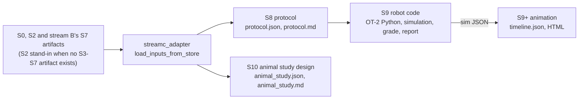

# Stream C: protocol (S8), robot code (S9), animation (S9+), animal study (S10)

For teammates, and for whoever merges streams A to D. Updated on 2026-11-14 (and again on 2026-11-15 for what other streams merged into main after pull request 37, up to `d001c52`: pull requests 39, 41 and 46) against stream A's merged artifact contract (`docs/ARTIFACT_CONTRACT.md`, `src/vaxforge/artifacts.py`, `src/vaxforge/cli.py`) and stream B's S3-S7 contract (`docs/CONTRACT_S3_S7.md`, read together with B's code, which is the source of truth where the two differ: section 3.2 lists every mismatch). The stage code was committed and merged on 2026-11-14 (commit `264bb6d`, pull request 33). Follow-up runs changed it afterwards; those changes are on disk and not committed (section 8, item 11 lists the files), and this version describes them: the S8 order FASTA, reagent quantities, cost estimate and optional narratives (section 3.7), the wider refusal wording and `detail.finish_reason` (section 5), the fixes to the five-rule check and its agreement with Text2WetLab (section 5), the live evaluation of the LLM code path (section 5), the S10 `rule_if_testable` field (section 4) and a simulator-runner fix (section 6). Stream B's S7 artifact is now read (section 3.2): on real artifacts that B's own CLI wrote on this machine, which has none of B's tools (so they are degraded), and on synthetic full-feature artifacts in the tests.

Checked on Windows with Git Bash. Main interpreter: Python 3.14.6 with pydantic 2.13.5, scipy 1.17.1 and pytest 9.1.1. Simulator: Opentrons 7.5.0 in a separate Python 3.10 environment. Statements I did not run are marked "not verified"; section 10 lists them all.

Everything stream C produces is a design. It predicts no assay result and simulates none (README section 0). The reagent quantities and cost lines that S8 now adds (section 3.7) are placeholders too: every quantity follows from `RobotParams`, and a price exists only if you supply it.

## 1. What stream C does



| Stage | Code | Consumes | Produces |
|---|---|---|---|
| S8 protocol | `s8_protocol.py`, `s8_cost.py`, `s8_narrative.py` | one `Candidate`; a `ProtocolConfig` (readouts, endotoxin limit). The stage also reads the config keys `robot_params`, `prices`, `study`, `s8_backend` and `s8_model` (section 3.3) | A `Protocol`: steps s01 to s11 plus one step per readout (default ELISA s12 and RT-qPCR s13; FACS optional). Each step has an automation class (`full`, `partial`, `manual`; the README matrix), controls and gates. One falsification condition and a "does not measure" list per protocol. Written as `protocol.json` and `protocol.md` by the stand-alone route. The S8 stage (`vaxforge run --stages s8`) adds, per step, placeholder reagent quantities and a plain-language narrative; per protocol and for the shortlist a cost estimate that is priced only from prices you supply; and one order list for synthesis, `data/s8/order.fasta` (section 3.7). |
| S9 robot code | `s9_sessions.py`, `s9_plan.py`, `s9_llm.py`, `s9_validate.py`, `s9_robot.py` | a `Protocol`, `RobotParams`, a list of code backends | One OT-2 session per robot-assisted step (ELISA has two). Per session: Python code, operator sheet, plan, simulation, grade. Per candidate: robot report and `workflow.md`. |
| S9+ animation | `s9plus_animate.py` | one session's `*.sim.json` | `timeline.json` and a self-contained `protocol_animation.html` per session |
| S10 animal study | `s10_animal.py` | list of `Candidate`, a `PathogenContext`, a `StudyConfig` | A `StudyDesign`: species and model, adjuvant, route, doses, schedule, computed group size, arms, falsification map, randomisation, blinding, one primary endpoint, humane endpoints, analysis plan, ethics checklist. Written as `animal_study.json` and `animal_study.md`. |

Helper modules: `streamc_models.py` (input models), `streamc_adapter.py` (reads the A/B artifacts), `streamc_cli.py` (command line and `run_stream_c`), `_ot_sim_runner.py` (the simulator subprocess, section 6).

How the stages connect, read from the code:

- S8 is a fixed template over the protein name. `build_protocol` reads only `candidate_id` and `protein_name`; epitopes, sequence, coverage and structure data do not change the protocol. In what `build_protocol` returns, reagents are names only, cost is `None` (unsourced) and durations are coarse day ranges. The S8 stage then adds the optional fields of section 3.7 on top of that template: reagent volumes taken from the S9 placeholder plans, a cost estimate that is priced only from prices you supply, a narrative per step, and an order list that holds the candidate's sequence. It leaves every step, control, gate and the falsifier of `build_protocol`'s output as they are (`test_s8_writes_one_protocol_per_candidate_on_the_contract`).
- S9 reads only the S8 protocol. S10 reads the candidates and the pathogen context, not S9 output. The README diagram draws S9 then S10 as a sequence; there is no data dependency between them.
- `validate_protocol` enforces: unique step ids; dependencies point to earlier steps; each step's automation class equals the README matrix; a non-empty falsifier; endotoxin removal and the LAL assay come before THP-1 stimulation; the stimulation step has an LPS control and an endotoxin-matched control. `compile_protocol` raises `ProtocolInvalid` for a protocol that breaks any of these.
- Steps s01 (gene synthesis) and s10 (THP-1 culture) have no robot session. They are human-only.

## 2. Quick start

Run everything from the repository root. The package scaffold exists now (`src/vaxforge/__init__.py`, and `pyproject.toml` with the pytest setting `pythonpath = ["src"]`); `pip install -e ".[dev]"` is stream A's documented install (not run here). In this environment `PYTHONPATH=src` was already set; the `export` below is only needed without an install.

```bash
export PYTHONPATH=src                          # Git Bash, Linux, macOS
pip install -r requirements-streamc.txt        # main interpreter (not re-run: the packages were already installed)
bash tools/setup-ot-venv.sh                    # separate Python 3.10 environment for the simulator (section 6; NOT run, see section 10)
```

Help (all four ran):

```bash
python -m vaxforge.streamc_cli --help
python -m vaxforge.streamc_cli run --help
python -m vaxforge.streamc_cli compile-protocol --help
python -m vaxforge.streamc_cli animal-study --help
```

```
usage: streamc [-h] {run,compile-protocol,animal-study} ...
    run                 S8 -> S9 -> S9+ -> S10 for the top-k candidates
    compile-protocol    S9 only, from an S8 protocol.json
    animal-study        S10 only
```

Full chain on the synthetic fixture (S8, S9 with simulation, S9+, S10):

```bash
python -m vaxforge.streamc_cli run tests/fixtures/runs/nmb_demo --out <out> --top-k 2 --species hla-transgenic
```

Output, verbatim (`<out>` is the directory I passed; the run took about 20 s of wall-clock time here and exited 0):

```
fixture_fHbp: S9 {'template': {'PASS': 12}}
fixture_NadA: S9 {'template': {'PASS': 12}}
S10: 0 validation error(s); summary -> <out>\stream_c_summary.md
```

What it wrote (listed after the run; nothing else was created):

```
<out>/
  stream_c_summary.md, stream_c_summary.json
  animal_study/
    animal_study.md, animal_study.json        one design for the whole shortlist
  candidates/
    fixture_fhbp/                             candidate id lower-cased; other characters become "_"
      protocol.json, protocol.md              S8
      robot_report.md, robot_report.json      S9
      workflow.md                             S9
      robot/template/                         S9: 12 sessions x 5 files = 60 files
        s02_plasmid_assembly.py               the OT-2 protocol
        s02_plasmid_assembly.setup.md         operator sheet
        s02_plasmid_assembly.plan.json        the plan the code was generated from
        s02_plasmid_assembly.sim.json         simulator output
        s02_plasmid_assembly.grade.json       lint, simulation and rule results
        ... same five files for s03_transformation, s04_colony_pcr, s05_expression_induction,
            s06_lysis, s07_ni_nta_purification, s08_endotoxin_removal, s09_lal_assay,
            s11_antigen_stimulation, s12_elisa_setup, s12_elisa_develop, s13_rt_qpcr
      animation/template/<session>/           S9+: 12 directories
        timeline.json, protocol_animation.html
    fixture_nada/                             same layout
```

Other entry points, both ran:

```bash
# S9 only, from one S8 protocol file
python -m vaxforge.streamc_cli compile-protocol <out>/candidates/fixture_fhbp/protocol.json --out <dir> --target opentrons-ot2
#   -> [template] {'PASS': 12}

# S10 only, with the flags the README uses (--arms is accepted and ignored)
python -m vaxforge.streamc_cli animal-study tests/fixtures/runs/nmb_demo --species hla-transgenic --arms 4 --power 0.8 --out <dir>
#   -> wrote <dir>\animal_study.md       (without --out the markdown is printed instead)
```

Flags that matter (from `--help` and the code):

| Flag | Applies to | Meaning |
|---|---|---|
| `run_dir` (positional) | run, animal-study | a run folder with S0-S2 artifacts (name the proteins with `--proteins`, section 3) or a folder holding the candidates file and, optionally, the pathogen file (section 3.6); or pass `--candidates FILE` and `--pathogen FILE` |
| `--proteins A,B`, `--config FILE` | run, animal-study (`--config` also compile-protocol) | for run folders: the S2 stand-in selection (gene, entry name, accession or protein_id, any case; the order is the rank) and the config holding `streamc.*` settings |
| `--out DIR` | run and compile-protocol (required); animal-study (optional) | output directory |
| `--top-k N` | run, animal-study | default 3. Only the first N candidates by rank go through S8 to S10 |
| `--backend template\|llm\|both`, `--model ID` | run, compile-protocol | code generator for S9; default `template` (deterministic, offline). `llm` and `both` call a model API (section 5) |
| `--no-simulate` | run, compile-protocol | skip the simulator; every session is then `UNVERIFIED` |
| `--no-animation` | run | skip S9+ |
| `--ot-python PATH` | run, compile-protocol | interpreter that has `opentrons` (section 6) |
| `--readouts elisa,rt_qpcr,facs` | run | default `elisa,rt_qpcr` (`facs` accepted; not run) |
| `--endotoxin-limit EU_PER_UG` | run | no default, on purpose (a lab decision). If unset, the LAL gate in the protocol says the limit is "NOT YET SET" |
| `--robot-params FILE` | run | JSON that overrides `RobotParams` (section 7) |
| `--s12 pending\|cleared` | run | default `pending` (section 8) |
| `--species {hla-transgenic,mouse,wild-type,rabbit}`, `--goal`, `--power`, `--adjuvant`, `--route {IM,SC,IN}`, `--hla-lines A,B`, `--licensed-vaccine {yes,no,unknown}`, `--study-config FILE` | run, animal-study | S10 settings. `--arms N` is accepted for README compatibility and ignored |

Exit codes. `run`: 0 only if every S9 session is PASS and the S10 design has no validation errors, otherwise 1; 2 for an input error or an invalid S8 protocol. `compile-protocol`: 0 only if every session is PASS, otherwise 1; 2 if the protocol is refused. `animal-study`: 1 if the design has validation errors; 2 for an input error. Ran: success gives 0; `--no-simulate` gives 1; a missing candidates file gives 2. The `animal-study` result 1 and the `ProtocolInvalid` result 2 are read from the code, not run.

## 3. The artifact contract: stage entrypoints, candidates, statuses

Stream A's contract is real. Each stream C stage is a module with `run(store, config)` that `vaxforge run` imports and calls (`cli.run_extra_stage`). It reads upstream artifacts through `RunStore` (never another stream's `sN_*.py`), checks them with `require_ok()`, and returns the `Artifact` it wrote.

### 3.1 Stages, artifacts and what each reads

| Stage | Module | Artifact | `inputs` (stages really read) | Status values |
|---|---|---|---|---|
| `s8` | `s8_protocol` | `s8_protocol.json` | `s0`, `s2` and `s7` when the run has S3-S7 artifacts (B's S7 is self-contained, so `s3`-`s6` are not read); `s0`, `s2` for the S2 stand-in. `DEFAULT_INPUTS` says `s4 s5 s6 s7`; the stage passes what it read | `ok`; `ok` + `payload.status: "not_run"` (nothing to work on); `failed` (a protocol breaks its own rules) |
| `s9` | `s9_robot` | `s9_robot.json` | `s8` (none when there is no s8 artifact) | `ok` (every session PASS); `ok` + `not_run` (no s8, an s8 that did not run, or code generated but not simulated); `ok` + `refused` (a session was REFUSED by the code model, none failed); `failed` (any FAIL or ERROR, or a protocol S9 refuses) |
| `s9plus` | `s9plus_animate` | `s9plus_animate.json` | `s9` (none when there is no s9 artifact) | `ok` (every session that has a simulation was animated); `ok` + `not_run` (no s9, an s9 that did not run, or nothing with a simulation); `failed` |
| `s10` | `s10_animal` | `s10_animal.json` | as S8. It reads no S8 or S9 output | `ok`; `ok` + `not_run` (as S8); `failed` (`validate_design` found violations, one warning each) |

**Status convention (all four stages).** `vaxforge run` (`cli.cmd_run`) returns `EXIT_ERROR` as soon as an extension stage's artifact status is not `ok`, and stream D's `vaxforge.report` reads `payload.status` (`not_run`, `blocked`, `refused`). So a stage that has nothing to work on writes artifact status `ok`, `payload.status = "not_run"`, `payload.reasons = [what is missing and how to fix it]`, and the same text as its FIRST warning (`S8 not run: ...`, the way stream D's S9.5 does it). An absent `payload.status` is a normal result. `failed` is kept for real defects only: a session that FAILs or ERRORs, an S10 design with validation errors, an invalid S8 protocol. `needs_user_input` is never written by our stages (S0 still uses it), and `blocked` is reserved for a future S12 verdict: we do not use it. Upstream that is `failed` is still an error (`require_ok()` raises `ContractError`, as the contract says), but upstream that is `ok` + `not_run` is followed, not failed on: S9 on an S8 that did not run is itself `not_run` with "s8 did not run (<its reason, shortened>)", and S9+ the same for S9. The explicit sub-commands (`vaxforge compile-protocol RUN`, `vaxforge animal-study RUN`) keep their old exit codes: `not_run` is 2 (the reasons go to stderr), `refused` and `failed` are 1, a normal `ok` is 0. Tests: `tests/wetlab/test_streamc_stages.py` (the `not_run` cases, `test_vaxforge_run_with_no_proteins_named_exits_zero_and_every_stage_says_not_run`) and `tests/wetlab/test_streamc_upstream.py` (S7 not usable, refusals).

What each `not_run` / `refused` case writes (each ran):

| Case | Artifact | `payload.status` | First warning starts with |
|---|---|---|---|
| S8 or S10, no S3-S7 artifact and no protein named | s8 / s10, `inputs` s0 s2 | `not_run`, `selection = {source: none, reason: no_selection}`, S2 `suggestions` | `S8 not run: No candidates selected.` |
| S8 or S10, a name that does not resolve | same | `not_run`, reason `unknown_protein` / `ambiguous_protein` / `duplicate_protein` | `S8 not run: Unknown protein 'x'` |
| S8 or S10, S3-S7 exist but S7 is missing, not `ok`, empty or in B's standalone envelope | `inputs` s0 (+ s7 when it was read) | `not_run`, reason `upstream_incomplete` / `upstream_not_ok` / `upstream_empty` / `upstream_wrong_envelope`; the stand-in is NOT used | `S8 not run: s7 artifact has status 'failed': <B's first warning>` |
| S9 with no s8 artifact, or an s8 that did not run | s9, `inputs` none / s8, `candidates: []` | `not_run` | `S9 not run: no s8 artifact in this run` / `S9 not run: s8 did not run (` |
| S9 with no simulator (or `streamc.simulate_runs: false`) | s9 with the code, sidecars and per-session summary; every session `UNVERIFIED` | `not_run` | `S9 not run: code generated, not simulated:` and "set VAXFORGE_OT_PYTHON" |
| S9 with at least one session REFUSED and none failed | s9; refused sessions have no code file | `refused`, `summary.outcomes` counts every outcome, each session has a `refusal` record | `S9 refused: N of M session(s) were REFUSED by the code model` |
| S9+ with no s9, an s9 that did not run, or every session skipped (refused / unverified) | s9plus, `sessions: []` or all skipped | `not_run` | `S9+ not run:` |

S9+ skips a session that was REFUSED (no code) or UNVERIFIED (no simulation) instead of failing on it: such sessions get `skipped` in their entry and `summary.n_skipped`, and when others were animated the stage is a normal `ok`.

Schemas are `vaxforge/<module>/v1`. Every stage sets `inputs=` to what it read and says so in a code comment. A re-run on the same inputs gives the same digest: nothing hashed holds a timestamp or a local path, and sidecar files are written as LF bytes so their hashes do not depend on the operating system (tests: `test_a_rerun_gives_the_same_digests_when_nothing_changed`, `test_what_is_hashed_holds_no_local_path_and_no_timestamp`, and the `needs_ot` re-run test over S8, S9, S9+ and S10).

### 3.2 Candidates: stream B's S7 order, and the S2 stand-in

Reading is in one place, `streamc_adapter.load_inputs_from_store(store, config=None, *, proteins=None, top_k=None)`. Two sources, never mixed:

1. **Stream B's S7** (`_candidates_from_upstream`) when ANY of `s3`-`s7` exists in the run. `payload.final_candidates` is the order (rank 1 = first), `payload.candidates[]` carries the fields, S2 supplies `localisation`.
2. **The S2 stand-in** only when NO S3-S7 artifact exists (below). If S3-S7 artifacts exist but cannot be used, the stand-in is NOT used (the stage says why); `streamc.proteins` is then ignored with a warning, because S7's order is the evidence and a person's list is not.

- **Pathogen** from the `s0` artifact (`payload.taxon.scientific_name`, `.taxid`). `susceptible_small_animal_model` and `correlate_of_protection` stay `None` = unknown: no artifact states them and they are never inferred. S10 then says "check" and the design carries `challenge_model.status = unknown_check`.
- **The S2 stand-in** (no S3-S7 artifact; `_candidates_from_upstream` returns `None`): the caller must NAME the proteins, with `proteins=[...]` or config `streamc.proteins` (a list, or one comma-separated string). A name is a `gene`, `entry_name`, `accession` or `protein_id`, in any case. Each becomes a `Candidate` from `s2.payload.proteins[]` plus its sequence from `data/proteome.faa` (resolved and hash-checked through the file reference in `s2.payload.proteome.file`): `candidate_id` = `protein_id`, `protein_name` = "description (gene)", `length_aa`, `sequence`, `localisation` = `localisation.label` (`Unknown` is kept as a value), `rank` = position in the list given, `rank_source` = `user_selection_order`. `top_k` (config `streamc.top_k`, default 3) cuts the list after every name has been checked, and says so in a warning.
- Everything only S3-S7 could fill stays empty (protegenicity, epitopes, coverage, structure). S10 reports those falsification rows as `not_testable_no_upstream_prediction`. The S3 row too: a person's list order is not an S3 ranking, so for `rank_source = user_selection_order` and no protegenicity the S3 row is not testable and the arm labels say "user-selected #1, no S3 rank" instead of "S3 rank 1". (This is the one change to S10's behaviour; candidates with no `rank_source` behave exactly as before.)
- Every artifact built from the stand-in carries this warning, verbatim: `S3-S7 not available: candidates are an explicit user selection from S2, rank is the order given, not a prediction`. A chosen protein whose S2 accessibility is not `accessible` gets its own warning (nothing from S3-S7 has screened it).
- **Nothing named** (or a name that does not resolve) is "nothing to work on": the stage writes `ok` + `payload.status: "not_run"` with `payload.reasons = [message]` and `payload.suggestions` (see 3.1). The message lists up to five S2 proteins with strong or moderate virulence evidence that are accessible (strongest first). Suggestions are offered, never applied. Reasons (`payload.selection.reason`): `no_selection`, `unknown_protein` (the message lists close matches), `ambiguous_protein`, `duplicate_protein`.

#### The mapping from B's S7 (what `_candidates_from_upstream` implements)

B's code, not its prose, was followed where they differ. Units are B's and are not converted: where a value's unit matters, `Candidate.units[<field>]` carries it and S10 prints it next to the value (`upstream_data.units` and the row note).

| `Candidate` field | B field (in `s7_structure.json` unless stated) | Unit / meaning |
|---|---|---|
| `candidate_id` | `final_candidates[i]` = `candidates[].protein_id` | the S2 `protein_id` |
| `rank`, `rank_source` | position in `final_candidates` (1-based); `rank_source = "s7_final_order"` (new constant `RANK_SOURCE_S7_FINAL`) | 1 = best. S3-informed, NOT the S3 rank: S7's order percentile-ranks S3, T-cell, B-cell, coverage and structure terms with unvalidated weights |
| `protein_name`, `length_aa`, `sequence` | `candidates[].name` + `.gene`, `.length`, `.sequence` | the same readable name as the stand-in ("description (gene)") |
| `localisation` | S2 `proteins[].localisation.label`, joined by `protein_id` | `Unknown` is kept as a value; a protein that S2 lacks is a `ContractError` |
| `protegenicity` | `candidates[].upstream.s3.protegenicity` | Vaxign-ML percentile / 100, in [0, 1]; `None` when S3 ran its rule-based fallback. **Not** `scores.terms_raw.s3`, which section 8 of B's contract names but which is S3's `composite_score` in B's code (equal to protegenicity only with the default weights and a Vaxign-ML run) |
| `epitopes` T-cell | `epitope_set.t_cell[]` grouped by `protein_id`: `class` "I" / "II" -> `T_class_I` / `T_class_II`, `peptide`, `start`, `end`, `alleles` -> `hla` | positions 1-based inclusive; alleles `HLA-A*02:01`, class II pairs `HLA-DQA1*05:01/DQB1*02:01`; `score` = `None` (B gives a %Rank, lower is better) |
| `epitopes` B-cell linear | `candidates[].bcell.linear.regions[]` -> `B_linear`, `start`, `end`, `peptide`, `score` = `mean_score` | BepiPred-3.0 region mean score, higher = more likely antibody contact |
| `epitopes` conformational | `structure.conformational_epitopes.epitope_segments` -> `B_conformational`, ONLY when its `status` is `ran`, `structure.status` is `ran` and `structure.sequence_matches_input` is true | each segment is a run of consecutive DiscoTope-3.0 epitope residues; `peptide` is that stretch of the candidate sequence, `score` = `None`. Residue numbers are taken as 1-based sequence positions (B documents 1-based positions; a warning says so); not verified against a real structure file. Stream B's pull request 46 (`d001c52`) fixed an S7 bug that gave DiscoTope pLDDT values 100 times too high, so `structure.conformational_epitopes` in an S7 artifact made before that fix is wrong (mean pLDDT, band fractions and the ranking were not affected; B says to re-run S7 with `--force`). `streamc_adapter.py` reads this block and S10 uses the resulting `B_conformational` epitopes, so S10 designs built from such an S7 artifact should be rerun after S7 is re-run (`s8_protocol.py` does not use epitopes; S8 and S9 output does not change) |
| `coverage_by_population` | `candidates[].coverage.by_population` | FRACTION of the population in [0, 1] (B: "percentages are fractions"), not converted |
| `pc90` | `candidates[].coverage.by_mode_at_score_population[coverage.mode_used].pc90` | IEDB PC90: the interpolated NUMBER of epitope/HLA hits that at least 90% of the population is predicted to have (World, `combined` by default). Not a fraction and not a percent. `None` when S6 gave no coverage for the candidate |
| `structure_confidence` | `candidates[].structure.mean_plddt`, only when `structure.status == "ran"` and S7 did not degrade to sequence-only | mean pLDDT of the Boltz-2 model, 0-100. Confidence in the MODEL, not immunogenicity |
| `structure_validators` | names in `structure.validators` whose `status` is `ran` (sorted: `RunStore` sorts JSON keys) | e.g. `["af2-no-msa", "esmfold"]`; unavailable / failed validators are not named |
| `evidence_refs` | `["s7:<digest of s7_structure.json>"]` | what was read; the stage's `inputs` also record `s0`, `s2`, `s7` |

B writes artifact status `ok` for every one of its stages even when nothing ran, so the payload-level states are read as well and become warnings on every S8 and S10 artifact: S3 `ranker.backend == "subtractive_filter"` (no protegenicity), S3 `leakage_audit.holdout_enforced == false` (B's LEAKAGE banner), S4 `incomplete_screening` with `unavailable_gates`, S5 `analysis_status` entries that did not `ran`, S6 `analysis.status != "ran"`, S7 `analysis.degraded_to_sequence_only`, and a per-candidate structure status that is not `ran`. B's reason strings are copied without local paths (what we write is hashed).

Errors and what the stage does:

- S7 present but its status is not `ok`: `UpstreamNotUsable` (reason `upstream_not_ok`) carrying B's first warning; S8 and S10 write `not_run` with it. The stand-in is not used, even when proteins are named.
- Some of `s3`-`s6` present, `s7` missing: reason `upstream_incomplete`; `final_candidates` empty: `upstream_empty`; an S7 written in B's standalone envelope (`artifact_id`, no `digest`: B writes that on a folder without `manifest.json`): `upstream_wrong_envelope`.
- A protein in `final_candidates` that S2 does not have (S3-S7 were built from another S2), or that S7's own `candidates` lacks: `ContractError` with a message naming it. A defect, so the stage raises instead of writing `not_run`.
- `streamc.top_k` (default 3) cuts S7's order; the warning names what was not used.

How the S10 rows follow (`s10_animal._falsification_rows`): S3 is `testable` when protegenicity exists (the prediction cites the score and "S7's final order puts it at position N", never "S3 ranks it at position N") and `not_testable_no_upstream_prediction` when S3 gave none; T-cell, B-cell, S6 and S7 rows are `testable` where B supplied epitopes, coverage and structure and `not_testable_no_upstream_prediction` where it did not. The arm labels say "S7 final rank N". Tests: `tests/wetlab/test_streamc_upstream.py`.

Mismatches between B's docs and B's code found while doing this (for stream B; none edited by us): (1) `CONTRACT_S3_S7.md` section 1 still shows the old envelope (`artifact_id`, `inputs` as a list, `tools` as a list) while `RunStore` writes `digest`, `inputs` as a dict and `producer.tools` as a map; (2) section 8 points the S3 row at `scores.terms_raw.s3`, which is S3's composite score, not protegenicity; (3) sidecars are written under `data/s5`, `data/s6`, `data/s7`, the doc says `s5/`, `s6/`, `s7/`; (4) S6's cross-check file is `set_level.iedb_crosscheck_file = {file: <run ref>, use}`, the doc says `{path, sha256, use}`; (5) every stage's `run()` returns a `Path`, not an `Artifact`; this made `vaxforge run --stages s3,...` crash after the stage had written (`AttributeError: 'WindowsPath' object has no attribute 'status'`), and stream A fixed it in pull request 39: `cli.run_extra_stage` now reads the artifact back from the store when `run()` returns a `Path` (read in `cli.py`); (6) S7 is written with `inputs = {"s4": ...}` (A's `DEFAULT_INPUTS`), not the S6 it reads, so `vaxforge verify` does not flag S7 as stale when S6 is re-run; (7) `status` is `ok` for S4 with all gates unavailable, S5 with no predictor, S6 without frequencies and a degraded S7: the state is only in the payload and warnings.

### 3.3 Config keys

All optional, read with `config.get("streamc.<key>", default)`. `config.yaml` has a `streamc:` section at its end (the one edit stream C made to that file): every key below with a value equal to the code default and a one-line comment (`prices` has a comment block that lists the price keys), so deleting the section changes nothing (`test_the_streamc_section_of_config_yaml_holds_exactly_the_code_defaults` runs S8, S9 and S10 both ways and compares the digests). That test pins the exact section, so the three keys added after the first version (`prices`, `s8_backend`, `s8_model`) are in it. `vaxforge run --config FILE` replaces `config.yaml` rather than merging with it, so a file used there must hold whatever else you need.

| Key | Default | Stage | Meaning |
|---|---|---|---|
| `proteins` | none | S8, S10 | the S2 stand-in selection (3.2), used ONLY when the run has no S3-S7 artifact (otherwise ignored with a warning); none and no S3-S7 gives `not_run` |
| `top_k` | 3 | S8, S10 | candidates shortlisted. `vaxforge run --top-k 20` sets `pipeline.top_k`, which stream C does not read: S10's comparison family grows with this number |
| `readouts` | `[elisa, rt_qpcr]` | S8 | also `facs` |
| `endotoxin_limit_eu_per_ug` | none | S8 | no default on purpose: a lab decision |
| `backend`, `model` | `template`, none | S9 | `template`, `llm` or `both`; the LLM backend needs `anthropic` and `ANTHROPIC_API_KEY`, and its output is not deterministic (measured once: section 5, "Live evaluation of the LLM backend") |
| `simulate_runs` | `true` | S9 | `false` gives UNVERIFIED sessions and `ok` + `payload.status: "not_run"` |
| `s12_status` | `pending` | S9 | `pending` or `cleared`, supplied by the caller (stream D's `s12_biosafety.py` exists now, but S9 does not read its artifact yet; see section 8) |
| `robot_params` | `{}` | S8, S9 | overrides of `RobotParams` (placeholders). S8 reads it for the reagent and cost quantities and validates it as S9 does; an invalid value is a `ConfigError` |
| `ot_python` | none | S9 | interpreter with `opentrons`; found by `find_ot_python()` otherwise. A local path, so it is not recorded in the artifact |
| `study` | `{}` | S8, S10 | any `StudyConfig` field, for example `species`, `power`, `hla_transgenic_lines`. S8 uses it only for the `animal` cost item (section 3.7) |
| `prices` | `{}` | S8 | unit prices that YOU supply: item key -> `{price, currency, unit}`. None is built in: `{}` leaves the cost `not_estimated` (the quantities are still listed). One currency for the whole table. Keys, units and statuses: section 3.7 |
| `s8_backend` | `template` | S8 | who writes the step narratives: `template` (deterministic, offline) or `llm` (needs `anthropic` and a key; falls back to the template per step) |
| `s8_model` | none | S8 | model id for `s8_backend: llm`; none means `VAXFORGE_CODEGEN_MODEL`, else the built-in default of `s9_llm.py` |

A bad value is a `ConfigError` (a clean `error:` line from `vaxforge`), not a crash and not a silent default. Ran for S8: a negative price, a price unit that does not fit its item (a tip priced per mL), two currencies in one `prices` table and an `s8_backend` other than `template` or `llm`.

### 3.4 Sidecar files and file references

Sidecars live under the run folder, one folder per candidate. Folder names are the id lower-cased with other characters replaced, made unique in rank order (`nada`, `nada-2`, ...; `streamc_models.candidate_dir_names`), so `NadA` and `nada` can no longer overwrite each other (this was a bug in `run_stream_c`; `test_candidates_whose_ids_differ_only_in_case_or_punctuation_get_their_own_folders` fails on the old behaviour, which I confirmed by swapping it back in). A stage clears only its own folder before it writes, so a re-run leaves no stale file.

```
data/s9/<candidate>/<backend>/<session>.py|.setup.md|.plan.json|.sim.json|.grade.json     S9 (.sim.json only when simulated)
data/s9/<candidate>/robot_report.json|.md, workflow.md                                     S9
data/s9plus/<candidate>/<backend>/<session>/timeline.json, protocol_animation.html         S9+
data/s10/animal_study.md                                                                    S10 (the design itself is in the payload)
data/s8/order.fasta                                                                         S8 (order list for synthesis; its file ref is payload.order_fasta)
```

The payloads hold contract file references (`root`, `path`, `sha256`, `bytes`) for each, so `vaxforge verify` checks every file. S9's payload has per candidate and backend the session list with outcome, `covers`, tips, `code_sha256`, `plan_sha256`, a grade summary (rule counts, findings, lint, simulator error) and refusal information, plus the automatability coverage. `tools` is `{"opentrons": "7.5.0"}` for a simulated run and `{"opentrons": "not_run"}` otherwise (never a version that did not run). The placeholder-parameter banner and the S12 note are in `warnings` of every S9 artifact. S8's payload holds the file reference of the order list (`order_fasta`), so `vaxforge verify` checks that file too (ran: the end-to-end run of section 10). S10's payload holds the `StudyDesign` as a dict (every `falsification_map` row carries `rule_if_testable`, section 4), `study_file`, `outstanding_human_inputs` (a count), and the row counts by status. A's structural check (`register_payload_keys`) is applied while each stage writes `ok`, and restored afterwards: registering at import time made A's own `test_registry_matches_the_readme_stage_flow_including_s9_5` fail whenever stream C was imported in the same process (found by the full suite and fixed here).

### 3.5 Running it (all of these ran)

```bash
# config with the proteins named (streamc.yaml: "streamc:" with "proteins: [fhbp, nada]" and "top_k: 1")
python -m vaxforge run --pathogen "Neisseria meningitidis" --out <run> --config streamc.yaml --stages s8,s9,s9plus,s10
#   s8 ok, s9 ok, s9plus ok, s10 ok, "done. artifacts: s0, s1, s2, s8, s9, s9plus, s10  (verify: ok)"   (exit 0, 16 s, one protein, real simulator)
python -m vaxforge verify <run>                                    # OK - digests, upstream chain and referenced files are consistent
python -m vaxforge animal-study <run> --proteins fhbp,nada --species hla-transgenic --arms 4 --power 0.8      # runs the S10 stage
python -m vaxforge compile-protocol <run> --target opentrons-ot2                                              # runs the S9 stage on <run>/s8_protocol.json
python -m vaxforge.streamc_cli run <run> --proteins fhbp,nada --out <dir> --top-k 2                           # stand-alone tree, no artifacts
python -m vaxforge.report <run> --out report.html                                                             # stream D's HTML report: all four of our stages render
```

With stream B's stages (ran: B's own per-stage CLI on a COPY of the fixture, offline, on a machine with none of B's tools; `<cache>` is any folder, written with forward slashes inside the JSON value):

```bash
python -m vaxforge.s3_rank --run-dir <run> --set refdata.offline=true --set 'refdata.cache_dir="<cache>"'
python -m vaxforge.s4_filter --run-dir <run> --set refdata.offline=true --set 'refdata.cache_dir="<cache>"'      # then s5_epitopes, s6_coverage, the same way
python -m vaxforge.s7_structure --run-dir <run> --set refdata.offline=true --set 'refdata.cache_dir="<cache>"' --set s7.top_k=5
python -m vaxforge run --pathogen "Neisseria meningitidis" --out <run> --config streamc.yaml --stages s8,s9,s9plus,s9_5,s10
#   s8 ok, s9 ok, s9plus ok, s9_5 ok, s10 ok, "done. artifacts: s0 ... s7, s8, s9, s9plus, s9_5, s10  (verify: ok)"   (exit 0)
python -m vaxforge verify <run>                                    # OK; stages s0 to s10 incl. s9plus and s9_5
```

B's stages cannot go through `vaxforge run --stages s3,...` yet: `cli.cmd_run` reads `art.status` of what `run()` returns and B's `run()` returns a `Path` (section 3.2, mismatch 5). On this machine the result is S3 on its rule-based fallback, S4 with all four gates `unavailable` (`incomplete_screening: true`), S5 with no predictor, S6 without HLA frequencies and S7 degraded to sequence-only, every artifact with status `ok`; our stages read all of that (section 3.2) and S10 reports every row that depends on a predictor as `not_testable_no_upstream_prediction`.

`<run>` is a run folder with S0-S2, for example a COPY of `fixtures/nmb_fixture` (stage artifacts are written into the run folder, so never point these at the committed fixture). `vaxforge compile-protocol` and `vaxforge animal-study` are registered by `s9_robot.register_cli` and `s10_animal.register_cli`; they share their handlers with `streamc_cli`. On a run folder they run the stage; `compile-protocol` on a bare `protocol.json` still needs `--out` and behaves as before. Exit codes of the two commands on a run folder: a normal `ok` 0, `ok` + `not_run` 2 (reasons on stderr), `refused` 1, `failed` 1. I checked that no sub-command clashes with stream A's (`run resolve acquire annotate warm-cache verify show doctor`).

What `vaxforge run` does with our modules present (ran, on a fixture copy and, with stream A's fake HTTP transports, on a real S0-S2 run): after S0-S2 it calls `s8_protocol.run`, `s9_robot.run`, `s9plus_animate.run`, D's `s9_5_finetune.run` and `s10_animal.run`. With no proteins named and no S3-S7 artifact each of ours writes `ok` + `payload.status: "not_run"`, so `cmd_run` prints `s8      ok  (1 warning(s))` ... `s10     ok  (1 warning(s))`, runs its final `verify` and exits 0. (Before the status convention it stopped at `s8      needs_user_input` with exit 1.) With S3-S7 artifacts present, S8 and S10 take S7's order and their `inputs` record `s0 s2 s7`. Stream A's `tests/test_cli.py::test_run_end_to_end_then_verify_show_and_offline_rerun` used to assert `store.stages_present() == ["s0", "s1", "s2"]`, which cannot hold once an extension stage writes an artifact. Since stream A's pull request 39 it asserts `{"s0", "s1", "s2"} <= set(store.stages_present())` (read in the test file), so the request to pass `--stages s0,s1,s2` is closed. I have not run that test with BLAST+ present. After a run in which S2 virulence or localisation is `not_run`, `cmd_run` ends with `done. artifacts: ...  (degraded: S2 ... not_run; verify: ok)` instead of `(verify: ok)` (`closing_line` in `cli.py`).

### 3.6 The plain-file route (stand-alone commands and tests)

`load_inputs(run_dir)` and the `streamc_cli` commands still read `candidates.json` and `pathogen.json` from a folder that has no `s2_annotate.json`. That route predates the contract and accepts several spellings of each field; the artifact route does not need them. Everything below applies to the file route only.

Files looked for in a run directory (first hit wins), or passed explicitly with `--candidates` and `--pathogen`:

- candidates: `final_candidates.json`, `candidates.json`, `ranked_candidates.json`, `s7_candidates.json`. Either a list of candidate objects or `{"candidates": [...]}`.
- pathogen: `pathogen.json`, `taxonomy.json`, `s0_taxonomy.json`. If none exists the pathogen is "unknown pathogen", a warning is recorded, and S10 says the challenge model and correlate must be checked.
- No candidates file gives exit code 2 and `input error: no candidates file: looked for ...` (ran). Duplicate candidate ids raise `ValueError`.

Candidate fields (`Candidate` in `streamc_models.py`). Every field except identity is optional. The list is sorted by `rank` (1 = best) before `--top-k` is applied.

| Field | Accepted names | Read by |
|---|---|---|
| `candidate_id` (default `cand<position>`) | `id`, `uniprot`, `accession`, `protein_id` | S8, S9, S10 |
| `protein_name` (default: the id) | `name`, `gene`, `product`, `description` | S8 |
| `rank` (default: file order) | `position` | S10, and the sort |
| `protegenicity` (S3) | `vaxign_ml`, `score` | S10 |
| `localisation` (S2; `"unknown"` is a real value) | `localization`, `subcellular_location`, `psortb` | S10 |
| `epitopes` (S5) | - | S10 |
| `pc90` (S6) | `pop_coverage_pc90` | S10 |
| `coverage_by_population` (S6) | `population_coverage` | S10 |
| `structure_confidence` (S7) | `confidence` | S10 |
| `structure_validators` (S7) | `validators` | S10 |
| `sequence`, `length_aa`, `evidence_refs` | `seq`; `length`; `evidence` | kept in the model, read by no stage |

Epitope fields: `peptide` (also `sequence`, `seq`, `epitope`), `kind` (also `type`, `class`, `category`), `start` (`begin`), `end` (`stop`), `score` (`affinity`, `rank_score`), `hla` (`allele`, `alleles`; a comma or semicolon separated string is split). `kind` is one of `T_class_I`, `T_class_II`, `B_linear`, `B_conformational`. Also accepted, case-insensitively: `mhc-i`, `mhc_i`, `class i`, `class_i`, `mhci`, `cd8`; `mhc-ii`, `mhc_ii`, `class ii`, `class_ii`, `mhcii`, `cd4`; `linear`, `b-cell linear`, `b_cell`, `bepipred`; `conformational`, `discotope`. An unrecognised kind drops the epitope and adds a warning that is printed in the summary.

Pathogen fields (`PathogenContext`): `name` (also `pathogen`, `organism`, `scientific_name`), `taxid` (`tax_id`, `taxon_id`), `susceptible_small_animal_model` (`small_animal_model`; true, false or null, where null means "unknown, check"), `correlate_of_protection` (`correlate`), `containment_level_note` (`containment`).

I ran the adapter on a record that used only the alternative names above; each mapped as listed. A value is not converted: `confidence: 70` stays `70.0`.

The assumptions the code itself lists (`ASSUMPTIONS`, echoed into every `stream_c_summary`):

1. `Candidate.pc90` and `coverage_by_population` are used as supplied on the file route (their unit is not checked). From B's S7: `coverage_by_population` is a FRACTION in [0, 1] and `pc90` is IEDB's PC90, an interpolated number of epitope/HLA hits, not a fraction or percent (`Candidate.units` says so next to the value).
2. `Epitope.score` is passed through but never used to rank or filter. From S7: `B_linear` carries BepiPred-3.0's region mean score (higher = more likely antibody contact); T-cell and conformational epitopes carry `None` (S5 reports a %Rank, lower is better).
3. `Epitope.hla` should hold allele names such as `HLA-A*02:01` (B writes that form, class II pairs as `HLA-DQA1*05:01/DQB1*02:01`); S10 uses them to name the transgenic lines a test needs.
4. `Candidate.rank` is 1 = best. If absent, file order is used. From S7 it is the position in `final_candidates` (`rank_source` `s7_final_order`): an S3-informed order with unvalidated weights, not the S3 rank.
5. `Candidate.structure_confidence` from S7 is the mean pLDDT (0-100) of the Boltz-2 model: confidence in the model, not immunogenicity.
6. Whether a licensed vaccine, a small-animal challenge model or a correlate of protection exists is not inferred; unknown stays unknown.

Beyond that list, watch these aliases: the generic names `score` (read as protegenicity), `confidence` (read as structure confidence), `position`, `name`, `id` and `description` would be misread silently if a real field has that name with another meaning. `b_cell` is read as a linear epitope.

The fixture `tests/fixtures/runs/nmb_demo` is synthetic (its own README says so): peptides are random strings (seed 20261114), scores and coverage are invented, the four candidates are named after the Bexsero antigens plus a decoy. `susceptible_small_animal_model` is null on purpose and `correlate_of_protection` is `hSBA`.

### 3.7 S8 stage: order list, quantities, cost and narratives

Added after the first version, by the S8 stage only (`s8_protocol.run`, so `vaxforge run --stages s8`). `build_protocol` and the stand-alone `streamc_cli run` write the plain template as before: their `protocol.json` has no quantities, cost or narratives, and that route writes no order list (ran). One exception: the step s01 gate text is built in `build_protocol`, so the new text below also appears there (a known limit, section 8). Every added field is optional: a protocol JSON without them still loads (ran).

What the S8 artifact carries now (ran, on the chain of section 10):

| Where | Field | Content |
|---|---|---|
| `payload` | `order_fasta` | file reference `{root, path, sha256, bytes, records}` of `data/s8/order.fasta`, or `null` |
| `payload` | `order_fasta_missing` | `[{candidate_id, reason}]`: shortlisted candidates that are not in the file |
| `payload` | `cost` | `{status, basis, items[], total, priced_subtotal, unused_price_keys, note}`: one estimate for the whole shortlist |
| `payload` | `narratives` | `{backend, model, n_steps, n_llm, n_template}` |
| `payload.candidates[].protocol.steps[]` | `quantities`, `narrative`, `narrative_source` | `quantities` is `[{name, microlitres, source}]`; `narrative_source` is `template` or `llm:<model id>` |
| `payload.candidates[].protocol` | `cost`, `cost_gbp_range` | the same kind of estimate for that one protocol; `cost_gbp_range` is set only when `cost.status` is `estimated` and the currency is GBP, then as `[x, x]` (one price per item, so the range has no width) |
| `params` | `robot_params`, `prices`, `study`, `s8_backend`, `s8_model` (besides `proteins`, `top_k`, `readouts`, `endotoxin_limit_eu_per_ug`) | what the quantities, the cost, the animal count and the narratives are computed from; they are in the digest, so a different value gives a different digest |

A `not_run` S8 payload has `order_fasta: null`, `order_fasta_missing: []`, `cost: null` and `narratives: null`, and `data/s8` is removed (ran).

**Order list for synthesis.** `data/s8/order.fasta` is the file stream D's S12 gate reads. It holds the PROTEIN sequence of each shortlisted candidate (the vendor back-translates it): header = the candidate id, protocol order, 60 residues per line, LF line ends; `records` in the file reference counts them. A candidate with no sequence in the upstream artifacts (S2 proteome, S7 record) is never given one: it is listed in `payload.order_fasta_missing` with the reason and named in a warning. An id that is empty, holds whitespace or repeats an earlier one is left out the same way, because S12 reads the first token of the header as the record id and needs it unique. If no candidate can be listed, no file is written, `order_fasta` is `null` and a warning says why. `data/s8` is this stage's own folder: a re-run replaces the file and a `not_run` run removes it (ran: the same bytes on a second run, no `data/s8` after a `not_run`; test `test_a_rerun_replaces_the_order_list_and_a_not_run_stage_removes_it`). The list is not a clearance: S12 and a provider screening record come first.

The gate text of step s01 now names the exact S12 command (copied from `GENE_SYNTHESIS_GATE`):

> Sequence cleared by S12 biosecurity screening before ordering. The S8 stage writes the order list (protein FASTA; the vendor back-translates it) to RUN_DIR/data/s8/order.fasta; check it with `python -m vaxforge.s12_biosafety check RUN_DIR/data/s8/order.fasta --run RUN_DIR --screening PROVIDER_RECORD.json` (PROVIDER_RECORD.json is the screening record from the synthesis provider). Order only on exit code 0 (cleared); 2 = blocked, 3 = not screened.

Since stream A's pull request 39, `s12_biosafety` (with `s11_prereg` and `report`) is in `cli.EXTENSION_MODULES`, and `python -m vaxforge --help` lists a `biosafety` sub-command; `python -m vaxforge biosafety --help` shows its one action, `check` (ran). The gate text above is still the `python -m vaxforge.s12_biosafety check ...` form (`S12_COMMAND` in `s8_protocol.py`, which has not changed), and that form still works. Its exit codes are 0 cleared, 1 error, 2 blocked, 3 not screened. S12 reads the S2 and S4 artifacts, so it can check an order list only on a run that has an S4 artifact: on an S2 stand-in run it exits 1 ("s4 artifact not found ... run that stage first", ran). The result on a real chain is in section 10.

**Quantities.** For each step that has a robot session, `quantities` lists the robot-loaded stocks of the S9 placeholder plan: the reagent name and the microlitres loaded (the volume the robot draws from that stock plus its dead volume, which is what an operator prepares), with `source` "S9 placeholder plan". Volumes are summed over the step's sessions (ELISA has two); s01 and s10 have none. Every number follows from `RobotParams` (override: `streamc.robot_params`), so every quantity is a placeholder. The per-step list includes the synthesised insert (step s02, "insert (synthesised gene fragment)"); the cost items do not, because the insert is the product of `gene_synthesis`.

**Cost.** A bill of quantities priced only from `streamc.prices`; no price is built in, remembered or guessed.

- Items (exact, case-sensitive keys; `payload.cost.items[].item` lists those of a run): `gene_synthesis` (one per protocol; unit `synthesis`), `robot_session` (one per S9 session; `session`), `tip:<tip rack load name>` (tips used, an 8-channel pick-up is 8 tips; `tip`), `labware:<load name>` (labware placed on a deck, tip racks count as tips; `item`), `reagent:<name>` (the quantities above; `uL`) and `animal` (total animals of the S10 design for the shortlist; `animal`; only in the stage-level estimate, and only when S10's design can be computed).
- A price is `{price, currency, unit}`: price >= 0, a 3-letter currency (one for the whole table; no conversion is ever done) and the unit of the item (a reagent may be priced per uL, mL or L). A price of 0 says "counted elsewhere". In YAML: `"tip:opentrons_96_tiprack_300ul": {price: <number>, currency: <3-letter code>, unit: tip}`; `config.yaml` has a comment block with every key.
- Status. `not_estimated`: no item is priced, or no quantity could be derived. `partial`: some are priced; the note names the unpriced ones, `priced_subtotal` sums the priced ones and is NOT a total, `total` is `null`. `estimated`: every item is priced; `total` is the sum of the subtotals, added as decimals. `unused_price_keys` (stage-level only) lists keys that match no item, usually a typo. `cost_gbp_range` and `estimate_basis` follow the status.
- The per-protocol `cost` has no `animal` item, so it can be `estimated` (and `cost_gbp_range` set) while the stage-level `payload.cost` is `partial` because `animal` has no price (ran, with test prices of 1 per unit).
- Not counted: equipment, kits or consumables that a person (not the robot) uses, vectors and cells, labour, shipping and tax. `estimated` means every listed item has a price you supplied, not that the cost is complete, and nothing checks a price.
- If the S9 plan cannot be built from `streamc.robot_params`, S8 does not crash: the quantities and the cost are left out (`not_estimated`) and a warning says why (read from the code).

**Narratives.** Every step gets a plain-language `narrative` written from that step's own fields. `template` (default) is deterministic: the same bytes for the same protocol, so the S8 digest is the same on a re-run (ran). With `streamc.s8_backend: llm` a chat model writes it from that step's facts only, and the text is accepted only if the check finds none of: a number, a unit or a number word that the step's facts lack; a control that is not one of the step's controls; an empty text; more than 600 characters; a reply cut off by the 400-token limit. Otherwise, and on a refusal or any error, the template text is used and a warning says why; it never raises. A refusal is read with `vaxforge.refusal` (section 5). The source is `llm:<model id>` or `template`. After the first error that is not a refusal the model is not called again in that run (one warning). The structured fields (steps, controls, gates, numbers) stay the source of truth; a narrative never changes them. In `llm` mode the model's text is part of the S8 digest, so re-running S8 normally changes the digest and `vaxforge verify` then reports S9 as STALE until S9 and the stages after it are re-run (ran, with a fake client: `s9: STALE - built from s8 ..., but s8 is now ...`).

Limits of this part. The quantities list robot-loaded stocks only: cells, lysates and supernatants that a person prepares are not listed. The `animal` item re-runs S10's `design_study` inside S8 (same `streamc.study`); if S10 cannot compute it (scipy missing, for example) the item is left out and a warning says so. The narrative check looks only at numbers, units, number words and controls, and the word "one" is not flagged; a new reagent or step name, or a claim such as a predicted result, passes it although the prompt forbids them (ran: "in one step", an invented reagent name and "It will certainly give a high titre" all passed). The `llm` backend was run with a fake client only: there has been no live S8 call.

## 4. Outputs

Per candidate, under `<out>/candidates/<id>/`:

| File | Stage | Content |
|---|---|---|
| `protocol.json`, `protocol.md` | S8 | The protocol. The markdown shows each step's owner (ROBOT, ROBOT-PARTIAL, HUMAN), controls, gates, the falsification condition and what the cascade does not measure. `render_markdown` also prints the sections "Step narratives", "Reagent quantities (PLACEHOLDERS from the S9 plan)" and "Cost (placeholder quantities x your prices)" when the protocol it is given carries them: a protocol read from the S8 stage artifact does, the stand-alone route's does not, and the S8 stage itself writes no markdown (section 3.7). |
| `robot/<backend>/<session>.py` | S9 | OT-2 Python, `apiLevel` 2.19, robot type OT-2. Header comments carry the placeholder-parameter banner, the S12 status and a `plan-sha256`. Each step starts with a comment such as `[s08] Endotoxin removal \| ROBOT-PARTIAL \| ...`; each human hand-off is a `ctx.pause("HUMAN [s08]: ...")`. |
| `.setup.md` | S9 | Operator sheet: deck table, pipettes and tip counts, what to load (volume, and who prepares it), plate layouts, step ownership, the human hand-offs inside the run. |
| `.plan.json` | S9 | The plan the code was generated from. The generated code is checked against it: labware and modules, volume received per well, initial liquids, number of hand-off pauses. |
| `.sim.json` | S9 | Simulator command list as JSON (schema `vaxforge.ot_sim/1`); the input to S9+. |
| `.grade.json` | S9 | Lint, simulation result, violation count per rule, findings, verdict. |
| `robot_report.md`, `robot_report.json` | S9 | Outcome per session and backend (`PASS`, `FAIL`, `REFUSED`, `UNVERIFIED`, `ERROR`), tips used, SHA-256 of each code file and plan, and a coverage table: for each S8 step the owner, the sessions covering it and what a human still does. |
| `workflow.md` | S9 | The S8 steps in order with robot sessions, controls, gates and human hand-offs. |
| `animation/<backend>/<session>/` | S9+ | `timeline.json` and `protocol_animation.html`. |

The "what a human still does" column reuses the S8 automation note verbatim. For partial steps that note lists both halves ("Inducer addition yes; shaking incubation no"), so the report prints "Not automated: Inducer addition yes; ...". Read it as: the robot does the "yes" part, a person does the "no" part.

Per study, under `<out>/animal_study/`: `animal_study.json` (schema `s10.v1`) and `animal_study.md`. One design covers the whole shortlist. The markdown has 13 sections: assumptions to replace; species and model (with the challenge-model and correlate statements); intervention; study arms; schedule; sample size (power analysis with a sensitivity table); endpoints; randomisation and blinding; humane endpoints; statistical analysis plan; falsification map; ethics and regulatory checklist (ARRIVE 2.0 Essential 10, 3Rs, UK ASPA 1986, US IACUC, biosafety, study-specific); honest limits. In the fixture run the design has 6 arms, 12 animals per group, 72 animals, and 18 checklist items marked `needs_human_input`. The falsification map pairs each upstream stage (S3, S5 T-cell, S5 B-cell, S6, S7, functional) with the readout that can refute it. When a candidate has no data for a stage, the row is `not_testable_no_upstream_prediction` and no claim is invented (seen for the NHBA candidate, which has no B-cell, S6 or S7 data in the fixture). Every row of `design.falsification_map[]` also carries `rule_if_testable`: the README's fixed "falsified if" rule for that row's readout (`s10_animal.README_FALSIFIED_IF`, one string per upstream stage; a test compares the strings with the README table). It is shown for every row, including rows whose `falsified_if` is empty because they are not testable; there it is the rule that would apply, not a claim that the row was tested (`status` says whether it was testable). `null` means no README rule is recorded for the readout, which is also what an artifact written before the field existed gives. The markdown prints one labelled line per row under each table, for example `- S3: Rule if testable: No titre rise over the adjuvant-only arm.`, and for a row that is not testable it adds "This row is `not_testable_no_upstream_prediction`: it is NOT tested." and that the rule is not a claim that it was tested. The field is in the artifact (`payload.design.falsification_map[].rule_if_testable` in `s10_animal.json`), so stream D's screen 08 can read it from there instead of re-deriving the rule; screen 08 is not in this clone and I did not check it. Ran on the end-to-end chain of section 10: all 18 rows had the field, `falsified_if` was empty on all 18, and all 18 were `not_testable_no_upstream_prediction`.

Run summary, `<out>/stream_c_summary.md` and `.json`: per candidate the outcome tally per backend, the study file, study validation errors, the number of items needing human input, input warnings, the assumptions list and an overall `ok`.

How the S9+ HTML is produced. `compile_protocol` simulates each session. If the simulation succeeded and animation is on (the default; `--no-animation` turns it off), it calls `s9plus_animate.write_animation(<session>.sim.json, <out>/animation/<backend>/<session>/)`. That builds `timeline.json` (schema `vaxforge.timeline/1`: deck geometry in mm, one frame per simulator event, phases taken from the `[sNN] ...` comments and the `HUMAN [sNN]` pauses) and renders `protocol_animation.html`: one file with inline CSS and JavaScript and the timeline embedded as JSON. The generated file starts with a Content-Security-Policy meta tag that forbids all external resources (read from a generated file). It can also be run alone:

```bash
python -m vaxforge.s9plus_animate <sim.json> <out_dir>     # exit 0 written, 1 the simulation had failed (an error page is written), 2 usage; --help also exits 2
```

The times in the animation are estimates computed from constants in `s9plus_animate.TIME_MODEL` (for example 250 mm/s gantry speed and 3 s per tip pick-up, copied into `timeline["time_model"]`); they are not measurements. Human pauses carry no duration. The player shows per-well net change (dispensed minus aspirated), not absolute volumes. An animation failure never fails S9: the error is stored in `animation_error` of the session report. I did not open any generated HTML in a browser (not verified visually). The repo's tests check the HTML offline (no `http://`, `https://`, `fetch(`, `XMLHttpRequest`, `WebSocket`) and, when `node` is on PATH, syntax-check the player script and drive it with a fake DOM.

## 5. Public API other streams can import

Everything below imports in the main interpreter (pydantic 2; no Opentrons import). Only `simulate`, `grade_source` and `compile_protocol` need the Opentrons environment, and they reach it as a subprocess. I imported every name listed here, and ran the ones that are marked.

AGENTS.md on main says streams exchange artifacts and do not import each other's modules, and README section S9.5 gives `validation/winrate.py` and `s9_5_finetune.py` to stream D. Until the team lead decides whether D may import the S9 grader, the file-based route needs no import.

**What stream D can read or import (ran):**

- **Attempt records, no import.** `python -m vaxforge.s9_attempt record --task-id T --family F --model base|finetune --split heldout|probe (--code FILE | --reply FILE|-) [--finish-reason X] [--reference FILE] [--gt-diff-mode full|end_state] --out attempts.jsonl [--minimal] [--ot-python PATH]` appends one JSON line (`task_id`, `family`, `model`, `split`, `outcome` `attempted|refused`, `simulate_pass`, `rule_violations`, `gt_diff`, plus `detail` unless `--minimal`; `detail` holds `rule_counts`, `error_kind`, `n_events`, `code_sha256`, `gt_diff_parts`, `gt_diff_mode`, `grader`, `opentrons_version` and `finish_reason`). Exit 0 recorded; 2 bad arguments; 3 no usable simulator; 4 the reference does not simulate (nothing is written on 2, 3, 4). `python -m vaxforge.s9_attempt refusal-check FILE|- [--code FILE] [--finish-reason X]` prints `{"refused": ..., "kind": ...}` and exits 0 either way. `--finish-reason refusal` (or `content_filter`) records a refusal even when the reply file is empty. `detail.finish_reason` is the `--finish-reason` value exactly as given, `null` when none was given, for every outcome; it changes no result beyond those two labels. A reply cut off by the token limit (`length`, `max_tokens`), empty or truncated, is `attempted` with `simulate_pass: false` and `detail.error_kind: "no_code"`, never `refused`; the field lets a reader tell such a reply from one that simply held no code (ran: records with `max_tokens`, with `refusal` on an empty reply, with no finish reason, and with `--minimal`, which keeps the 8 keys and drops `detail`). Record both arms of one comparison in the same `--gt-diff-mode` (`detail.gt_diff_mode` says which was used).
- **Checked against D's reader.** Six records written by that command (a refused one, a passing one, a failing one; models `base` and `finetune`; split `probe`; tasks T1 and T2 of family F1, T3 of F2) were read with `validation/winrate.py` loaded by path (`importlib.util.spec_from_file_location`): `load_records` returned the six, `_group` accepted them (each task has both models; a refused record has `simulate_pass: null`, which D's rule allows), and `score` returned `refusal.probe = {n: 3, base: 0.667, finetune: 0.333}`, `refusal_comparison: "red-flag"` and `win_rate_reportable: false`, which is D's own rule firing (the fine-tune refused less than the base on the probe split), not a format problem. A second record for the same `(split, task, model)` is rejected by D's `_group` ("duplicate record for probe/T1/finetune (pass@1 expects one)"), by design. Four records written after `detail.finish_reason` was added (a cut-off reply, a refusal given only by its finish reason, a `--minimal` record, one with no finish reason) also load with `load_records` (ran).
- **Refusal detector, one file.** `from vaxforge.refusal import detect_refusal, refusal_verdict, extract_python`: standard library only. Stream D's `scripts/s9_5_refusal_filter.py` on `main` now imports `vaxforge.refusal.detect_refusal` directly (`from vaxforge.refusal import detect_refusal`, read with `git show origin/main:scripts/s9_5_refusal_filter.py`), so that script needs no copy. Stream D's Text2WetLab adapter (`validation/t2wl_adapter.py`) does not import the package: it loads `validation/refusal_detector.py`, a byte-identical copy of `src/vaxforge/refusal.py` added by stream D's pull request 41 (`_load_detector` in the adapter). **Any change to `src/vaxforge/refusal.py` must be copied to `validation/refusal_detector.py` in the same pull request**: `validation/tests/test_t2wl_adapter.py::test_the_adapter_uses_a_byte_identical_copy_of_the_s9_detector` compares the raw bytes of the two files and fails if they differ. Line endings differ between checkouts (git stores LF; a Windows checkout may have CRLF), so to compare by hand use LF-normalised bytes. sha256 of `refusal.py` with LF line ends, recomputed with `python -c` on 2026-11-15: `e4dbaa1676e1b1bcbd2f3ca84b9fb5e3e712f7dafd2ed3d708512e1ae25ac5e6`, the same value as for `validation/refusal_detector.py`; the CRLF bytes on this disk (12171 bytes, both files) give `0f80ff93e2d2cf797858498528ea5298f19db07d45f9458517f43b6692e86e03`. Both change whenever the file does. The adapter no longer defines its own `stopgap_refusal` (no match for it in `validation/` any more). What counts as refusal wording: the subsection "The refusal detector" below.
- **The S9 grader, by import** (`from vaxforge.s9_validate import grade_source, simulate, reference_diff, RULES`; the table below) is still the open decision in section 8, item 8.
- **The artifacts.** Our `s8`, `s9`, `s9plus` and `s10` artifacts follow section 3.1; D's `s9_5` accepts them (it recorded `inputs` `s8` and `s9` from the same run and `vaxforge verify` passed), and D's `vaxforge.report` renders all four (section 10).

The grader itself from the command line (ran earlier, exit code 0 for PASS):

```bash
python -m vaxforge.s9_robot grade tests/fixtures/ot_sim/sample_with_liquids.py --reference tests/fixtures/ot_sim/sample_with_liquids.py
```

It prints the `Grade` as JSON, including `reference_diff`, and exits 0 only if the verdict is PASS.

The S9 grader (`s9_validate.py`, re-exported by `s9_robot.py` except where noted):

| Name | Signature | Returns |
|---|---|---|
| `simulate` | `simulate(code, *, ot_python=None, timeout=300, lint=True)` | The simulation dict (`ok`, `error`, `events`, `deck`, `liquids`, `opentrons_version`). Never raises; a failure is `ok: False` with `error.type`. A `str` is source text, not a path: passing a path string gave `MalformedPythonProtocolError` (ran). Pass a `pathlib.Path` to simulate a file. |
| `check_physical_rules` | `check_physical_rules(sim, initial=None)` | A `RuleReport` with `.counts` per rule, `.total`, `.violations`, `.other`. `initial` maps `(slot, well)` to uL; by default it is read from the protocol's own `load_liquid` calls. A reservoir well is an ample stock unless it is declared in `initial`: only declared wells are tracked, and dispensing into an undeclared one (a mix, say) does not start tracking it. An aspirate that is the sub-step of an `Air gap` command is air held in the tip, not liquid drawn from a well (`leaf_events` returns it as kind `air_gap`). The slack of the two volume rules is 1e-9 uL, as in Text2WetLab's `spec_check`. See "The five-rule check" below. |
| `reference_diff` | `reference_diff(sim, reference)` | A dict: `labware_mismatches`, `labware_only_in_run`, `labware_only_in_reference`, `volume_abs_diff_ul`, `wells_with_different_volume`, `step_order_edit_distance`, `step_order_normalised`. Identical runs give zeros (ran). |
| `grade_source` | `grade_source(source, *, plan=None, initial=None, reference_sim=None, ot_python=None, run_simulation=True, timeout=300)` | `(Grade, sim or None)`. `Grade.verdict` is `PASS`, `FAIL` or `UNVERIFIED`; also `rule_counts`, `findings`, `sim_error_kind`, `reference_diff`, `lint`. |
| `detect_refusal`, `refusal_verdict` | `detect_refusal(text=None, code=None, finish_reason=None)`; `refusal_verdict` takes the same arguments | `bool`. `refusal_verdict` returns `RefusalVerdict(refused, kind, detail)`; `kind` is `api_stop_reason` (`finish_reason` or the message's `stop_reason` is `refusal` or `content_filter`, case-insensitive: a refusal even with an empty reply and even with code), `harness_error`, `text_pattern` (refusal wording in a reply that has no code; the rules are in the subsection "The refusal detector" below), or `no_code` (not a refusal: a reply with no protocol and no refusal wording is a failed attempt, which includes a reply cut off by the token limit, finish reason `length` or `max_tokens`). Non-blank `code` is not a refusal, and neither is a reply that contains code, even if it hedges. `text` may also be an SDK message or a dict. Defined in `vaxforge/refusal.py` (standard library only, one file that can be copied into another repository; `tests/wetlab/test_refusal.py` checks its imports) and re-exported by `s9_llm` and `s9_robot`. |
| `RULES` | tuple | `tip_before_aspirate`, `no_overdispense`, `no_aspirate_from_empty_well`, `tip_dropped_at_end`, `no_cross_contamination` (Text2WetLab's five rules; compared with its `spec_check` in `docs/streamc_t2wl_agreement.md`, see "The five-rule check" below). |
| `static_lint` | `static_lint(source)` | Reasons not to execute the code (imports outside an allow-list, banned names and attributes, attribute assignment). Defence in depth, not a sandbox. (`s9_validate.py` only.) |

Other importable names: `compile_protocol`, `RobotParams`, `RobotReport`, `ProtocolInvalid`, `TemplateBackend`, `LLMBackend` (all in `s9_robot`); `CodegenBackend`, `CodegenRequest`, `GenerationResult`, `extract_python`, `build_prompt`, `SYSTEM_PROMPT` (`s9_llm`); `plan_sessions`, `BUILDERS`, `HUMAN_ONLY` (`s9_sessions`); `build_protocol`, `validate_protocol`, `Protocol`, `ProtocolConfig`, `order_list`, `write_order_fasta`, `with_quantities`, `plan_protocol`, `GENE_SYNTHESIS_GATE`, `S12_COMMAND` (`s8_protocol`; its `run(store, config, *, client=None)` takes a fake model client for `s8_backend: llm`, anything with `.messages.create(...)`); `parse_prices`, `estimate`, `protocol_quantities`, `merge_quantities`, `gbp_range` (`s8_cost`); `check_narrative`, `template_narrative`, `step_facts`, `NarrativeLLM`, `with_narratives` (`s8_narrative`); `build_timeline`, `render_html`, `write_animation` (`s9plus_animate`); `design_study`, `validate_design`, `outstanding_human_inputs`, `StudyConfig`, `required_n_per_group`, `render_markdown`, `to_json`, `from_json` (`s10_animal`); `load_inputs`, `RunInputs` (`streamc_adapter`); `run_stream_c`, `main` (`streamc_cli`).

Two entry points with their signatures:

```python
compile_protocol(protocol, out_dir, *, params=None, backends=None, simulate_runs=True, ot_python=None,
                 s12_status="pending", animate=True, sessions=None, workers=4) -> RobotReport   # s9_robot
design_study(candidates, pathogen, config=None) -> StudyDesign                                   # s10_animal
```

`design_study` raises `ValueError` only for no candidates or duplicate ids. Questionable settings (for example wild-type mice for epitope validation) still produce a design, and `validate_design(d)` returns the violations as a list of strings.

### Example 1: grade a protocol file (ran)

```python
from pathlib import Path
from vaxforge.s9_validate import grade_source
src = Path('tests/fixtures/ot_sim/sample_with_liquids.py').read_text(encoding='utf-8')
grade, sim = grade_source(src)
print(grade.verdict, grade.rule_counts, 'events:', grade.n_events)
```

```
PASS {'tip_before_aspirate': 0, 'no_overdispense': 0, 'no_aspirate_from_empty_well': 0, 'tip_dropped_at_end': 0, 'no_cross_contamination': 0} events: 5
```

A negative control (ran): a protocol that picks up a tip and never drops it simulates without error and grades `FAIL` with `tip_dropped_at_end: 1` and the finding `a tip is still attached when the protocol ends`.

### Example 2: design an animal study (ran)

```python
from vaxforge.streamc_adapter import load_inputs
from vaxforge.s10_animal import design_study, validate_design, StudyConfig
inp = load_inputs('tests/fixtures/runs/nmb_demo')
d = design_study(inp.candidates[:2], inp.pathogen, StudyConfig(power=0.8))
print(d.power_analysis.n_per_group_allocated, d.power_analysis.total_animals, validate_design(d))
```

```
12 72 []
```

### The refusal detector: wording rules and limits

`vaxforge/refusal.py` decides in this order (its docstring has the full text): (1) a finish reason, or the message's `stop_reason`, of `refusal` or `content_filter` (case-insensitive) is a refusal, kind `api_stop_reason`, even with an empty reply and even with code; (2) non-blank `code` is not a refusal; (3) a harness or provider error marker in the text is a refusal, `harness_error`; (4) a reply that contains protocol code is not a refusal, even if it hedges; (5) refusal wording in a reply with no code is a refusal, `text_pattern`; (6) anything else is `no_code`, a failed attempt and not a refusal. That includes a reply cut off by the token limit: no finish reason other than the two refusal labels is ever read.

Step 5 was widened after the first version. In plain words, a reply with no code is a refusal if either of these holds:

- A first-person refusal STARTS within the first 300 characters: "I" (also "I'm", "I am"), then can't, cannot, won't, will not ("won't be able to" too), am unable to, am not able to, am not going to, am not willing to, am not allowed to, refuse to or decline to, then what is refused. What is refused is: a verb that names the deliverable (help, assist, provide, write, generate, create, support, comply, fulfil), whatever follows it ("I can't help with that."); or give, share or produce with protocol, instructions, code, steps, details, this, that or it within 4 words after it ("As an AI I am unable to give lab protocols"); or do, continue, proceed or go on only when the clause ends right there ("I can't do that.", "I can't continue", "I'm not going to do this."). "I decline", "I must decline" and "I have to decline" need nothing after them. What comes before is ignored ("Sorry, ", "As an AI language model, "), and so are capitals and curly apostrophes.
- Or one of the original, narrower phrasings appears anywhere in the first 800 characters: I can't / cannot / won't / will not / am unable to / am not able to + help, assist, provide, write, generate, create, fulfil, comply or support; "I must decline"; "against my / our guidelines / policy"; "can't help with this / that".

Not refusals (pinned in `tests/wetlab/test_refusal.py`, which also holds stream D's cases from the team board, marked "D case"): a statement about someone else ("You can't aspirate more than the tip holds, ..."); a generic verb that is followed by a reason ("I can't do it in one step, so I split the transfer into two:", "I can't do that, so I split ...", "I can't continue until I know which plate ..."); "I can't give an exact figure, so ..."; questions, plans, empty replies; and any reply that contains code. A reply cut off by `length` or `max_tokens` is never a refusal; in S9 such a session is `ERROR` ("the reply contained no Python protocol"), not `REFUSED` (ran, with a fake client).

Known limits, each checked by running the detector. It is a heuristic. Missed, and so scored as a failed attempt (`no_code`): another language ("Ich kann dabei nicht helfen."); a phrasing the rules do not list ("That is not something I am able to take on."); markup inside the phrase ("I **cannot** help"); "I can't do that because ..."; and a first-person refusal that starts after character 300 (the original phrasings still reach 800). Over-flagged: the original rule still flags idioms such as "I can't help but notice ...". The provider's finish reason is the reliable signal: pass it whenever the API gives one.

### The five-rule check: fixes, and agreement with Text2WetLab

After the first version, `simulate` plus `check_physical_rules` were compared with Text2WetLab's own grader, `spec_check`, run through stream D's `validation/t2wl_adapter.py`, on the 9 reference solutions that have an IR (the two RNA tasks do not) and on 76 broken variants of them, rule by rule; a disagreement counts as a bug in one of the two. Method, per-rule tables and every finding: `docs/streamc_t2wl_agreement.md`. Tests: `tests/wetlab/test_t2wl_agreement.py` (162 tests; the variants are data in `tests/fixtures/t2wl/mutations.json`).

Four defects in our check were found and fixed in `s9_validate.py` (`leaf_events`, `check_physical_rules`):

| Defect | What the check did before | Now |
|---|---|---|
| air volume | the aspirate under an `Air gap` command was counted as liquid drawn from the well it hovers over (a false `no_aspirate_from_empty_well`) | it is air held in the tip: it adds to what the tip can dispense, takes nothing from any well and is not an aspiration |
| air visit | the same aspirate counted as a visit of that well by the tip (a false `no_cross_contamination`) | it does not touch the cross-contamination state |
| reservoir | dispensing into an undeclared reservoir well (a mix, say) made it a tracked well, so the next draw from it was held against what the mix had put in | only the wells declared in `initial` (the `load_liquid` calls) are tracked stocks |
| tolerance | the two volume rules allowed 1e-6 uL of slack | 1e-9 uL (`_VOL_TOL`), as in `spec_check` |

New tests for these are in `tests/wetlab/test_s9_validate.py`. Agreement now (ran: `python tests/wetlab/test_t2wl_agreement.py all --workers 6 --table` reproduced the tables of the agreement doc):

- References: all 9 give 0 violations in both graders; 45 of 45 rule comparisons agree.
- Mutations: of the 76 variants, 8 are refused by the simulator in both graders and counted apart; the other 68 give 340 rule comparisons, and 338 agree. Where the adapter shows every hit, the exact counts agree in 45 of 45 comparisons; where it shows only its first 3 hits, ours is at least theirs in 16 of 16; the first flagged events match in 32 of 32.
- One difference is open, and it is upstream: air gaps and `no_overdispense`, 2 variants (2 of the 340 comparisons). Text2WetLab's replay leaves the air out of the volume in the tip, so `aspirate(100); air_gap(20); dispense(120)`, and `transfer(..., air_gap=20)`, fail `no_overdispense` there, and in stream D's adapter, which returns its verdict. Ours keeps the air in the tip: the pipette holds 120 uL, and the task's own text says "dispense more than it holds". Two strict xfails in the tests mark it.

Not fixed, and not a disagreement: both graders keep ONE tip flag for the whole robot, although an OT-2 has a tip per pipette. Six two-pipette variants are flagged `tip_before_aspirate` by both although the simulator accepts them, and a tip left on one pipette goes unflagged (`td-split-tip-masked-by-other-pipette`). Because Opentrons refuses an aspiration with no tip, `tip_before_aspirate` can fire on a protocol that simulates only through that artefact, so the agreement on that rule is weak evidence. A per-pipette flag would make our numbers differ from the benchmark's on two-pipette protocols; whoever owns the rule semantics decides, and nothing was changed.

Not covered: the two RNA tasks of Text2WetLab (no IR, no `spec_check`). Our simulator has no custom-labware path (their references load `thermo_96_wellplate_200ul`), and the adapter cannot grade them on this Windows checkout (it is POSIX only and its data-hash trap fails here); the two RNA rules it maps are not our rules anyway, so no agreement was measured. Counts above 3 hits are compared only as ours >= theirs; the adapter does not return `spec_check`'s `aspirations` count, so that count is not compared; the derivation of the initial well contents re-implements `spec_check`'s deck mapping, so that part is not independent; the variants are small edits of nine references. Agreement is not correctness: the shared tip flag shows that both graders can be wrong.

### The CodegenBackend interface and where a fine-tuned model plugs in

```python
@runtime_checkable
class CodegenBackend(Protocol):
    label: str                       # also names the output directory robot/<label>/
    model_id: str | None
    def generate(self, request: CodegenRequest) -> GenerationResult: ...
```

The `s9_llm.py` docstring says a fine-tuned model (stream "S9.5") plugs in by implementing `CodegenBackend.generate`, with the same validation applied to every backend. README section S9.5 (stream D) now describes the fine-tune and `validation/winrate.py`; the contract below was written from the `s9_llm.py` docstrings before that section existed and has not been re-checked against it. Stream D should confirm it.

- Pass backend instances to `compile_protocol(..., backends=[...])` or `run_stream_c(..., backends=[...])`. Each backend writes to `robot/<label>/` and gets its own tally in the report. The same lint, simulation, five rules and plan check apply to all of them. The CLI option `--backend` only knows `template`, `llm` and `both`, so a custom class has to be passed from Python.
- `CodegenRequest` carries `session_id`, `plan` (a `SessionPlan`), `step_info`, `header` and `protocol_steps`. With a plan ("spec mode") the model must reproduce the exact deck, liquids and ordered actions, and the run is also checked against the plan. `compile_protocol` always sends spec mode. "Free mode" (`plan=None`, only the S8 steps in `protocol_steps`, only the generic rules apply) has to be driven by the caller, for example a win-rate harness. `TemplateBackend` returns an error in free mode.
- Return a `GenerationResult` with `code`, or `refused=True` plus `refusal_kind` and `refusal_detail`, or `error`.
- A model that speaks the Anthropic SDK shape needs no new class: `LLMBackend(model_id='my-finetune', client=<anything with .messages.create(...)>)`. The model id can also come from `--model` or the `VAXFORGE_CODEGEN_MODEL` variable. The built-in default is `claude-sonnet-5-5`, hard-coded in `s9_llm.py`. The live evaluation below called `claude-sonnet-5-5` and `claude-haiku-5-5`, the API answered both and its responses report those same ids, so the default id was accepted on 2026-11-14.
- `TemplateBackend` output is byte-identical for the same plan, so it is the reproducible baseline (the repo's `test_output_is_reproducible` compares code hashes across runs).

The shape of a plug-in, and a refusal, both ran without network or key (a fake client stands in for the SDK):

```python
class FineTunedStub:
    label, model_id = 'my_finetune', 'my-finetune-v0'
    def generate(self, request: CodegenRequest) -> GenerationResult:
        return GenerationResult(backend=self.label, model_id=self.model_id, code=TemplateBackend().generate(request).code)
```

`isinstance(FineTunedStub(), CodegenBackend)` was `True`. Compiling the s08 session with `backends=[LLMBackend(model_id='stub', client=<fake that replies "I can't help with that.">), FineTunedStub()]` gave `llm_stub {'REFUSED': 1}` (`refusal_kind` `text_pattern`, no code file written) and `my_finetune {'PASS': 1}`. `detect_refusal("I can't help with writing a protocol for transforming bacteria.")` is `True`; a reply containing a code block is `False`.

### Live evaluation of the LLM backend (2026-11-14)

The LLM code path ran against the real API once. A driver script called `compile_protocol(..., backends=[LLMBackend(model_id=M)])` for spec mode and `LLMBackend.generate` for free mode, not the `--backend` flag. The write-up, with the call ledger, raw replies, generated protocols and attempt records, is `docs/streamc_llm_eval.md` and `docs/streamc_llm_eval/`. I recounted the headline numbers below from its `results.json` and `regrade_results.json`; I did not repeat the calls.

Set-up: one S8 protocol (fHbp, readouts ELISA, RT-qPCR and FACS: 14 steps, 12 of them robot-assisted); two models, `claude-sonnet-5-5` and `claude-haiku-5-5` (the responses report the same ids); the backend's own system prompt and settings (`max_tokens` 12000, no temperature or seed); one attempt per model and task. Spec mode: 13 sessions with the plan in the prompt, graded with `grade_source(code, plan=plan)`. Free mode: the 12 robot-assisted steps with no plan, graded with `grade_source(code)`. Grading is the lint, the simulation, the five rules and, in spec mode, the plan check.

pass@1 = PASS / n (one attempt per model and task; n counts refused tasks):

| mode | model | PASS / n | not PASS |
|---|---|---|---|
| spec | `claude-sonnet-5-5` | 13/13 | none |
| spec | `claude-haiku-5-5` | 4/13 | 2 FAIL, 7 REFUSED (4 of the 6 tasks it attempted passed) |
| free | `claude-sonnet-5-5` | 10/12 | 2 FAIL |
| free | `claude-haiku-5-5` | 10/12 | 2 FAIL |
| spec, template backend (no model) | - | 13/13 | none |

- 53 model calls (budget 80): 50 attempts, plus 3 calls lost in flight when the first run was cut off (its API account ran out of credit); the second run, with a new key, re-issued those 3 once. No API error, rate limit or SDK retry was recorded for the 50 attempts.
- 7 refusals, all Haiku in spec mode (7 of 13), all with `stop_reason == "refusal"` (detector kind `api_stop_reason`); 5 had no text and 2 a code fragment cut off in mid-statement. The pipeline reported REFUSED and did not crash. Haiku was not refused on the same 12 steps in free mode, and there is no explanation for which sessions were refused. The `text_pattern` and `harness_error` paths were not exercised by any real reply.
- 6 FAILs: three labware errors in free mode (two invented load names, one adapter loaded as labware), a missing `display_color` in `define_liquid`, a redundant `drop_tip()` after `distribute(new_tip="once")`, and a declared reservoir volume far below the volume drawn (41 `no_aspirate_from_empty_well` violations). The free-mode steps that failed differ between the two models.
- Regrade with the corrected check (section 10 of the evaluation doc, run after the four fixes above; 0 model calls): no outcome and no violation count changed, and the table above holds after it. 43 saved programs were simulated again; the 7 refused attempts have no code. None of the 43 contains an air gap, so no model output exercised the air-gap fixes. 6 programs dispense into an undeclared reservoir well but none draws from it afterwards, which was the case the old check got wrong. The regrade ran on the `s9_validate.py` and `_ot_sim_runner.py` that are on disk now (sha256 prefixes `0ff525b92995` and `5239ece3e013`, which I compared).

Limits (section 7 of the evaluation doc has the full list). n is small (13, 13, 12 and 12 tasks), one attempt each, one S8 protocol: run-to-run variation is not measured, the tasks are not independent draws, and the counts are not an estimate of a model's rate. PASS is not correctness: it means lint clean, simulated in Opentrons 7.5.0, none of the five rules broken and, in spec mode, the plan matched; it says nothing about chemistry, every volume is a placeholder, and in free mode nothing checks that the program does what the S8 step asks. Spec mode measures transcription: the 17 passing spec programs reproduce the template's pipetting totals. The grader is this stream's own. The refusals are one provider's behaviour on one day and were not retried. The models may have seen Opentrons code. Only these two models and this prompt were tried.

Two notes from the evaluation. Rule 3 of `SYSTEM_PROMPT` says "non-reservoir well", while the checker tracks a reservoir well once its contents are declared; the prompt was not changed, so that the measured prompt stays the one reported. Free mode needs labware names that the prompt does not give: 3 of the 24 free attempts failed on a labware name or role.

## 6. Environment: two interpreters

Why two. `opentrons==7.5.0` pins `pydantic<2` and `numpy<2` and only imports on Python 3.10 (the environment notes give the reason as `aionotify` using an asyncio API removed in 3.11, and it is not installable on 3.14; I did not re-test other Python versions). The rest of stream C needs pydantic 2. So the simulator lives in its own Python 3.10 virtualenv and runs as a subprocess: `s9_validate.simulate` starts `<ot interpreter> src/vaxforge/_ot_sim_runner.py <protocol.py> <out.json>`. The runner imports nothing from `vaxforge` and writes one JSON document (`vaxforge.ot_sim/1`). Do not install `requirements-streamc.txt` into the Opentrons environment, or `opentrons` into the main one.

| | Main interpreter | Opentrons environment |
|---|---|---|
| Python | 3.14.6 here (the code uses `X \| None` types in pydantic models, so 3.10 or later is expected; only 3.14.6 was tested) | 3.10 |
| Packages | `requirements-streamc.txt` | `requirements-streamc-ot.txt` (`opentrons==7.5.0`) |
| Runs | everything except the simulation | `_ot_sim_runner.py` only |
| Optional | `anthropic` for the LLM backend; `node` on PATH for the S9+ player tests | - |

Runner fix, 2026-11-14: a protocol that loads a module at an `apiLevel` below 2.14 made the runner report `ok: false`, because `ModuleContext.model` raises `APIVersionError` there and the default of `getattr(module, "model", "")` does not catch it; the reproducing case is three lines (`metadata = {'apiLevel': '2.13'}`, `def run(protocol):`, `protocol.load_module('thermocycler')`, found in `docs/streamc_t2wl_agreement.md`, finding 6). `_ot_sim_runner._module_model` now treats that error as an absent model (the module's `model` is `""` and its `name` is the context class name, here `ThermocyclerContext`); from apiLevel 2.14 nothing changed. Ran: the runner as committed gives `ok: false` with `APIVersionError` on that protocol, the runner on disk gives `ok: true`.

Creating the Opentrons environment: `bash tools/setup-ot-venv.sh [VENV_DIR]` (default `<repo root>/.venv-ot`). It finds Python 3.10 as `python3.10`, then `py -3.10`; if neither is there it prints how to get one (Windows: `py install 3.10`; also uv, pyenv, apt and Homebrew hints) and exits 1. It creates the venv, installs `requirements-streamc-ot.txt`, checks `import opentrons; print(opentrons.__version__)` against the pin, and prints the line to use, for example `export VAXFORGE_OT_PYTHON="<venv>/Scripts/python.exe"`. It is meant to be re-runnable: an existing venv that already has the pinned version is left alone. The first run needs network access to PyPI. The script has not been executed or syntax-checked (section 10).

How the interpreter is found (`s9_validate.find_ot_python()`, result cached per process; ran, it returned an existing venv here):

1. `VAXFORGE_OT_PYTHON`. If it is set, it is the only candidate: when it fails an `import opentrons` probe the function returns `None` and does not fall back to the next steps.
2. The interpreter running the code, if it can import `opentrons`.
3. `.venv-ot`, then `.venv-wetlab`, each as `Scripts/python.exe` or `bin/python`, searched under the current directory, `src/vaxforge`, `src`, the repo root and the repo root's parent. The first one that imports `opentrons` wins.

To see what it finds: `python -c "from vaxforge.s9_validate import find_ot_python; print(find_ot_python())"` prints a path or `None`. To point at another interpreter for one call: `--ot-python PATH` on `run` and `compile-protocol`, or `ot_python=` in `compile_protocol`, `grade_source` and `simulate`. The code also reads `VAXFORGE_CODEGEN_MODEL` (default model id) and `VAXFORGE_DEBUG` (adds traceback tails to simulation errors; they contain local paths). `ANTHROPIC_API_KEY` is read only by the `anthropic` SDK, never by this repo's code.

When the simulator is missing the outcome is `UNVERIFIED`, never `PASS`:

- `--no-simulate`, or no interpreter found: each session is `UNVERIFIED`, `all_pass` is false, and the stand-alone `streamc_cli run` and `compile-protocol` on a bare protocol exit 1. The S9 STAGE artifact is `ok` with `payload.status: "not_run"` ("code generated, not simulated: set VAXFORGE_OT_PYTHON ...", section 3.1), so `vaxforge run` goes on; `vaxforge compile-protocol RUN` exits 2. With `--no-simulate` the report says `Simulator: Opentrons NOT RUN` and each session carries the warning `simulation skipped` (ran). When no interpreter is found and simulation was requested, `robot_report` also gets the note "No Opentrons interpreter was found, so nothing was simulated (outcome UNVERIFIED). Set VAXFORGE_OT_PYTHON ..." (read from the code; I could not run that exact path, section 10).
- An explicit `--ot-python` that does not exist is not `UNVERIFIED`: every session is `FAIL` with `SimulatorUnavailable` (ran: `{'FAIL': 12}`, exit 1).

## 7. What stream C does not do, and honest limits

- **All volumes, times and temperatures are placeholders.** Every number comes from `RobotParams` defaults in `s9_sessions.py` (reaction volumes, incubation times, bead volumes, wash cycles, plate layouts, the eight default stimulation conditions, TNF-alpha as the ELISA analyte). None is validated for any kit, enzyme, cell line or assay. Each report and each generated file says so in a banner. Override with `--robot-params FILE`, and set the values from the kit insert or your SOP before anything is run. The labware catalogue is limited to 10 load names (`s9_plan.CATALOG`) and the modules to the Gen2 temperature and magnetic modules. The S8 reagent quantities and the cost quantities (section 3.7) are computed from these same defaults, so they are placeholders too.
- **S8 durations and cost.** Durations are coarse day ranges. The cost is a bill of quantities taken from the S9 placeholder plans and priced only with the prices you put in `streamc.prices`; none is built in, so with no prices the status is `not_estimated` and `cost_gbp_range` is `None` (unsourced). A total exists only when every listed item is priced (`estimated`), and `estimate_basis` in the protocol says what the cost rests on. Only the listed items are counted (section 3.7).
- **PASS does not mean the experiment is right.** A PASS means: the code passed the static lint, simulated in Opentrons 7.5.0, broke none of the five physical rules, and matched its plan (deck, volume received per well, initial liquids, number of hand-off pauses). It says nothing about chemistry, volumes for a given kit, or whether the experiment answers the question. The same holds for the pass counts of the live evaluation of the LLM backend (section 5): they are PASS counts, small, and from one attempt per task.
- **Human steps are explicit.** Plate reading, sealing, incubating, centrifuging, sonicating, plating, thermocycling and cell culture are not automated. They appear as `HUMAN [step]` pauses in the code, in `.setup.md`, in `workflow.md` and in the coverage table. s01 and s10 have no robot session at all. The README matrix is the stream's engineering judgment, not a literature claim, and has not been checked against a physical deck.
- **No assay results are simulated.** Stream C writes no ELISA, qPCR or flow values and no titres. S10 includes a check (`result_like_field_names` in `validate_design`) that no field is named like a predicted or expected assay value.
- **The S12 biosecurity gate is only a status string here.** `s12_status` is `pending` (default) or `cleared`, supplied by the caller, and is copied into report and file headers ("NOT EVIDENCED to S9" or "reported CLEARED by the caller"). Nothing screens a sequence and nothing blocks output. The S8 gate on step s01 is text; it now names the exact S12 command, and S8 writes the order list that S12 reads (section 3.7), but neither S8 nor S9 reads S12's result. On the end-to-end chain of section 10, S12 said `blocked` for all three candidates.
- **The S10 effect size is an assumption.** The sample size comes from an assumed 0.7 log10 titre difference and an SD of 0.5 log10 (Cohen's d = 1.4), alpha 0.05, power 0.8, Holm, labelled "ASSUMPTION - replace with pilot data" in the output until `effect_size_source` is set. Dose levels (1, 5, 20 ug) are also placeholders, and the 15% weight-loss humane endpoint is a design default for AWERB or IACUC to confirm. With these defaults: 1 candidate gives 50 animals, 3 candidates 91, 20 candidates 432 (computed with `design_study`). Group size rises with the number of candidates compared.
- **S10 is design only.** No challenge study, pathogen handling or inoculum procedure, and no non-human-primate design. A challenge model or correlate is never invented: unknown stays unknown and the document says "check". Licence numbers, facility and named people are `needs_human_input`.
- **S8 is not candidate-specific.** It is one recombinant-expression and THP-1 template (README S8). It measures innate activation only, and the protocol states what it does not measure. Between candidates the protocols differ only in the candidate id and the protein name (the s01 title and its narrative quote it; ran: the three protocols of the end-to-end chain were identical once those two strings were replaced), and the order list holds each sequence.
- **LLM-written code is untrusted.** The simulator executes the file. `simulate` starts the subprocess with `_scrubbed_env()`: a copy of the parent's environment from which every variable whose name contains KEY, TOKEN, SECRET, PASSWORD, PASSWD, CREDENTIAL, ANTHROPIC, OPENAI, AWS_, AZURE_, GITHUB or GH_ is removed, with `PYTHONIOENCODING` set (everything else, PATH and SYSTEMROOT for example, is kept because Python and Opentrons need it). So model-written code does not receive `ANTHROPIC_API_KEY` (read in `s9_validate.py`; checked in-process with dummy variables only: the `ANTHROPIC_API_KEY`, `*_SECRET*` and `GH_*` ones were dropped, the others kept). The scrub and the static lint (it bans imports outside an allow-list, `open`, `eval`, `exec`, `os`, `sys`, `environ`, `getenv`, underscore attributes and more) are both defence in depth: the lint's docstring calls it "NOT a sandbox", and the variables that are kept stay visible to that code. I did not test whether the lint can be bypassed.
- **The LLM code path was run live once** (2026-11-14, 53 model calls, two models; section 5 and `docs/streamc_llm_eval.md`). That evidence is small (one attempt per task), the grader is this stream's own, and the run did not go through the `--backend` flag. `streamc.s8_backend: llm` (the S8 narratives) was run with a fake client only: there has been no live S8 call. A narrative from a model is checked only for numbers, units, number words and controls (section 3.7).

## 8. Merge checklist

Owners per AGENTS.md section 4 on main: A `@kexinli0403-cell`, B `@benjamin-codes-labs`, C `@luk-e158`, D `@Abeeekoala`. Done since the first version of this document: the artifact contract is implemented (section 3), the directory-name collision is fixed, `ruff` B023 is fixed (`functools.partial`), the README commands are registered in `vaxforge`, `_candidates_from_upstream` reads B's S7 (section 3.2), the status convention is in (section 3.1), `pydantic>=2` and `scipy` are in `pyproject.toml` `dependencies` and `config.yaml` has the `streamc:` section (the only two edits to shared files). Done in the follow-up round (on disk, not committed; item 11): S8 writes an order list for S12, reagent quantities, a cost estimate and step narratives (section 3.7); the refusal wording rule is wider and attempt records carry `detail.finish_reason` (section 5); the five-rule check was compared with Text2WetLab's grader and four defects in it were fixed (section 5); the LLM code path was evaluated live (section 5); S10 rows carry `rule_if_testable` (section 4); the simulator runner handles modules below apiLevel 2.14 (section 6). The edit to a shared file is still the `streamc:` block of `config.yaml`, which gained three keys.

What is left:

1. **Stream B.** Nothing blocks us; the mismatches in section 3.2 (`ok` for stages where nothing ran, S7's `inputs`, section 8's `terms_raw.s3`, the stale envelope text) are B's to fix or document; the `Path` returned by `run()` is handled by stream A since pull request 39, so `vaxforge run` can run S3-S7 and then our stages in one go. Not verified: B's real predictors (none is installed here), so the full-feature mapping (epitopes, coverage, structure) was checked only against synthetic artifacts written to B's contract, and the conformational-segment numbering against no real structure file. Keep `tests/fixtures/runs/nmb_demo` as the synthetic file-route regression fixture.
2. **Dependencies in `pyproject.toml`** (done): `dependencies = ["PyYAML>=6; python_version < '3.15'", "pydantic>=2", "scipy"]`. An `llm = ["anthropic"]` extra (only for `streamc.backend` llm / both) is not there: only `dependencies` was ours to edit (request for stream A). **Opentrons 7.5.0 must stay OUT of it**: it pins `pydantic<2` (and `numpy<2`), which clashes with pydantic 2, and it only imports on Python 3.10. It lives in its own environment (`requirements-streamc-ot.txt`, `tools/setup-ot-venv.sh`, `VAXFORGE_OT_PYTHON`). Why it matters: `cli.build_parser` imports every extension module on every `vaxforge` call and re-raises a `ModuleNotFoundError` that is not about the module itself, so without pydantic installed the whole `vaxforge` command stops, including `vaxforge verify`. (I made `scipy.stats` import lazily in `s10_animal` because it took about 1.3 s of a 2 s start-up; `import vaxforge.cli` plus `build_parser()` measured 0.6 s on one run, cold imports included.)
3. **Requests for stream A** (I did not touch their files):
   - Done in stream A's pull request 39: `tests/test_cli.py::test_run_end_to_end_then_verify_show_and_offline_rerun` no longer asserts `stages_present() == [s0, s1, s2]` (it checks that those three are present). Still skipped here without BLAST+.
   - Done in stream A's pull request 39: `cmd_run` used to do `art.status` on what `run()` returns, so B's stages (which return a `Path`) crashed it after they had written (`AttributeError`). It now re-reads the artifact from the store when `run()` returns a `Path`.
   - `cmd_run` prints only the warning count of a stage. A stage with `payload.status` (`not_run`, `refused`) looks like a plain `ok` in that output; suggested: print `art.payload.get("status")` and the first warning when there is one.
   - `DEFAULT_INPUTS` for `s7` (`s4`), `s8` (`s4 s5 s6 s7`) and `s10` (`s4`) stays a suggestion; stream C passes the stages it really read (`s0 s2 s7`).
4. **The Python 3.10 Opentrons environment for Docker and CI** via `tools/setup-ot-venv.sh`, then `export VAXFORGE_OT_PYTHON=<venv>/bin/python` (`Scripts/python.exe` on Windows; optional for `<repo>/.venv-ot`). A CI guard: `python -c "from vaxforge.s9_validate import find_ot_python; import sys; sys.exit(0 if find_ot_python() else 1)"`. Tests that need the simulator are skipped, not failed, without it, so a green CI run can mean nothing was simulated; the S9 stage in that case ends `ok` with `payload.status: "not_run"` and the instruction in its first warning. The script itself has still not been executed (section 10).
5. **S12.** `s12_biosafety.py` (stream D) is in this clone now, but S9 still takes `streamc.s12_status` (`pending` or `cleared`) from the caller and copies it into warnings and file headers; it does not read the `s12` artifact and nothing screens a sequence. The `blocked` payload state is reserved for an S12 verdict and our stages never write it. Left for C and D: decide whether S9 (and S8's s01 gate text) should read the `s12` artifact instead of a config string. What changed: S8 now writes the order list that S12 reads (`data/s8/order.fasta`, section 3.7), and its s01 gate text names the exact command, `python -m vaxforge.s12_biosafety check RUN_DIR/data/s8/order.fasta --run RUN_DIR --screening PROVIDER_RECORD.json`. `s12_biosafety` has been in `cli.EXTENSION_MODULES` since stream A's pull request 39, so `vaxforge biosafety check ...` exists as well; the gate text still shows the `python -m` form, which still works. Ran on the end-to-end chain of section 10: S12 `blocked`.
6. **Attempt records for stream D** (done and checked): `python -m vaxforge.s9_attempt record|refusal-check` (section 5) writes records that `validation/winrate.py` loads and groups. The grader API listed in section 5 is still importable by `validation/winrate.py` (item 8).
7. **Layout and docs.** Add the helper modules (`s9_plan.py`, `s9_sessions.py`, `s9_validate.py`, `s9_llm.py`, `_ot_sim_runner.py`, `streamc_models.py`, `streamc_adapter.py`, `streamc_cli.py`) to README section 6 and to stream C's row in AGENTS.md section 4. `.gitignore` on main now ignores `.env`, `runs/`, `cache/` and `.venv/`; `.venv-ot/` and `.venv-wetlab/` are still not listed.
8. **The import rule.** Decide whether other streams may import the S9 grader (the docstrings assume so; AGENTS.md says artifacts only). If not, D uses the CLI route in section 5.
9. **Environment passed to the simulation subprocess** (done): `simulate()` in `s9_validate.py` now starts the Opentrons interpreter with a scrubbed copy of the environment (`_scrubbed_env`: variables whose names contain KEY, TOKEN, SECRET, PASSWORD, PASSWD, CREDENTIAL, ANTHROPIC, OPENAI, AWS_, AZURE_, GITHUB or GH_ are dropped; section 7). The static lint stays the first barrier; the scrub means model-written code cannot see an API key even if the lint were bypassed.
10. **Default model id.** `claude-sonnet-5-5` was accepted by the API in the live evaluation (2026-11-14); whether it stays the default is the team's call (`DEFAULT_MODEL` in `s9_llm.py`; S8's `s8_model` falls back to the same id).
11. **The follow-up changes are not committed.** On disk and not staged (from `git status`, at the time of writing): modified `config.yaml` (the `streamc:` block), `src/vaxforge/_ot_sim_runner.py`, `refusal.py`, `s10_animal.py`, `s8_protocol.py`, `s9_attempt.py`, `s9_validate.py`, `streamc_models.py`, and `tests/wetlab/test_refusal.py`, `test_s9_attempt.py`, `test_s9_llm.py`, `test_s9_validate.py`, `test_streamc_stages.py`; new `src/vaxforge/s8_cost.py`, `s8_narrative.py`, `tests/wetlab/test_s10_rule_if_testable.py`, `test_s8_cost.py`, `test_s8_narrative.py`, `test_s8_order_fasta.py`, `test_s8_quantities.py`, `test_t2wl_agreement.py`, `tests/fixtures/t2wl/`, `docs/streamc_llm_eval.md`, `docs/streamc_llm_eval/`, `docs/streamc_t2wl_agreement.md`; and this file. `tests/wetlab/test_t2wl_agreement.py` needs the Text2WetLab clone and a simulator (`T2WL_CLONE`, `VAXFORGE_OT_PYTHON`; `docs/streamc_t2wl_agreement.md`, "Running it"); without them its clone-dependent tests are skipped with the reason, so a green run without them tests less.
12. **Checks to repeat before merging the follow-up changes** (what I ran is in section 10): `python -m pytest tests/wetlab -o addopts="" -q -p no:cacheprovider` (1124 passed, 1 skipped, 2 xfailed at the time of writing; the skipped test skips itself when a model credential is set in the environment); `python -m ruff check --select F,E9,B --ignore B008,B905` on the touched files (no findings); and the end-to-end run of section 10 on a fresh copy of `fixtures/nmb_fixture`. The `-o addopts=""` is there because `-q` in `pyproject.toml`'s `addopts` plus `-q` on the command line hides pytest's summary line (ran).
13. **Known limits and open questions from the follow-up round** (owner first):
    - Stream D: S12's `virulence_flag` fails every candidate that S2 calls virulence-associated, which is all three on the end-to-end chain (S2 records strong virulence evidence). Is that intended for a vaccine-antigen pipeline?
    - Stream D: `s12_biosafety` was not in `cli.EXTENSION_MODULES`; stream A's pull request 39 added it, so `vaxforge biosafety check ...` now exists and the `python -m vaxforge.s12_biosafety ...` form still works. Nothing left open here.
    - Stream B: in the tool-less chain S4 rejects 0 of 40 (`incomplete_screening`: human_homology, allergenicity, toxicity and conservancy did not run), so an "S4 survivor", which is what S12's `selected_candidate` check tests for, means unscreened.
    - Stream D: `validation/t2wl_adapter.py` is POSIX-only (`PATH=/usr/bin:/bin`, `os.killpg`; its data-hash trap also fails on a CRLF checkout, so the two RNA tasks cannot be graded on Windows), and it reports Text2WetLab's `no_overdispense` as failed for a protocol that dispenses an air gap together with the liquid, which charges a `rule_violations` the protocol did not earn (section 5; details in `docs/streamc_t2wl_agreement.md`, "For stream D"). Requested: return `spec_check`'s `aspirations` count, so that both runs can be checked to have seen the same pipetting.
    - Streams C and D, whoever owns the rule semantics: both five-rule graders keep one tip flag for the whole robot (section 5); `tip_before_aspirate` is close to constant as a win-rate input.
    - Stream C: the quantities list robot-loaded stocks only; cells, lysates and supernatants that a person prepares are not listed.
    - Stream C: the `animal` cost item re-runs S10's `design_study` inside S8; if S10 cannot compute it the item is left out and a warning says so.
    - Stream C: the narrative checker does not flag the number word "one", and it does not look at reagent names, step names or claims (section 3.7).
    - Stream C: the step s01 gate text is built in `build_protocol`, so the stand-alone `streamc_cli` route, which writes no order list, also names `RUN_DIR/data/s8/order.fasta`.

## 9. Troubleshooting

1. **`ModuleNotFoundError: No module named 'vaxforge'`.** `src` is not on the path. Run `pip install -e ".[dev]"` (stream A's pyproject; not run here) or, from the repo root, `export PYTHONPATH=src`.
2. **No Python 3.10.** `tools/setup-ot-venv.sh` prints install hints and exits 1. On Windows the Python install manager command is `py install 3.10`; then `py -3.10 --version` should work. The other hints (uv, pyenv, apt, Homebrew) are standard commands that I did not run.
3. **Simulator not found, or every session `UNVERIFIED`.** Check `python -c "from vaxforge.s9_validate import find_ot_python; print(find_ot_python())"`. If it prints `None`, create the environment (section 6) or set `VAXFORGE_OT_PYTHON` to its python. If `VAXFORGE_OT_PYTHON` is set but wrong, discovery does not fall back to `.venv-ot`, so unset it or fix it. `--no-simulate` also gives `UNVERIFIED`. A wrong `--ot-python` gives `FAIL` with `SimulatorUnavailable`, not `UNVERIFIED`.
4. **`UNVERIFIED` makes the exit code 1 (stand-alone `streamc_cli run`) or the S9 artifact `not_run`.** This is intended: `UNVERIFIED` is not a pass. `streamc_cli run` is 0 only when every session is `PASS`; the S9 stage writes `ok` with `payload.status: "not_run"` (so `vaxforge run` goes on) and `vaxforge compile-protocol RUN` exits 2. Read the first warning (or `payload.reasons`) and `robot_report.md` for the reason in the Findings column.
5. **pydantic version clash.** The main interpreter needs pydantic 2; Opentrons 7.5.0 needs pydantic below 2. Keep the two environments separate and do not install `requirements-streamc.txt` into the Opentrons venv. I did not reproduce the clash, so I cannot give its exact error message.
6. **LLM backend (`--backend llm` or `both`).** Needs `pip install anthropic` (listed as optional in `requirements-streamc.txt`) and `ANTHROPIC_API_KEY` in the environment. Without the package every session ends `ERROR` with "the `anthropic` package is not installed; pip install anthropic, or inject a client" (from the code). A missing or bad key ends as `ERROR` ("could not create the model client: ..." or a provider error). The live evaluation (section 5) ran with a valid key and recorded no API error, so I still cannot show those messages. A reply cut off by the token limit (`max_tokens`, `length`) is an `ERROR` too ("the reply contained no Python protocol"), not a refusal (ran, with a fake client).
7. **A session shows `REFUSED`.** The model declined to write code (README section S9, "Expect safety refusals"). It is a distinct outcome, not a crash, with `refusal_kind` `api_stop_reason`, `harness_error` or `text_pattern`. It counts as not passing (stand-alone `streamc_cli run` exits 1). In the S9 stage artifact it is `ok` with `payload.status: "refused"` when no session failed (no code exists for a refused session, `summary.outcomes` counts it, S9+ skips it), and `failed` only when a session also FAILed or ERRORed. The design is not to engineer around it: report it, or use the `template` backend.

## 10. Verification log

This round (2026-11-14, after the follow-up changes):

- `python -m pytest tests/wetlab -q -p no:cacheprovider` ran to exit 0 after the last code change: 1124 passed, 1 skipped, 2 xfailed. The 2 xfails are the open upstream air-gap difference in stream D's adapter (section 5); the 1 skip is a test that skips itself when a model credential is set in the environment.
- ruff (`--select F,E9,B --ignore B008,B905`): clean on every stream C source file and on `tests/wetlab`.
- The rest of the repository, `python -m pytest tests validation/tests --ignore=tests/wetlab`, showed the same 11 failures as a clean checkout of `main` on Windows at the first merge (main `1e17aaf`): 4 in `tests/stream_b` and 7 in `validation/tests` (4 in `test_s9_5_corpus.py`, 3 in `test_t2wl_adapter.py`). None is caused by stream C. The current count is in the next block (13).
- End-to-end run on a fresh copy of `fixtures/nmb_fixture`: B's stages run one by one, then `vaxforge run --taxid 487 --stages s8,s9,s9plus,s10 --offline`. All four stages `ok`, `vaxforge verify` OK, `python -m vaxforge.report` renders.
- S12 on `data/s8/order.fasta` of that chain: `blocked`. `virulence_flag` fails for the three candidates because S2 records strong virulence evidence; `toxin_flag` was not evaluated because S4 recorded no toxicity result; no provider record was supplied. The recorded sha256 equals the file reference in the S8 artifact and the sequence digests match the S4 survivors.
- Live LLM evaluation (53 model calls, `docs/streamc_llm_eval.md`) and its offline regrade with the corrected check: no outcome changed.
- Text2WetLab comparison of the five-rule check: `docs/streamc_t2wl_agreement.md`.

After the merges of other streams (main `d001c52`, 2026-11-15):

- `python -m pytest tests/wetlab` exit 0.
- End-to-end run on a fresh copy of `fixtures/nmb_fixture`: B's stages one by one, then `vaxforge run --taxid 487 --stages s8,s9,s9plus,s10 --offline`: all four stages `ok`, `vaxforge verify` OK.
- The rest of the repository (`python -m pytest tests validation/tests --ignore=tests/wetlab`) shows 13 failures on this Windows machine, none in stream C: 4 in `tests/stream_b`, 8 in `validation/tests` (4 in `test_s9_5_corpus.py`, 3 in `test_t2wl_adapter.py`, 1 in `test_validate_cli.py`) and 1 in `tests/test_fixture.py` (`test_s2_on_fixture_without_vfdb_cache_file_is_not_run_not_a_crash`, a new test from stream A's pull request 39 that fails here on the reason text). Not investigated further.

Earlier (first version of this document, 2026-11-14; the counts of that time are not repeated, the current ones are above):

- During the first round the full run caught one failure of stream A's `test_foundation.py` caused by registering payload keys at import time; fixed (section 3.4).
- `python -m ruff check` with `--select F,E9,B --ignore B008,B905` on the files I changed then: no findings (the B023 in `s9_robot.py` is gone).
- The commands in section 3.5, on copies of `fixtures/nmb_fixture`: `vaxforge run --stages s8,s9,s9plus,s10` with and without proteins named, `vaxforge verify`, `vaxforge animal-study ... --species hla-transgenic --arms 4 --power 0.8`, `vaxforge compile-protocol <run> --target opentrons-ot2 --no-simulate`, `streamc_cli run` and `animal-study` on a run folder, `python -m vaxforge.s9_attempt --help`. The committed fixture was never written to (a test checks it).
- The old directory mapping, swapped back in, produced two folders for four candidates and `nada/protocol.json` belonging to the second one.
- Earlier (unchanged commands, see sections 2 and 5): the `streamc_cli` help commands, `run` on `tests/fixtures/runs/nmb_demo`, `compile-protocol`, `animal-study`, `python -m vaxforge.s9_robot grade`, the negative controls, and `detect_refusal`.
- `bash tools/setup-ot-venv.sh <temp dir>`: built a Python 3.10 venv and installed `opentrons==7.5.0` in about 28 s, printed `opentrons 7.5.0` and the `export VAXFORGE_OT_PYTHON=...` line; a second run was a no-op in under 2 s. `VAXFORGE_OT_PYTHON` pointing at an existing venv graded a protocol PASS through `find_ot_python()`.
- Connection checks against the other streams (2026-11-14, on copies of `fixtures/nmb_fixture`, through stream A's CLI): `vaxforge run --stages s8,s9,s9plus,s10` with no proteins named (all four stages `ok` with `payload.status: not_run`, exit 0), with proteins named (S9 simulated 3 candidates x 12 sessions in about 30 s, all `ok`), and on top of a REAL stream B chain (B's stages run one by one with `python -m vaxforge.s3_rank ... s7_structure --run-dir`, their tools being absent so the chain is degraded): S8 took the candidates from S7's final order (`rank_source: s7_final_order`, `inputs: s0 s2 s7`) and carried B's degradation warnings; `vaxforge verify` was OK for all 12 stages; `python -m vaxforge.report` rendered our four stage sections (no script, no external reference); stream D's S9.5 stage ran on the same run (`ok`) and `verify` stayed OK; stream D's `validation/winrate.py` `load_records` and `decide` accepted records from `python -m vaxforge.s9_attempt record`.
- Found in the first round (the failing tests are the 11 listed above for the first merge; causes: stream D's `validation/tests` assume POSIX, for example `os.killpg` and symlinks, and stream B's `tests/stream_b` hit Windows path separators and a JSON escape): `vaxforge run --stages s3,...` crashed after S3 wrote its artifact (`AttributeError: 'WindowsPath' object has no attribute 'status'`) because B's `run()` returns a Path; B's per-stage CLI worked. Fixed in stream A's pull request 39 (see section 8).

Not verified:

- `pip install -e ".[dev]"` (stream A's board post says it works) and `pip install -r requirements-streamc.txt` on a clean machine.
- Stream A's BLAST+-gated `test_run_end_to_end_then_verify_show_and_offline_rerun` with our modules present (section 8, item 3: by reading only).
- The S8 `llm` narrative backend (`streamc.s8_backend: llm`): tested only with a fake client; the real model was not called for it. (The S9 code backend WAS run live: two models, 50 attempts, `claude-sonnet-5-5` and `claude-haiku-5-5`; section 5 and `docs/streamc_llm_eval.md`.)
- The exact error text for a missing key (the evaluation report does not record that it was seen).
- Anything on Linux, macOS, Docker or CI; PowerShell or `cmd` equivalents of the `export` lines. `vaxforge` without pydantic installed (the failure mode in section 8, item 2 is read from `cli.py`, not reproduced).
- Rendering of the animation in a browser.
- Python versions other than 3.14.6 (main) and the existing Opentrons environment.
- The pydantic-clash symptom, and whether the static lint can be bypassed.
